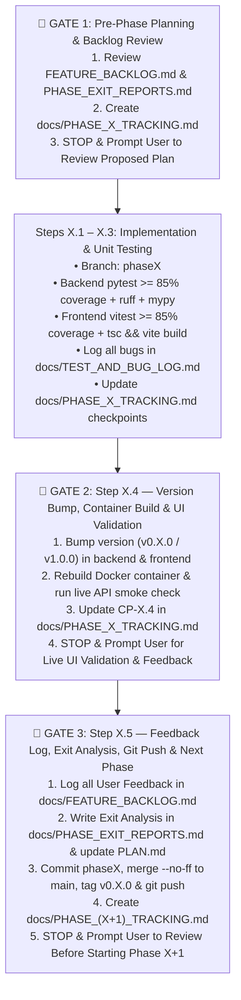

# Agent Continuity & Phase Execution Protocol (`AGENTS.md`)

> **Mandatory Instructions for All AI Coding Agents Working in `gateway-front-end`:**  
> Before executing any task, writing code, or starting a phase, every agent **MUST** read this document, [`PLAN.md`](PLAN.md), [`docs/FEATURE_BACKLOG.md`](docs/FEATURE_BACKLOG.md), [`docs/PHASE_EXIT_REPORTS.md`](docs/PHASE_EXIT_REPORTS.md), [`docs/TEST_AND_BUG_LOG.md`](docs/TEST_AND_BUG_LOG.md), and the active [`docs/PHASE_X_TRACKING.md`](docs/) file.

---

## 1. Project Context & Environment Map

- **Application:** Self-hosted, single-container Dockerized web application (`http://localhost:8080`) managing LAN device internet access via **OPNsense (`26.7.7-amd64`)** at `https://gateway.sparkle-pony.com` (`192.168.50.1`, alias `gateway_blocked_devices` + `kill_states`) and displaying network/device/group telemetry from **Elasticsearch (`9.4.3`)** at `https://es1.sparkle-pony.com` (`logs-pfsense.log*`, Elastic `pfSense` Integration `1.25.4`).
- **Workspace Root:** `d:\source\gateway-front-end` (GitHub remote: `https://github.com/cpavlas/gateway-front-end.git`)
- **Local Tooling Paths (Windows PowerShell `pwsh`):**
  - **Backend Python 3.12 (`pytest`, `ruff`, `mypy`):**
    - `.\backend\.venv\Scripts\python.exe`
    - `.\backend\.venv\Scripts\pytest.exe backend/tests --cov=app`
    - `.\backend\.venv\Scripts\ruff.exe check backend`
    - `.\backend\.venv\Scripts\mypy.exe backend/app`
  - **Frontend Node.js 22 (`npm`, `vitest`, `tsc`, `vite`):**
    - Prepend to `PATH`: `$env:PATH = "d:\source\gateway-front-end\.uv\node\node-v22.14.0-win-x64;$env:PATH"`
    - Run in `frontend/`: `npm test` (`vitest run --coverage`) and `npm run build` (`tsc -b && vite build`)
  - **Docker Desktop & Compose:**
    - Prepend to `PATH`: `$env:PATH = "C:\Users\cpavl\AppData\Local\Programs\DockerDesktop\resources\bin;$env:PATH"`
    - Rebuild & restart: `docker compose -f docker/docker-compose.yml --env-file .env up -d --build`
- **Strict Secret Safety Rule:**
  - Runtime credentials live in `d:\source\gateway-front-end\.env`.
  - **NEVER** print secret values from `.env` in terminal output or chat responses, **NEVER** overwrite `.env`, and **ALWAYS** verify `.env` is untracked (`git status -s`) prior to every `git commit`.

---

## 2. Canonical Documentation & Governance Files (All Located in `docs/`)

| File Path | Purpose & When to Update |
| :--- | :--- |
| [`PLAN.md`](PLAN.md) | Master 7-Phase architecture and execution plan. Updated at every Phase Exit with waterfalled items. |
| [`AGENTS.md`](AGENTS.md) | This file — mandatory agent workflow, quality gates, and user review pause points. |
| [`docs/PHASE_1_TRACKING.md`](docs/PHASE_1_TRACKING.md) .. [`docs/PHASE_7_TRACKING.md`](docs/) | Detailed step-by-step execution & checkpoint tracker for each phase (`CP-X.1` .. `CP-X.5`). **Must be created and reviewed by the user BEFORE starting any new phase**, and updated as each step completes. |
| [`docs/FEATURE_BACKLOG.md`](docs/FEATURE_BACKLOG.md) | Living ledger of all user UI/feature feedback items (`FB-PX-YYY`). Reviewed at the **start** and **end** of every phase. |
| [`docs/TEST_AND_BUG_LOG.md`](docs/TEST_AND_BUG_LOG.md) | Cumulative ledger of every bug discovered during unit testing, static analysis, container builds, or live smoke testing (`BUG-PX-YYY`). Updated **prior to every Git check-in**. |
| [`docs/PHASE_EXIT_REPORTS.md`](docs/PHASE_EXIT_REPORTS.md) | End-of-phase retrospective, test/coverage metrics, waterfall adjustments, and Unplanned-Information audit. Completed at Step `X.5` of every phase. |
| [`docs/ES_SCHEMA_DISCOVERY.md`](docs/ES_SCHEMA_DISCOVERY.md) | Verified live OPNsense `26.7.7` and Elasticsearch `9.4.3` (`logs-pfsense.log*`) schema reference. |
| [`docs/API_KEYS_SETUP.md`](docs/API_KEYS_SETUP.md) | Least-privilege OPNsense (`svc_gateway_ui`) ACL privileges and Elasticsearch API key setup guide. |

---

## 3. Mandatory Phase Lifecycle & Critical User Review Gates (STOP Points)

Every phase (`Phase 1` through `Phase 7`) follows a strict **5-Step Cycle** with **3 Mandatory User Review Gates** where the agent **MUST STOP and wait for explicit user approval** before proceeding.

---

### 🛑 GATE 1 — Pre-Phase Planning & Backlog Review (Before Writing Phase Code)
1. **Audit Inputs:**
   - Read [`docs/FEATURE_BACKLOG.md`](docs/FEATURE_BACKLOG.md) for all `OPEN` and `EVALUATING` items.
   - Read the previous phase's exit report in [`docs/PHASE_EXIT_REPORTS.md`](docs/PHASE_EXIT_REPORTS.md) and any waterfalled items in [`docs/TEST_AND_BUG_LOG.md`](docs/TEST_AND_BUG_LOG.md).
2. **Create `docs/PHASE_X_TRACKING.md`:**
   - Include:
     - **Section 1:** Phase Objectives & Scheduled Backlog Items (`FB-P...`).
     - **Section 2:** Mermaid Workflow Diagram & Progress Summary Table (`CP-X.1` through `CP-X.5`).
     - **Section 3:** Detailed Step-by-Step Breakdown (exact files to create/modify, unit test suites, and checkpoint verification criteria).
3. **STOP & PROMPT USER:**
   - Present a clear summary of [`docs/PHASE_X_TRACKING.md`](docs/) and the scheduled backlog items, and **wait for user confirmation** before executing Steps `X.1`–`X.4`.

---

### ⚙️ STEPS `X.1` – `X.3` — Incremental Implementation, Static Analysis & Unit Testing
1. **Git Branching:**
   - Always work on a dedicated phase branch (`git checkout -b phaseX` from `main`).
2. **Backend Quality Gate (Every Backend Step):**
   - Separate pure synchronous business/query/policy logic into testable helper functions so Python 3.12's `sys.monitoring` coverage (`core = "sysmon"`) accurately tracks line execution across async SQLAlchemy sessions.
   - Run:
     - `.\backend\.venv\Scripts\pytest.exe backend/tests --cov=app` (**100% pass rate, `>= 85%` coverage**)
     - `.\backend\.venv\Scripts\ruff.exe check backend` (**0 errors**)
     - `.\backend\.venv\Scripts\mypy.exe backend/app` (**0 issues**)
3. **Frontend Quality Gate (Every Frontend Step):**
   - Run:
     - `npm test` (`vitest run --coverage` — **100% pass rate, `>= 85%` coverage**)
     - `npm run build` (`tsc -b && vite build` — **0 TypeScript or bundle errors**)
4. **Continuous Tracking & Bug Logging:**
   - Whenever any test failure, type issue, or integration bug is encountered and fixed, immediately record it as `BUG-PX-YYY` in [`docs/TEST_AND_BUG_LOG.md`](docs/TEST_AND_BUG_LOG.md) with Symptom, Root Cause, Resolution, and Regression Test.
   - Mark each completed checkpoint (`[x] Complete`) in `docs/PHASE_X_TRACKING.md`.

---

### 🛑 GATE 2 (Step `X.4`) — Version Increment, Container Rebuild & Live User UI Validation
1. **Semantic Version Increment (`FB-P4-002`):**
   - Before building the container for Step `X.4`, increment the version number (`0.6.0` for Phase 6, `1.0.0` for Phase 7) across all three locations:
     - [`backend/app/__init__.py`](backend/app/__init__.py) (`__version__ = "0.X.0"`)
     - [`backend/pyproject.toml`](backend/pyproject.toml) (`version = "0.X.0"`)
     - [`frontend/package.json`](frontend/package.json) (`"version": "0.X.0"`)
2. **Rebuild & Restart Single-Container Deployment:**
   - Execute `docker compose -f docker/docker-compose.yml --env-file .env up -d --build`.
   - Verify container status is `Up ... (healthy)` on `0.0.0.0:8080->8000/tcp`.
   - Run an automated smoke test inside the container verifying `/api/v1/system/health` (`version == "0.X.0"`, `overall_status == "healthy"`) and the new phase's API endpoints.
   - Update `docs/FEATURE_BACKLOG.md` statuses for all backlog items implemented in this phase to `COMPLETED (Phase X)`.
   - Mark `Step X.4` (`CP-X.4`) `[x] Complete` in `docs/PHASE_X_TRACKING.md`.
3. **STOP & PROMPT USER FOR MANUAL UI VALIDATION:**
   - Present a structured **"What to Verify at `http://localhost:8080`"** checklist covering both the new phase deliverables and the completed `FEATURE_BACKLOG.md` items.
   - **STOP and wait** for the user's manual UI testing results and feedback.

---

### 🛑 GATE 3 (Step `X.5`) — Feedback Logging, Exit Analysis, Git Check-in & Next Phase Handoff
1. **Process User Feedback (`docs/FEATURE_BACKLOG.md`):**
   - Log every change request, UI observation, or future requirement from the user's phase feedback into [`docs/FEATURE_BACKLOG.md`](docs/FEATURE_BACKLOG.md) with a unique ID (`FB-PX-001`, etc.), complexity rating, technical evaluation, and target phase.
2. **Complete End-of-Phase Exit Report (`docs/PHASE_EXIT_REPORTS.md` & `PLAN.md`):**
   - Append the **Phase X Exit Analysis & Unplanned-Information Retrospective** to [`docs/PHASE_EXIT_REPORTS.md`](docs/PHASE_EXIT_REPORTS.md) documenting:
     - Final test & coverage metrics.
     - Waterfall adjustments & scheduled backlog items for Phase `X+1`.
     - Unplanned Information Audit (what we discovered during implementation/testing that wasn't originally anticipated, and how it feeds forward).
   - Update [`PLAN.md`](PLAN.md) with the waterfalled deliverables for Phase `X+1`.
   - Mark `Step X.5` (`CP-X.5`) `[x] Complete` and Phase status `COMPLETE` in `docs/PHASE_X_TRACKING.md`.
3. **Git Commit, Merge, Tag & Push:**
   - Verify `git status -s` shows `.env` is untracked.
   - Stage, commit on `phaseX`, merge `--no-ff` into `main`, create annotated tag `v0.X.0` (or `v1.0.0`), and push `main`, `phaseX`, and `--tags` to `origin`.
4. **Create Next Phase Tracking Document & STOP (Gate 1 of Phase `X+1`):**
   - Create `docs/PHASE_(X+1)_TRACKING.md` and **STOP & PROMPT USER** to review the proposed tracking plan before beginning implementation of the next phase.

