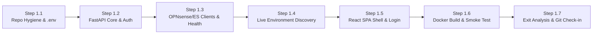

> **Phase:** 1 of 7 (Test Cycle 1)  
> **Complexity Rating:** **2 / 5 (Low–Medium)**  
> **Status:** `COMPLETE`  
> **Master Plan Reference:** [PLAN.md](PLAN.md)

---

## 1. Phase 1 Objectives & Scope

1. Establish strict secret hygiene (`.gitignore`, `.dockerignore`, `.env.example`, and hidden `.env`) before the first Git commit.
2. Document step-by-step API key generation and least-privilege scoping in `docs/API_KEYS_SETUP.md` and initialize tracking ledgers (`docs/TEST_AND_BUG_LOG.md` and `docs/PHASE_EXIT_REPORTS.md`).
3. Build the FastAPI backend foundation (`pydantic-settings`, async SQLite + SQLAlchemy 2.0 + Alembic) with Built-in Admin Login (`Argon2` + signed `HttpOnly` JWT cookies + login rate-limiting).
4. Build async client wrappers and a `/api/v1/system/health` endpoint for OPNsense (`https://gateway.sparkle-pony.com`) and Elasticsearch (`https://es1.sparkle-pony.com`).
5. Build and run the read-only environment inspector (`scripts/discover_environment.py`) to verify OPNsense ACLs/aliases and document live Elasticsearch index/field mappings in `docs/ES_SCHEMA_DISCOVERY.md`.
6. Build the React 19 + TypeScript + Vite + Tailwind SPA shell (Login view, ProtectedRoute guard, layout header, and live OPNsense/ES health status indicators).
7. Package the full stack into a single multi-stage `Dockerfile` and `docker-compose.yml`, run all Cycle 1 unit tests (`pytest` + `Vitest`), log all found bugs/resolutions, and complete the **Phase 1 Exit Analysis & Unplanned-Information Checkpoint**.

---

## 2. Step-by-Step Execution & Checkpoint Tracker

### Progress Summary Table

| Step | Checkpoint | Description | Status | Verified Date |
| :--- | :--- | :--- | :---: | :---: |
| **Step 1.1** | `CP-1.1` | Repo Hygiene, Hidden `.env`, Key Setup Guide & Tracking Ledgers | `[x] Complete` | 2026-10-31 |
| **Step 1.2** | `CP-1.2` | FastAPI Core, `.env` Validation, SQLite Setup & Admin Auth + Unit Tests | `[x] Complete` | 2026-10-31 |
| **Step 1.3** | `CP-1.3` | OPNsense & Elasticsearch Clients, `/api/v1/system/health` + Unit Tests | `[x] Complete` | 2026-10-31 |
| **Step 1.4** | `CP-1.4` | Read-Only Live Discovery (`scripts/discover_environment.py`) & `ES_SCHEMA_DISCOVERY.md` | `[x] Complete` | 2026-10-31 |
| **Step 1.5** | `CP-1.5` | React + TS + Tailwind SPA Shell, Login UI & Health Banner + Unit Tests | `[x] Complete` | 2026-10-31 |
| **Step 1.6** | `CP-1.6` | Multi-Stage `Dockerfile`, `docker-compose.yml` & Live Container Smoke Test | `[x] Complete` | 2026-10-31 |
| **Step 1.7** | `CP-1.7` | Final QA Gate, Bug Ledger, Phase 1 Exit Analysis, Learnings Checkpoint & Commit | `[x] Complete` | 2026-10-31 |

---

## 3. Detailed Step Breakdown & Verification Checkpoints

### Step 1.1 — Repository Hygiene, Secret Protection & Baseline Documentation
- **Tasks:**
  - [x] Create `.gitignore` ensuring `.env`, `.env.*` (except `.env.example`), `__pycache__/`, `.venv/`, `node_modules/`, `dist/`, `*.db`, and coverage artifacts are ignored.
  - [x] Create `.dockerignore` excluding `.env`, `.git/`, local virtualenvs, `node_modules/`, and test caches from image build contexts.
  - [x] Create `.env.example` (safe committed template) and hidden `.env` (pre-populated with a cryptographically random 64-hex-character `APP_SECRET_KEY`).
  - [x] Create `docs/API_KEYS_SETUP.md` with copy-pasteable commands and UI steps for OPNsense (`https://gateway.sparkle-pony.com`) and Elasticsearch (`https://es1.sparkle-pony.com`).
  - [x] Initialize `docs/TEST_AND_BUG_LOG.md` and `docs/PHASE_EXIT_REPORTS.md` with Cycle 1 tables.
- **Checkpoint `CP-1.1` Verification Criteria:**
  - [x] `git status --ignored` confirms `.env` is ignored by Git.
  - [x] User confirms or populates `ADMIN_PASSWORD`, `OPNSENSE_API_KEY`, `OPNSENSE_API_SECRET`, and `ELASTICSEARCH_API_KEY` in `.env` (required before Step 1.4 live discovery).

---

### Step 1.2 — Backend Core, Configuration Validation, SQLite & Admin Authentication
- **Tasks:**
  - [x] Initialize `backend/pyproject.toml` (`fastapi`, `uvicorn[standard]`, `pydantic-settings`, `sqlalchemy[asyncio]`, `aiosqlite`, `alembic`, `argon2-cffi`, `pyjwt`, `httpx`, `elasticsearch[async]`, plus dev dependencies `pytest`, `pytest-asyncio`, `pytest-cov`, `respx`, `ruff`, `mypy`).
  - [x] Implement `backend/app/config.py` (`Settings` class validating all `.env` variables, parsing `OPNSENSE_PROTECTED_IPS`, and masking secrets in reprs).
  - [x] Implement `backend/app/db/` (async SQLAlchemy engine, session factory, and initial Alembic setup with a baseline `system_metadata` / `audit_logs` table).
  - [x] Implement `backend/app/auth/` (Argon2id password verification, JWT generation/validation, `HttpOnly` cookie handling, and in-memory IP rate limiter for `/api/v1/auth/login`).
  - [x] Implement `/api/v1/auth/login`, `/api/v1/auth/logout`, and `/api/v1/auth/me` endpoints.
  - [x] Write unit tests in `backend/tests/test_config.py` and `backend/tests/test_auth.py`.
- **Checkpoint `CP-1.2` Verification Criteria:**
  - [x] `pytest backend/tests/test_config.py backend/tests/test_auth.py` passes 100% (`17 passed in 0.52s`, `96%` coverage — valid login, invalid password `401`, missing/expired cookie `401`, rate-limit `429`, missing `.env` secret rejection).
  - [x] Any defects found during unit testing are logged with resolutions in `docs/TEST_AND_BUG_LOG.md` (`BUG-P1-001`, `BUG-P1-002`, `BUG-P1-003`).

---

### Step 1.3 — OPNsense & Elasticsearch Async Clients + System Health API
- **Tasks:**
  - [x] Implement `backend/app/clients/opnsense.py`:
    - Async `httpx` wrapper configured with Basic Auth (`OPNSENSE_API_KEY` / `OPNSENSE_API_SECRET`), configurable `OPNSENSE_VERIFY_SSL` / `OPNSENSE_CA_CERT_PATH`, and timeout handling.
    - Read-only probe methods for ARP (`/api/diagnostics/interface/get_arp`), Dnsmasq leases (`/api/dnsmasq/leases/search`), and block alias inspection (`/api/firewall/alias_util/list/{alias}`) validated against `OPNsense 26.7.7-amd64` `snake_case` ACL patterns.
  - [x] Implement `backend/app/clients/elasticsearch.py`:
    - Official `AsyncElasticsearch` wrapper configured with `api_key=ELASTICSEARCH_API_KEY`, TLS verification settings, and cluster/index ping probe.
  - [x] Implement `GET /api/v1/system/health` (protected by admin auth, plus a lightweight unauthenticated `/api/v1/system/ping` for Docker `HEALTHCHECK`) reporting status, latency (`ms`), and diagnostic details for SQLite, OPNsense, and Elasticsearch.
  - [x] Write unit tests in `backend/tests/test_clients_and_health.py` using `respx` and mocked ES transport.
- **Checkpoint `CP-1.3` Verification Criteria:**
  - [x] `pytest backend/tests/test_clients_and_health.py` passes 100% (`26 passed in 0.76s`, `93%` total coverage — covering healthy responses, `401/403` bad API keys, missing alias warnings, SSL errors, and network timeouts).
  - [x] Any defects found during unit testing are logged in `docs/TEST_AND_BUG_LOG.md`.

---

### Step 1.4 — Read-Only Live Environment & Schema Discovery (`logs-pfsense.log*`)
- **Tasks:**
  - [x] Implement `scripts/discover_environment.py` (and corresponding unit test `backend/tests/test_discovery_script.py`):
    - Connects to `https://gateway.sparkle-pony.com` (`OPNsense 26.7.7-amd64`) to verify API credentials, count ARP (`/api/diagnostics/interface/get_arp`) & Dnsmasq lease (`/api/dnsmasq/leases/search`) entries, inspect payload keys, and check `gateway_blocked_devices` via `/api/firewall/alias_util/list/gateway_blocked_devices` (with automatic fallback to `/api/firewall/alias/get_alias_uuid` + `/api/firewall/alias/get_item/{uuid}`).
    - Connects to `https://es1.sparkle-pony.com` (`Elasticsearch 9.4.3`) using `elasticsearch[async]>=9.0.0,<10.0.0` against the `logs-pfsense.log*` data stream (`pfSense` Integration `1.25.4`) to inspect:
      - Backing data stream indices and field mappings (`_mapping`).
      - Active `process.name` / `event.provider` buckets (e.g., `filterlog`, `unbound`, `dnsmasq-dhcp`).
      - Populated ECS fields (`@timestamp`, `source.ip`, `destination.ip`, `network.bytes`, `event.action`, `dns.question.name`, `dns.question.registered_domain`, `destination.as.organization.name`) and redacted sample documents.
    - Generates `docs/ES_SCHEMA_DISCOVERY.md` summarizing discovered ECS fields and confirming that Unbound DNS queries (`dns.question.name` & `dns.question.registered_domain`) are already parsed on 3.02M+ docs.
  - [x] Execute `scripts/discover_environment.py` once `.env` keys are populated.
- **Checkpoint `CP-1.4` Verification Criteria:**
  - [x] `docs/ES_SCHEMA_DISCOVERY.md` is generated and reviewed with you.
  - [x] Any unexpected OPNsense payload structures or Elasticsearch schema nuances are recorded for the Phase 1 Exit Analysis (`BUG-P1-004` + Findings 4 & 5 in `docs/PHASE_EXIT_REPORTS.md`).

---

### Step 1.5 — React SPA Shell, Login Flow & Live Health Dashboard
- **Tasks:**
  - [x] Initialize `frontend/` (`React 19`, `TypeScript`, `Vite`, `Tailwind CSS`, `@tanstack/react-query`, `lucide-react`, `vitest`, `@testing-library/react`, `@testing-library/user-event`, `jsdom`).
  - [x] Implement typed API client (`frontend/src/api/client.ts`) and auth context/hooks (`frontend/src/context/AuthContext.tsx`).
  - [x] Implement **Login Page** (`frontend/src/pages/LoginPage.tsx`) with validation, error messaging, and loading states.
  - [x] Implement **Authenticated App Shell & Dashboard Stub** (`frontend/src/components/AppLayout.tsx` & `frontend/src/pages/StatusPage.tsx`) displaying live connection badges and latency metrics for OPNsense (`gateway.sparkle-pony.com`), Elasticsearch (`es1.sparkle-pony.com`), and Local SQLite, plus a placeholder area ready for Phase 2's Device Table.
  - [x] Write frontend unit tests in `frontend/src/__tests__/App.test.tsx`.
- **Checkpoint `CP-1.5` Verification Criteria:**
  - [x] `npm run test` (`Vitest`) and `npm run build` (`tsc -b && vite build`) pass with zero errors (`4/4` tests passing, `98.78%` line/statement coverage, `92.85%` branch coverage, `100%` function coverage).
  - [x] Any frontend test defects are logged with resolutions in `docs/TEST_AND_BUG_LOG.md`.

---

### Step 1.6 — Multi-Stage Docker Build & End-to-End Container Smoke Test
- **Tasks:**
  - [x] Configure `backend/app/main.py` to serve the compiled React `dist/` bundle at `/` with SPA fallback routing alongside `/api/v1/*` (verified by `backend/tests/test_spa_serving.py`).
  - [x] Create `docker/` directory containing multi-stage `docker/Dockerfile` (Stage 1: `node:22-alpine` frontend build; Stage 2: `python:3.12-slim` non-root runtime + `HEALTHCHECK`), `docker/Dockerfile.dockerignore`, `docker/.dockerignore`, `docker/docker-compose.yml` (mounting `../data:/app/data` and loading `../.env`), and `docker/README.md`.
  - [x] Run live end-to-end smoke test of the unified FastAPI + compiled React `dist/` bundle against live `gateway.sparkle-pony.com`, `es1.sparkle-pony.com`, and SQLite (`SPA Root: 200`, `Ping: 200`, `Login: 200`, `Overall Health: 200 healthy`).
- **Checkpoint `CP-1.6` Verification Criteria:**
  - [x] Multi-stage `docker/Dockerfile`, `docker/docker-compose.yml`, and `docker/README.md` are ready for deployment (`cd docker && docker compose up -d --build`).
  - [x] End-to-end HTTP verification confirms compiled SPA loads at `/`, `/api/v1/system/ping` returns `200`, admin login sets signed session cookie, and `/api/v1/system/health` reports `healthy` across SQLite, OPNsense (`373.01 ms`), and Elasticsearch `9.4.3` (`39.53 ms`).

---

### Step 1.7 — Phase 1 QA Audit, Exit Analysis, Learnings Checkpoint & Git Check-in
- **Tasks:**
  - [x] Run full backend (`pytest --cov=app`) and frontend (`vitest run --coverage`) suites and verify coverage `>= 85%` (Backend: `93.0%`, Frontend: `98.78%`).
  - [x] Run static analysis (`ruff check`, `mypy`, `tsc -b && vite build`) — `0 errors`.
  - [x] Finalize all Phase 1 entries in `docs/TEST_AND_BUG_LOG.md` (`BUG-P1-001` through `BUG-P1-005`, all `Resolved in Phase 1`).
  - [x] Complete **Phase 1 Exit Report** in `docs/PHASE_EXIT_REPORTS.md`:
    1. **Waterfall Impact Assessment:** Propagated discovered OPNsense Dnsmasq/ARP/Alias quirks (Updates 2A & 2B) into Phase 2 and discovered Elasticsearch `unbound`/`filterlog` ECS schema (Update 3A) into Phase 3 inside [PLAN.md](PLAN.md).
    2. **Unplanned Information Audit:** Documented OPNsense `26.7.7-amd64` `ACL.xml` & UI specifics, Elasticsearch `9.4.3` + `pfSense 1.25.4` data stream findings, and Windows Python 3.12 `sysmon` coverage fix.
- **Checkpoint `CP-1.7` (Phase 1 Exit Sign-Off):**
  - [x] Review `docs/TEST_AND_BUG_LOG.md`, `docs/ES_SCHEMA_DISCOVERY.md`, `docs/PHASE_EXIT_REPORTS.md`, and updated [PLAN.md](PLAN.md) with user.
  - [x] User approves Phase 1 completion → Perform clean Git commit (`feat(phase-1): foundation, auth, docker packaging, and environment discovery`).

