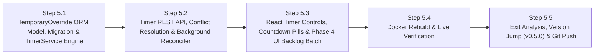

# Phase 5 Execution & Checkpoint Tracking (`PHASE_5_TRACKING.md`)

> **Phase:** 5 of 7 (Test Cycle 5 — Control Feature #3: Timed Temporary Controls — Pause & Bonus Access Timers + Phase 4 UI Backlog Integration)  
> **Branch:** `phase5`  
> **Complexity Rating:** **3.5 / 5 (Medium–High)**  
> **Status:** `COMPLETE`  
> **Master Plan Reference:** [PLAN.md](PLAN.md) | [docs/PHASE_EXIT_REPORTS.md](docs/PHASE_EXIT_REPORTS.md) | [docs/FEATURE_BACKLOG.md](docs/FEATURE_BACKLOG.md)

---

## 1. Phase 5 Objectives & Waterfalled Inputs from Phases 1–4

1. **Feature Backlog Review & Scheduled Phase 4 UI / Visualization Enhancements (`docs/FEATURE_BACKLOG.md` — Waterfall Update 5A):**
   - **`FB-P4-001` (Header Health Badge):** Remove `SYSTEM:` prefix in `AppLayout.tsx` so the badge displays only the health status (`HEALTHY`, `DEGRADED`, `DOWN` / `UNHEALTHY`).
   - **`FB-P4-002` (Application Version Incrementing):** Increment version (`0.4.0` → `0.5.0`) across `backend/app/__init__.py`, `backend/pyproject.toml`, `frontend/package.json` on Phase 5 push.
   - **`FB-P4-003` (Telemetry Button Label):** Change Telemetry column button label in `DevicesPage.tsx` from `Usage & Domains` to `Analytics`.
   - **`FB-P4-004` (Internet Access Column Button State):** Remove `— Click to Block` / `— Click to Allow` in `DevicesPage.tsx` and display only the current state (`Blocked` / `Allowed`), preserving click-to-toggle behavior.
   - **`FB-P4-005` (`Top Visited Domains` Title):** Remove ``(`dns.question.name`)`` from `Top Visited Domains` in `DeviceAnalyticsDrawer.tsx`.
   - **`FB-P4-006` (Stacked `Usage & Activity Timeline` Bar Graph):** Convert the timeline bar chart in `DeviceAnalyticsDrawer.tsx` and `GroupAnalyticsDrawer.tsx` to a **Stacked Bar Graph** with distinct colors for **DNS Queries** vs. **Firewall Events**, a visible color key/legend in the chart header, and a hover tooltip breakdown.
   - **`FB-P4-010` (`Traffic & DNS Analytics` Tab Copy):** Remove ``(`logs-pfsense.log*`)`` from the page title and change `Inspect Device` button label to `Inspect` in `AnalyticsPage.tsx`.
   - **`FB-P4-011` (`System Connectivity` Tab Cleanup):** Replace the stale Phase 1 `Network Device Inventory & Internet Access Control` placeholder box at the bottom of `StatusPage.tsx` with a live **Gateway Enforcement & Inventory Summary** card.
2. **Persistent Temporary Override Engine (`APScheduler` + SQLite `temporary_overrides`):**
   - **Data Model (`TemporaryOverride` in `backend/app/models/__init__.py` + Alembic migration `0004_phase5_temporary_overrides.py`):**
     - Supports both **Single-Device Overrides** (`target_type="device"`, `device_id`) and **Group Overrides** (`target_type="group"`, `group_id`).
     - Supports two override modes:
       - **`pause` (Temporary Block for Duration):** Blocks a device or group for `15m`, `30m`, `1h`, `2h`, `Until Tomorrow (07:00 local TZ)`, or custom minutes — automatically restores internet access (`unblock`) when the timer expires.
       - **`bonus` (Temporary Bonus Access for Duration):** Unblocks a currently blocked device or group for `15m`, `30m`, `1h`, or custom minutes — automatically re-blocks (`block` + `kill_states`) the moment bonus time expires.
     - Tracks `created_at`, `expires_at` (UTC), `duration_minutes`, `mode` (`pause` | `bonus`), `is_active`, `cancelled_at`, `completed_at`, and `created_by`.
3. **Startup & 60-Second Background Reconciliation Loop:**
   - On container startup and every 60 seconds via `APScheduler` (in `backend/app/main.py` lifespan), `TimerService.reconcile_expired_overrides()` inspects all active `TemporaryOverride` records whose `expires_at <= now_utc`:
     - If `mode == "pause"` expired: unblocks the target device(s) in OPNsense `gateway_blocked_devices`, marks the override `is_active=False, completed_at=now_utc`, and logs an `AuditLog` event (`actor="timer"`, `action="timer_expired_unblock"`).
     - If `mode == "bonus"` expired: re-blocks the target device(s) in OPNsense `gateway_blocked_devices`, calls `kill_states` for immediate cutoff, marks the override `is_active=False, completed_at=now_utc`, and logs an `AuditLog` event (`actor="timer"`, `action="timer_expired_block"`).
   - **Conflict Resolution:** Any manual permanent Block/Unblock on a device or group automatically cancels any active `TemporaryOverride` on that target cleanly.
4. **React Timer Controls & Live Countdown Badges:**
   - Quick-timer popover menu on every Device row and Group card (*"Pause 15m"*, *"Pause 30m"*, *"Pause 1h"*, *"Pause 2h"*, *"Until Tomorrow 07:00"*, *"Grant 30m Bonus"*, *"Grant 1h Bonus"*).
   - Live countdown badge (`Paused — 28m left` / `Bonus Time — 14m left`) on active devices and groups with a one-click **Cancel Timer** button.

---

## 2. Step-by-Step Execution & Checkpoint Tracker

### Progress Summary Table

| Step | Checkpoint | Description | Status | Verified Date |
| :--- | :--- | :--- | :---: | :---: |
| **Step 5.1** | `CP-5.1` | `TemporaryOverride` ORM Model, Alembic Migration `0004`, and `TimerService` (Pause, Bonus, Until-07:00 Calculation & Expiry Reconciliation) + Unit Tests (`freezegun`) | `[x] Complete` | 2026-10-31 |
| **Step 5.2** | `CP-5.2` | `/api/v1/timers` & Device/Group Timer Endpoints, Manual-Toggle Conflict Cancellation, and 60s `APScheduler` Lifespan Job + Unit Tests | `[x] Complete` | 2026-10-31 |
| **Step 5.3** | `CP-5.3` | React Quick-Timer Popover, Live Countdown Badges, and Phase 4 UI Backlog Batch (`FB-P4-001`..`006`, `FB-P4-010`, `FB-P4-011`) + Unit Tests | `[x] Complete` | 2026-10-31 |
| **Step 5.4** | `CP-5.4` | Docker Container Rebuild (`http://localhost:8080`) & Live Timer + UI Backlog Smoke Verification | `[x] Complete` | 2026-10-31 |
| **Step 5.5** | `CP-5.5` | Phase 5 QA Gate, Feature Backlog Review, Exit Analysis, Version Bump (`v0.5.0`) & Git Push | `[x] Complete` | 2026-11-01 |

