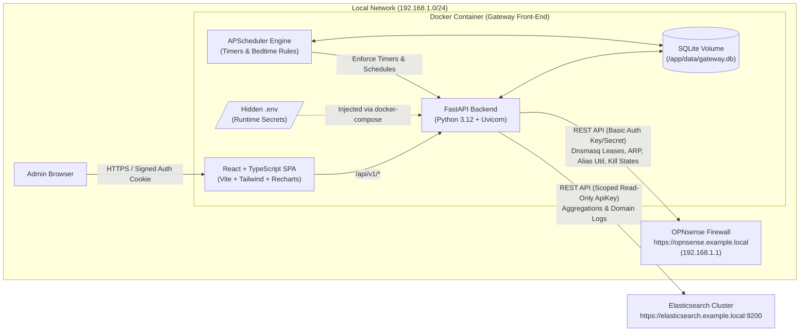
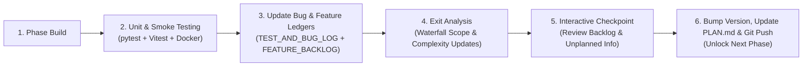
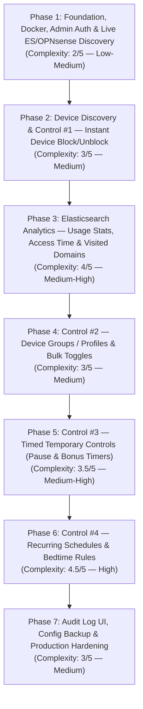

# Gateway Network Access Controller & Analytics — Master Project Plan

> **Status:** Living Plan v1.2 (Baseline Ready — Updated with OPNsense `26.7.7-amd64` & Elasticsearch `9.4.3` / `pfSense 1.25.4`)  
> **Target Deployment:** Self-hosted Docker Container  
> **Firewall Integration:** OPNsense `26.7.7-amd64` (`https://opnsense.example.local` / `192.168.1.1`) — Dnsmasq DHCP, ARP Table, Firewall Aliases, State Table  
> **Analytics Integration:** Elasticsearch `9.4.3` (`https://elasticsearch.example.local:9200`) — Elastic `pfSense` Integration `1.25.4` (`logs-pfsense.log*`)

---

## 1. Executive Summary & System Architecture

This project builds a self-hosted, single-container web application that provides a unified dashboard to:
1. **Control Internet Access** for network devices through OPNsense (`https://opnsense.example.local` at `192.168.1.1`), progressing from instant single-device toggles to device groups, temporary countdown timers, and recurring weekly schedules.
2. **Visualize Network Activity** by querying Elasticsearch (`https://elasticsearch.example.local:9200`) to display per-device and per-group bandwidth/usage statistics, active hours/access timelines, and web domains visited.



---

## 2. Agreed Software Stack

| Layer | Technology | Rationale |
| :--- | :--- | :--- |
| **Backend API** | **Python 3.12 + FastAPI** (`uvicorn`) | First-class async ecosystem, automatic OpenAPI schema validation, clean dependency injection for unit testing. |
| **Configuration** | **`pydantic-settings`** | Strictly validates all required `.env` variables at startup and prevents secret leakage in logs/tracebacks. |
| **OPNsense Client** | **`httpx` (AsyncClient)** | Async HTTP with connection pooling, configurable TLS verification (self-signed certs or local CA), and deterministic mocking via `respx`. |
| **Elasticsearch Client** | **`elasticsearch[async]>=9.0.0,<10.0.0`** | Official v9 async Python client matching Elasticsearch `9.4.3` (`compatible-with=9`), native `api_key` auth, and ECS query DSL support against `logs-pfsense.log*`. |
| **Persistence** | **SQLite + SQLAlchemy 2.0 (Async) + Alembic** | Zero external DB container needed; stores device nicknames, MAC mappings, groups, active timers, schedules, and audit logs on a mounted Docker volume. |
| **Scheduler** | **`APScheduler`** | Runs inside the backend process with SQLite persistence so temporary countdowns and bedtime schedules survive container restarts. |
| **Authentication** | **Built-in Admin Auth (`argon2-cffi` + `PyJWT`)** | Admin credentials configured via `.env`; issues `HttpOnly`, `SameSite=Lax` signed session cookies with login rate-limiting. |
| **Frontend UI** | **React 19 + TypeScript + Vite + Tailwind CSS** | Responsive desktop/mobile UI, `TanStack Query` for live polling & optimistic toggles, `Recharts` for usage timelines, `Lucide` icons. |
| **Testing & QA** | **`pytest` + `respx` + `freezegun` / `Vitest` + `RTL`** | Deterministic backend and frontend unit test suites + `ruff`, `mypy`, `eslint`, and `tsc` static checks. |
| **Packaging** | **Multi-Stage `Dockerfile` + `docker-compose.yml`** | Stage 1 (`node:22-alpine`) compiles the React SPA; Stage 2 (`python:3.12-slim`) serves both `/api/v1/*` and static SPA assets as a non-root user. |

---

## 3. OPNsense Internet Blocking Design (`https://opnsense.example.local` / `192.168.1.1`)

To block and unblock devices instantaneously without full firewall filter reloads—and without breaking DHCP lease renewals on the LAN—we use OPNsense's live `pf` table alias API paired with targeted state termination.

### 3.1 One-Time OPNsense Firewall Rule Setup
1. **Create Host Alias (`Firewall → Aliases`)**:
   - **Name:** `gateway_blocked_devices` (matches `OPNSENSE_BLOCK_ALIAS` in `.env`)
   - **Type:** `Host(s)`
   - **Description:** `Managed by Gateway Front-End Container`
2. **Create LAN Firewall Rule (`Firewall → Rules → LAN`)** placed **above** the general LAN-to-any allow rule (and **below** anti-lockout / local DHCP & DNS rules if desired):
   - **Action:** `Block` (or `Reject` so client browsers fail fast instead of hanging on TCP timeouts)
   - **Interface:** `LAN` (and any additional internal VLAN interfaces if applicable)
   - **Direction:** `in`
   - **TCP/IP Version:** `IPv4+IPv6` (or `IPv4`)
   - **Source:** `gateway_blocked_devices`
   - **Destination / Invert:** Check **Destination / Invert** and target `Private_Networks` (RFC1918 alias: `10.0.0.0/8`, `172.16.0.0/12`, `192.168.0.0/16`) so blocked devices **lose all WAN/Internet access** while still maintaining local DHCP lease renewals and visibility in OPNsense ARP/Dnsmasq tables. *(Note: Add a rule right above or include WAN DNS blocking so external DNS queries to `8.8.8.8`/`1.1.1.1` are also rejected.)*

### 3.2 OPNsense API Endpoints Used by the Container (`OPNsense 26.7.7-amd64`)
| Operation | Method & Endpoint | Purpose |
| :--- | :--- | :--- |
| **Fetch DHCP Leases** | `GET` / `POST /api/dnsmasq/leases/search` | Maps IP addresses to MAC addresses, hostnames, and lease expirations from Dnsmasq. |
| **Fetch Live ARP Cache** | `GET /api/diagnostics/interface/get_arp` *(or `POST .../search_arp`)* | Discovers static-IP devices, online presence, and NIC manufacturer (OUI). Uses 26.7 `snake_case` to match `page-diagnostics-arptable` ACL. |
| **List Blocked IPs** | `GET /api/firewall/alias_util/list/{alias}` | Reads live `pf` table entries in `gateway_blocked_devices` (ground truth). |
| **Block Device IP** | `POST /api/firewall/alias_util/add/{alias}` | Payload `{"address": "<ip>"}` — adds IP immediately with zero config reload delay. |
| **Kill Active Connections** | `POST /api/diagnostics/firewall/kill_states` | Payload `{"filter": "<ip>"}` — drops established TCP/UDP/QUIC streams immediately on block. |
| **Unblock Device IP** | `POST /api/firewall/alias_util/delete/{alias}` | Payload `{"address": "<ip>"}` — restores internet access immediately. |

> **Safety Guardrail:** The backend enforces a mandatory `OPNSENSE_PROTECTED_IPS` allowlist (always automatically including `192.168.1.1` and the admin's current session IP unless overridden) that cannot be added to `gateway_blocked_devices` or passed to `kill_states`.

---

## 4. Hidden `.env` Specification & Least-Privilege API Key Guide

### 4.1 Secret Hygiene Rules
- `.env` is listed in `.gitignore` and `.dockerignore` **before the first commit** so secrets are never committed to Git or baked into Docker image layers.
- `.env.example` (containing empty placeholders and comments) **is** committed to Git for documentation.
- At runtime, `docker-compose.yml` mounts variables via `env_file: - .env`. Recommended host permissions: `chmod 600 .env` (Linux) or restricted NTFS ACLs (Windows).

### 4.2 Planned `.env` Structure
```dotenv
# ==============================================================================
# 1. APPLICATION & ADMIN AUTHENTICATION
# ==============================================================================
APP_ENV=production
APP_PORT=8080
TZ=America/Los_Angeles

# Generate with: python -c "import secrets; print(secrets.token_hex(32))"
APP_SECRET_KEY=REPLACE_WITH_64_CHAR_RANDOM_HEX

# Built-in Web UI Admin Login
ADMIN_USERNAME=admin
# Plaintext password hashed in-memory or pre-hashed Argon2id string via helper script
ADMIN_PASSWORD=REPLACE_WITH_STRONG_ADMIN_PASSWORD
SESSION_EXPIRE_MINUTES=720

# SQLite database path inside container (persisted via Docker volume)
DATABASE_URL=sqlite+aiosqlite:////app/data/gateway.db

# ==============================================================================
# 2. OPNSENSE INTEGRATION (https://opnsense.example.local / 192.168.1.1)
# ==============================================================================
OPNSENSE_BASE_URL=https://opnsense.example.local
OPNSENSE_API_KEY=REPLACE_WITH_OPNSENSE_API_KEY
OPNSENSE_API_SECRET=REPLACE_WITH_OPNSENSE_API_SECRET

# Set true when using a valid TLS certificate for opnsense.example.local
# (or set false / provide OPNSENSE_CA_CERT_PATH if using an internal/self-signed CA)
OPNSENSE_VERIFY_SSL=true
OPNSENSE_CA_CERT_PATH=
OPNSENSE_TIMEOUT_SECONDS=10

# Exact name of the Host(s) Firewall Alias in OPNsense
OPNSENSE_BLOCK_ALIAS=gateway_blocked_devices

# Comma-separated IPs that the backend MUST NEVER block (Gateway IP, Docker Host, NAS, etc.)
OPNSENSE_PROTECTED_IPS=192.168.1.1

# ==============================================================================
# 3. ELASTICSEARCH INTEGRATION (https://elasticsearch.example.local:9200 — ES 9.4.3)
# ==============================================================================
ELASTICSEARCH_URL=https://elasticsearch.example.local:9200
# Base64-encoded API key ("encoded" field from POST /_security/api_key)
ELASTICSEARCH_API_KEY=REPLACE_WITH_BASE64_ELASTICSEARCH_API_KEY
ELASTICSEARCH_VERIFY_SSL=true
ELASTICSEARCH_CA_CERT_PATH=
ELASTICSEARCH_TIMEOUT_SECONDS=15

# Elastic pfSense Integration (v1.25.4) data stream pattern
ELASTICSEARCH_INDEX_PATTERNS=logs-pfsense.log*
```

---

### 4.3 How to Generate & Scope the OPNsense API Key (`https://opnsense.example.local` — `OPNsense 26.7.7-amd64`)

Follow the principle of least privilege by creating a dedicated non-interactive service account and group rather than using `root`:

1. **Create a Scoped Privilege Group**:
   - In OPNsense, navigate to **System → Access → Groups** and click **+** (Add).
   - **Group name:** `gateway_controller`
   - **Description:** `Least-privilege API access for Gateway Front-End container`
   - Click **Save**, then click the **Edit (pencil)** icon on `gateway_controller` and click **Edit** next to **Assigned Privileges**.
   - In **OPNsense 26.7.7-amd64**, enable **only** the following 6 privileges (search using the filter box):
     - **`Firewall: Aliases`** *(internal key `page-firewall-aliases`; grants read-only access to `/api/firewall/alias/get*`, `list*`, `search*`, `export`)*
     - **`Firewall: Alias: Edit`** *(internal key `page-firewall-alias-edit`; grants write access to `/api/firewall/alias/*` including `set_item` and `reconfigure`)*
     - **`Diagnostics: PF Table IP addresses`** *(internal key `page-diagnostics-tables`; grants runtime table access to `/api/firewall/alias_util/*` for fast `list`, `add`, and `delete`)*
     - **`Diagnostics: ARP Table`** *(internal key `page-diagnostics-arptable`; grants access to `/api/diagnostics/interface/get_arp*` and `/api/diagnostics/interface/search_arp*`)*
     - **`Diagnostics: Show States`** *(internal key `page-diagnostics-showstates`; grants access to `/api/diagnostics/firewall/kill_states*` and state inspection)*
     - **`Services: Dnsmasq DNS/DHCP: Settings`** *(internal key `page-services-dnsmasq`; maps to `api/dnsmasq/*` which covers `/api/dnsmasq/leases/search`. Note: in OPNsense 26.7.7-amd64 there is no separate `Leases` privilege, and `Services: Dnsmasq DNS/DHCP: Logfile` is not needed)*
   - Click **Save** twice. *(Ensure `GUI - All pages` is **NOT** checked.)*

2. **Create the Dedicated API Service User**:
   - Navigate to **System → Access → Users** and click **+** (Add).
   - **Username:** `svc_gateway_ui`
   - **Scrambled Password:** Check the box (*"Generate a scrambled password to prevent local database logins for this user."*).
   - **Login shell:** Leave set to **`Default (none for all but root)`**.
   - **Group membership:** Add `gateway_controller`.
   - Click **Save**.

3. **Generate the API Key & Secret**:
   - In the **System → Access → Users** table, click the **ticket (`+` API key) icon** in the right-hand actions column on the `svc_gateway_ui` row *(or use the **API Keys** tab at the top of the Users page)*.
   - A text file (`*_svc_gateway_ui_apikey.txt`) downloads automatically containing:
     ```ini
     key=...
     secret=...
     ```
   - Paste those values into `OPNSENSE_API_KEY` and `OPNSENSE_API_SECRET` in `.env`, then securely delete the downloaded `.txt` file.

4. **Quick Verification (Optional Pre-Check)**:
   - Confirm the key can read ARP and Dnsmasq leases (`HTTP 200`) and is **denied** (`HTTP 403`) on unrelated admin endpoints like `/api/core/firmware/status`.

---

### 4.4 How to Generate & Scope the Elasticsearch `9.4.3` API Key (`https://elasticsearch.example.local:9200`)

Because OPNsense logs are ingested via the **Elastic `pfSense` Integration (`v1.25.4`)** into the **`logs-pfsense.log*`** data stream (`logs-pfsense.log-default`), we can create a **single, permanent, least-privilege read-only API key** scoped directly to `logs-pfsense.log*` from the start:

In **Kibana (`v9.4.3`) → Management → Dev Tools → Console**, run:

```json
POST /_security/api_key
{
  "name": "gateway-frontend-pfsense-logs-readonly",
  "role_descriptors": {
    "gateway_pfsense_logs_readonly": {
      "cluster": [ "monitor" ],
      "indices": [
        {
          "names": [ "logs-pfsense.log*" ],
          "privileges": [ "read", "view_index_metadata" ]
        }
      ]
    }
  }
}
```
- Copy the **`encoded`** string from the JSON response (Base64-encoded `id:api_key`) and paste it into `ELASTICSEARCH_API_KEY` in `.env`.
- **ECS Schema & `pfSense 1.25.4` Ingest Pipeline Note:**
  - The `pfSense 1.25.4` integration maps packet filter events (`process.name: "filterlog"`) to ECS fields: `@timestamp`, `source.ip`, `destination.ip`, `source.port`, `destination.port`, `network.transport`, `network.direction`, `event.action`, and `network.bytes`.
  - For DNS domain resolution (`dns.question.name`), the `pfSense 1.25.4` pipeline natively parses `unbound` logs and by default drops unrecognized `event.provider` values (such as `dnsmasq`) unless added to the pipeline whitelist or `logs-pfsense.log@custom`.
  - In **Phase 1 (Step 1.4)**, `scripts/discover_environment.py` will inspect `logs-pfsense.log*` to verify active `process.name` / `event.provider` buckets and populated ECS fields (`network.bytes`, `dns.question.name`, etc.) so we can confirm whether any `logs-pfsense.log@custom` pipeline tweak or DNS logging toggle is needed prior to Phase 3.

---

## 5. Quality Assurance, Bug Tracking & End-of-Phase Exit / Checkpoint Protocol

Every phase below operates as a self-contained **Test Cycle** followed by a formal **Exit Analysis & Interactive Learnings Checkpoint**. No phase is checked into the repository or closed—and no subsequent phase begins—until all quality gates and the phase-end checkpoint are completed.



### 5.1 Unit & Component Testing Standards
- **Backend (`pytest` + `pytest-asyncio` + `pytest-cov`)**:
  - Minimum **85% code coverage** per phase module.
  - All external calls to `https://opnsense.example.local` (`192.168.1.1`) mocked via `respx` (testing `200 OK`, `401/403 Auth Error`, `500`, connection timeout, and malformed payloads).
  - All calls to `https://elasticsearch.example.local:9200` tested against realistic fixture payloads captured (and redacted) from Phase 1 discovery.
  - All SQLite tests run against isolated ephemeral databases (`:memory:` or `tmp_path`).
  - Time-dependent logic (Phase 5 timers & Phase 6 schedules) tested deterministically with `freezegun`.
- **Frontend (`Vitest` + `React Testing Library`)**:
  - Component rendering, user click/toggle workflows, loading/error states, and protected-device disabled states tested per phase.
- **Container & Live Integration Verification**:
  - Build the multi-stage Docker container and run smoke verification against OPNsense and Elasticsearch at the end of each phase (including verifying container DNS resolution for `opnsense.example.local` and `elasticsearch.example.local:9200`).

### 5.2 Bug Documentation & Resolution Ledger (`docs/development/TEST_AND_BUG_LOG.md`)
A dedicated tracking document, `docs/development/TEST_AND_BUG_LOG.md`, will be maintained in the repository and updated **with every Git check-in**. Every defect found during unit testing, static type checking, container build, or live API validation will be recorded—including bugs intentionally deferred to a future phase:

| Field | Description |
| :--- | :--- |
| **Bug ID** | Sequential phase identifier (e.g., `BUG-P2-001`) |
| **Phase / Test Cycle** | Phase number and feature area where discovered |
| **Found During** | `Unit Test` / `Static Analysis` / `Docker Build` / `Live Smoke Test` |
| **Severity** | `Low` / `Medium` / `High` / `Critical` |
| **Disposition / Status** | `Resolved in Phase` **or** `Deferred (Waterfalled to Phase X)` |
| **Symptom & Root Cause** | Exact failure observed and why it occurred (e.g., OPNsense `dnsmasq` returning array vs dict when empty) |
| **Resolution / Interim Mitigation** | Code fix applied now, **or** temporary workaround & rationale for deferring to Phase `X` |
| **Regression Test** | Exact unit test added (`tests/...::test_...`), or planned test target if deferred |
| **Commit Reference** | Git commit hash where logged and/or resolved |

### 5.3 End-of-Phase Exit Analysis, Feature Backlog Review & Waterfall Re-Baselining
Because real-world network data, user UI feedback, and API behaviors evolve as we build, **`PLAN.md` and `docs/development/FEATURE_BACKLOG.md` are treated as living documents**. At the conclusion of each phase (before check-in), we perform a structured **Exit Analysis** recorded in `docs/development/PHASE_EXIT_REPORTS.md`:
1. **Waterfall Item & Feature Backlog Migration (`docs/development/FEATURE_BACKLOG.md`):** Any non-blocking bugs (`Deferred` in `docs/development/TEST_AND_BUG_LOG.md`), user UI/feature requests logged in `docs/development/FEATURE_BACKLOG.md`, newly uncovered edge cases, or architectural refinements are explicitly evaluated at each phase boundary and scheduled into the **Deliverables** and **Unit Testing Scope** of their target future phase (`Phase N+1..7`) inside `PLAN.md`.
2. **Complexity & Scope Re-Assessment:** Re-evaluate the complexity ratings (`1–5`) and dependencies of upcoming phases based on waterfalled items so scope creep stays visible and controlled.
3. **Carry-Over Verification & Version Increment (`FB-P4-002`):** At the start of Phase `N+1`, any bugs or backlog items waterfalled into Phase `N+1` become priority acceptance criteria for that cycle. Prior to each phase Git check-in/push, increment the application version (`backend/app/__init__.py`, `backend/pyproject.toml`, `frontend/package.json`) so the UI header always matches the current release pushed to GitHub.

### 5.4 Phase-End Interactive Checkpoint & "Unplanned Information" Retrospective
At the end of every phase, development pauses for a **mandatory discussion checkpoint** with you before moving forward. Together we review:
1. **Phase Exit Summary:** Test pass/coverage metrics, bugs fixed in-cycle, and proposed waterfall deferrals.
2. **Unplanned Information Audit (*"What did we need that we didn't plan for?"*):**
   - Document every unexpected requirement encountered during the phase—such as undocumented OPNsense ACL quirks, TLS/DNS nuances inside Docker, missing or differently structured Elasticsearch fields, rate/timeout behavior, or missing `.env` knobs.
3. **Feed-Forward Learnings Applied to Next Phase:**
   - Decide concretely how those discoveries change how we prepare for the next phase (e.g., running an upfront API payload probe before writing mocks, adding a new `.env` setting, or expanding test fixtures).
4. **Next-Phase Sign-Off:** Once we agree on the Exit Report and any `PLAN.md` adjustments, we check in the completed phase and unlock the next phase.

---

## 6. Phased Development & Test Cycles



---

### Phase 1 (Test Cycle 1): Foundation, Docker Packaging, Admin Auth & Environment Discovery
- **Complexity:** **2 / 5 (Low–Medium)** — Straightforward project setup, auth boilerplate, multi-stage Docker build, and read-only API probing.
- **Deliverables:**
  1. Repository initialization: `.gitignore` (protecting `.env`), `.dockerignore`, `.env.example`, hidden `.env`, `docs/API_KEYS_SETUP.md`, `docs/development/TEST_AND_BUG_LOG.md`, and `docs/development/PHASE_EXIT_REPORTS.md`.
  2. Backend core (`FastAPI`, `pydantic-settings`, SQLite + Alembic initial migration) with Built-in Admin Login (`/api/v1/auth/login`, `/logout`, `/me`) using signed `HttpOnly` cookies and login rate-limiting.
  3. Connectivity Health API (`/api/v1/system/health`) checking live reachability & credential validity for OPNsense (`https://opnsense.example.local`) and Elasticsearch (`https://elasticsearch.example.local:9200`).
  4. **Environment Discovery Tool (`scripts/discover_environment.py`)**:
     - Probes OPNsense ARP (`/api/diagnostics/interface/get_arp`), Dnsmasq leases (`/api/dnsmasq/leases/search`), and verifies `gateway_blocked_devices` alias existence.
  5. React SPA shell: Login page, authenticated layout, dark/light responsive navigation, and System Connection Status banner.
  6. Multi-stage `Dockerfile` + `docker-compose.yml` running end-to-end.
- **Unit Testing Scope:**
  - `.env` parsing & missing-secret startup rejection tests.
  - Password verification, JWT cookie issuance/expiration, unauthorized route rejection (`401`), and rate-limit tests.
  - Mocked OPNsense & ES health check tests (healthy, auth failure, SSL error, unreachable).
  - Frontend Login form & protected route unit tests.
- **Phase Exit & Check-in Gate:**
  - Complete **Phase 1 Exit Analysis & Interactive Checkpoint** in `docs/development/PHASE_EXIT_REPORTS.md` (waterfall any discovered OPNsense/ES quirks or deferred bugs into Phases 2–3 in `PLAN.md`, and review unplanned info needed during live discovery) → Git check-in.

---

### Phase 2 (Test Cycle 2): Device Inventory & Control Feature #1 — Instant Single-Device Block / Unblock
- **Complexity:** **3 / 5 (Medium)** — Merging multiple OPNsense data sources (Dnsmasq leases + ARP + live `pf` alias) cleanly and enforcing self-lockout safety guardrails.
- **Deliverables:**
  1. **Device Discovery & Reconciliation Service**:
     - Combines OPNsense `/api/dnsmasq/leases/search` + `/api/diagnostics/interface/get_arp` + `/api/firewall/alias_util/list/{alias}` (with automatic fallback to `/api/firewall/alias/get_alias_uuid` + `/api/firewall/alias/get_item/{uuid}`).
     - **Phase 1 Waterfall Update 2A (Dnsmasq Schema Normalization):** Maps Dnsmasq lease fields (`address` → IPv4, `hwaddr` → MAC, `mac_info` → vendor, `if_descr` → interface) alongside ARP fields (`ip`, `mac`, `manufacturer`, `intf_description`), and strips Dnsmasq's literal `"*"` placeholder when `hostname` or `client_id` is unknown.
     - Persists discovered devices by MAC address in SQLite so custom friendly names (e.g., *"Living Room Apple TV"*), custom icons, notes, and `is_protected` flags persist even if DHCP IPs change.
  2. **Control Feature #1 — Instant Block / Unblock API**:
     - `POST /api/v1/devices/{device_id}/block`: Validates target is not in `OPNSENSE_PROTECTED_IPS` or marked `is_protected`, adds the IP to `gateway_blocked_devices`, calls `/api/diagnostics/firewall/kill_states` (`{"filter": "<ip>"}`) for immediate traffic cutoff, and records an audit event.
     - `POST /api/v1/devices/{device_id}/unblock`: Removes the IP from `gateway_blocked_devices` and records an audit event.
     - **Phase 1 Waterfall Update 2B (Dual-Path Alias Mutation):** Supports `/api/firewall/alias_util/add` & `delete` with automatic fallback to `/api/firewall/alias/get_item/{uuid}` → `set_item/{uuid}` → `/api/firewall/alias/reconfigure` when `alias_util` returns `HTTP 403`.
  3. **React Device Dashboard (v1)**:
     - Summary KPI bar (Total Devices, Online Now, Currently Blocked, Protected).
     - Searchable, sortable device table/cards (Filter by: All / Online / Blocked / Unassigned) with inline nickname editor and instant **Internet Access Toggle** with optimistic feedback.
- **Unit Testing Scope:**
  - Merge logic edge cases: static-IP device in ARP only, offline device in SQLite/Dnsmasq but absent from ARP, MAC address with changed DHCP IP, IPv4 validation preventing command/filter injection into `kill_states`.
  - Protected-IP safety tests verifying `403 Forbidden` if attempting to block `192.168.1.1` or admin's IP.
  - Partial failure handling (e.g., `alias_util/add` succeeds, `kill_states` times out — surfaces warning without corrupting state).
  - Frontend Device table filtering, inline rename, and toggle switch tests.
- **Phase Exit & Check-in Gate:** Update Cycle 2 `docs/development/TEST_AND_BUG_LOG.md` → **Phase 2 Exit Analysis & Interactive Learnings Checkpoint** (`docs/development/PHASE_EXIT_REPORTS.md` + waterfall adjustments to `PLAN.md`) → Git check-in.

---

### Phase 3 (Test Cycle 3): Elasticsearch `9.4.3` Analytics (`logs-pfsense.log*` — `pfSense 1.25.4`)
- **Complexity:** **3.5 / 5 (Medium–High)** *(Reduced from `4/5` because `logs-pfsense.log*` uses standardized Elastic Common Schema `ECS` fields via the `pfSense 1.25.4` integration, and Phase 1 live discovery confirmed `unbound` DNS and `filterlog` fields are already populated across 6.67M+ docs)*
- **Deliverables:**
  1. **Elasticsearch `9.4.3` Analytics Service (`logs-pfsense.log*`)**:
     - **Phase 1 Waterfall Update 3A (Verified Provider & ECS Field Filters):** Queries `event.provider: "filterlog"` (`3.63M+` docs) for bandwidth (`network.bytes`), packet actions (`event.action: pass | block`), and destination ASN organization (`destination.as.organization.name`), and queries `event.provider: "unbound"` (`3.02M+` docs) for DNS domain resolution (`dns.question.name`, `dns.question.registered_domain`, `dns.question.subdomain` correlated by `source.ip` / `client.ip`).
     - **Phase 2 Waterfall Update 3B (SQLite Device Metadata Enrichment):** Enriches top-device IP buckets from `logs-pfsense.log*` (`source.ip` / `client.ip`) with local SQLite `Device` records (`id`, `effective_name`, `mac_address`, `vendor`, `is_blocked`, `is_online`) and returns a clean zero-state payload when a device has no `ipv4_address`.
     - **Network Overview (`/api/v1/analytics/overview`)**: Total traffic volume (`network.bytes`) / connection activity (`event.action: pass | block`) histogram (`1h`, `24h`, `7d`, `30d`), Top Devices by `source.ip` / `destination.ip`, and Top Domains (`dns.question.name` & `dns.question.registered_domain`) network-wide.
     - **Per-Device Analytics (`/api/v1/devices/{device_id}/analytics`)**:
       - **Usage Statistics:** Bytes transferred (`network.bytes` from `filterlog`) and allowed vs. blocked packet counts over time.
       - **Access Time:** Hourly activity timeline & 24-hour distribution chart (`date_histogram` with `TZ` offset) showing exact windows when the device is active online.
       - **Web Pages / Domains Visited:** Top domains table (`dns.question.name` / destination ASN/org enrichment) + searchable chronological recent domain feed.
     - Short-TTL in-memory cache (`15–30s`) and graceful fallback so OPNsense blocking controls continue working normally even if Elasticsearch is temporarily unreachable.
  2. **React Analytics Views**:
     - Network Overview charts panel + time-range selector (`Last 1h`, `24h`, `7d`, `30d`).
     - Interactive **Device Detail Drawer / Page** triggered by clicking any device: displays Usage chart, Access Time hourly chart, Top Visited Domains, and Recent Domain Log search—right alongside the device's Block/Unblock toggle.
- **Unit Testing Scope:**
  - ES aggregation query builder tests verifying IP filters, time-range bounds, timezone bucketing (`TZ`), and pagination/size caps.
  - Response normalization tests with real-shaped fixture data (missing fields, null bytes, IPv4-mapped formats, empty buckets).
  - Graceful degradation tests when ES returns `503` or times out.
  - Frontend Device Detail Drawer chart/table rendering & time-window switching tests.
- **Phase Exit & Check-in Gate:** Update Cycle 3 `docs/development/TEST_AND_BUG_LOG.md` → **Phase 3 Exit Analysis & Interactive Learnings Checkpoint** (`docs/development/PHASE_EXIT_REPORTS.md` + waterfall adjustments to `PLAN.md`) → Git check-in.

---

### Phase 4 (Test Cycle 4): Control Feature #2 — Device Groups / Profiles & Bulk Access Control
- **Complexity:** **3 / 5 (Medium)** — Coordinating multi-device batch operations against OPNsense and aggregating multi-IP Elasticsearch queries cleanly.
- **Deliverables:**
  1. **Groups / Profiles Data Model & API (`/api/v1/groups`)**:
     - Create, edit, delete groups (e.g., *Kids Devices*, *Living Room Media*, *IoT*, *Guests*) with color badge, icon, and assigned member devices.
  2. **Bulk Group Block / Unblock (`/api/v1/groups/{group_id}/block` & `/unblock`)**:
     - Batch-updates OPNsense `gateway_blocked_devices` for all non-protected member devices, kills active states for newly blocked members, and computes real-time group state (`Allowed`, `Partially Blocked`, `Blocked`).
  3. **Group-Level Analytics (`/api/v1/groups/{group_id}/analytics`)**:
     - Queries Elasticsearch across all member IPs combined (`terms` filter) so you can view combined usage, access hours, and visited domains across an entire profile (e.g., a child's phone + tablet + laptop together).
     - **Phase 3 Waterfall Update 4A (Multi-IP Group Analytics & Member Breakdown):** Reuses Phase 3's `filterlog` + `unbound` aggregation structure with multi-IP `terms` filters (`source.ip`, `destination.ip`, `client.ip`) and adds a `by_member_ip` `terms` sub-aggregation so Group Analytics displays per-member traffic & DNS contribution across the group alongside the Python-side 24-hour access profile (`_compute_24h_access_profile()`).
  4. **React Groups UI**:
     - Group summary cards at the top of the dashboard with one-click Group Block/Unblock toggle, member count, and Group Management modal + Group Analytics filter.
- **Unit Testing Scope:**
  - Group state calculation (`Allowed` vs `Partially Blocked` vs `Blocked` vs empty group).
  - Batch toggle behavior when a group contains a protected device or an offline device without a current IP.
  - Multi-IP Elasticsearch `terms` query construction tests.
  - Frontend GroupCard toggle & member assignment modal tests.
- **Phase Exit & Check-in Gate:** Update Cycle 4 `docs/development/TEST_AND_BUG_LOG.md` → **Phase 4 Exit Analysis & Interactive Learnings Checkpoint** (`docs/development/PHASE_EXIT_REPORTS.md` + waterfall adjustments to `PLAN.md`) → Git check-in.

---

### Phase 5 (Test Cycle 5): Control Feature #3 — Timed Temporary Controls (Pause & Bonus Access Timers)
- **Complexity:** **3.5 / 5 (Medium–High)** — Asynchronous background timer execution, container-restart persistence, and periodic state reconciliation with OPNsense.
- **Deliverables:**
  1. **Persistent Temporary Override Engine (`APScheduler` + SQLite `temporary_overrides`)**:
     - **Temporary Pause (Block for Duration):** Block a device or group for `15m`, `30m`, `1h`, `2h`, `Until Tomorrow (07:00)`, or custom minutes — automatically restores access at expiration.
     - **Temporary Bonus Access (Allow for Duration):** Unblock a currently blocked device or group for `15m`, `30m`, `1h`, or custom minutes — automatically re-blocks and kills active firewall states the moment bonus time runs out.
  2. **Startup & 60-Second Reconciliation Job**:
     - On container boot (and every minute), checks for any overrides that expired while the container was down and synchronizes OPNsense's `gateway_blocked_devices` alias to match expected state.
  3. **React Timer Controls**:
     - Quick-timer popover menu on every Device row and Group card (*"Pause 30m"*, *"Pause 1h"*, *"Pause 2h"*, *"Grant 30m Bonus"*, *"Custom..."*).
     - Live countdown pill (`Paused — 28m left` / `Bonus Time — 14m left`) with one-click **Cancel Timer**.
  4. **Phase 4 Waterfall Update 5A — UI Polish, Stacked Activity Chart & System Connectivity Cleanup (`docs/development/FEATURE_BACKLOG.md`)**:
     - Integrate scheduled Phase 4 UI backlog items (`FB-P4-001` through `FB-P4-006`, `FB-P4-010`, and `FB-P4-011`): header health status badge (`HEALTHY`/`DOWN`), semantic version increment (`v0.4.0` -> `v0.5.0`), Telemetry button label (`Analytics`), Internet Access button state label (`Blocked`/`Allowed`), `Top Visited Domains` label cleanup, stacked `Usage & Activity Timeline` bar chart (DNS Queries vs. Firewall Events with color key legend and hover breakdown), Analytics title/button copy cleanup, and replacing/removing the stale Phase 1 placeholder card on `StatusPage.tsx`.
- **Unit Testing Scope:**
  - Deterministic time-travel tests (`freezegun`) verifying exact block/unblock + `kill_states` calls upon timer expiry.
  - Simulated container restart tests (override expires while scheduler is stopped -> startup reconciliation fixes OPNsense alias).
  - Conflict resolution tests (manual permanent toggle cancels an active timer cleanly).
  - Frontend countdown badge and timer action menu tests.
- **Phase Exit & Check-in Gate:** Update Cycle 5 `docs/development/TEST_AND_BUG_LOG.md` → **Phase 5 Exit Analysis & Interactive Learnings Checkpoint** (`docs/development/PHASE_EXIT_REPORTS.md` + waterfall adjustments to `PLAN.md`) → Git check-in.

---

### Phase 6 (Test Cycle 6): Control Feature #4 — Recurring Schedules & Bedtime Rules
- **Complexity:** **4.5 / 5 (High)** — Highest logic complexity: overnight time windows crossing midnight, timezone/DST transitions, DHCP IP drift handling, and strict precedence between Schedules, Bonus Timers, and Manual Locks.
- **Deliverables:**
  1. **Recurring Schedule Engine (`schedules` table + Policy Evaluator)**:
     - Weekly schedule rules assignable to individual Devices or Groups (e.g., *"School Night Bedtime: Sun–Thu 21:00–07:00"*, *"Weekend Bedtime: Fri–Sat 23:00–08:00"*).
     - **Deterministic Policy Precedence Order** (evaluated every 60s and immediately on any rule/override change):
       1. **Protected Device / Protected IP** → Always Allowed
       2. **Active Temporary Override (Phase 5)** → Enforces Pause or Bonus Time until timer expires *(allows granting "30m Bonus Time" during bedtime without editing the schedule!)*
       3. **Manual Permanent Block** → Blocked until manually cleared
       4. **Active Recurring Schedule Block Window** → Blocked during scheduled off-hours; automatically unblocked when window ends
       5. **Default Policy** → Allowed
     - **DHCP IP Drift Sync:** If a blocked MAC address receives a new IP from OPNsense Dnsmasq, the reconciliation loop swaps the old IP out and adds the new IP into `gateway_blocked_devices` + kills states.
  2. **React Schedule Manager UI**:
     - Dedicated **Schedules** tab with visual day-of-week & time-window rule builder, enable/disable rule switch, target Device/Group selector, and clear status badges on devices (*"Blocked by Schedule: School Night Bedtime until 07:00"*).
  3. **Phase 5 Waterfall Update 6A — Centered Timer Modal, Unified Timer Button, UI Polish & Persistent SQLite Volume (`docs/development/FEATURE_BACKLOG.md` `FB-P5-001`..`FB-P5-010`)**:
     - Convert Timer controls into a centered screen modal dialog (`FB-P5-001`), merge active countdown & mode color directly into the `Timer` button (`FB-P5-002`), show duration-only preset labels (`FB-P5-003`), set Bonus Access presets to `20m` / `40m` / `60m` (`FB-P5-004`), align `Timer` button height on Group cards (`FB-P5-005`), rename `Sign Out` to `Logout` (`FB-P5-006`), stabilize Group `Filter` button layout (`FB-P5-007`), remove `(gateway_blocked_devices)` from Devices subtitle (`FB-P5-008`), format `Synced: HH:MM:SS` as 24-hour time underneath `Sync from OPNsense` (`FB-P5-009`), and bind `SQLITE_DB_PATH=/app/data/gateway.db` in `Settings.database_url` so groups, timers, and schedules persist across container restarts/rebuilds (`FB-P5-010`).
- **Unit Testing Scope:**
  - Midnight-spanning window evaluation (`21:00` Monday → `07:00` Tuesday) across all 7 days of the week.
  - Daylight Saving Time (spring-forward / fall-back) boundary tests in configured `TZ`.
  - Complete **Precedence Matrix Test Suite** covering every combination of Schedule + Bonus Timer + Pause Timer + Manual Block + Protected Flag.
  - DHCP IP change mid-schedule reconciliation tests.
  - Frontend Schedule Builder validation and status badge tests.
- **Phase Exit & Check-in Gate:** Update Cycle 6 `docs/development/TEST_AND_BUG_LOG.md` → **Phase 6 Exit Analysis & Interactive Learnings Checkpoint** (`docs/development/PHASE_EXIT_REPORTS.md` + waterfall adjustments to `PLAN.md`) → Git check-in.

---

### Phase 7 (Test Cycle 7): Audit Log UI, Settings Backup & Production Hardening
- **Complexity:** **3 / 5 (Medium)** — Final observability polish, configuration portability, security audit, and end-to-end acceptance testing.
- **Deliverables:**
  1. **Audit & Event History Tab (`/api/v1/audit-logs`)**:
     - Filterable timeline of every block, unblock, state kill, timer expiration, schedule transition, and IP-drift swap (recording actor: `admin`, `timer`, `schedule`, `system_reconcile`, timestamp, target device, and OPNsense result).
  2. **Configuration Export / Import**:
     - One-click JSON backup & restore of local metadata (device nicknames, groups, schedules) without exposing `.env` secrets.
  3. **Container & Security Hardening**:
     - Non-root container execution, Docker `HEALTHCHECK`, structured JSON logging, CSP/security headers, automatic SQLite audit-log retention pruning (e.g., 90 days), and comprehensive `README.md` self-hosting runbook.
  4. **Phase 6 Waterfall Update 7A — Selective Application Blocking (YouTube vs. Plex), Application Usage Time Telemetry & UI Enhancements (`docs/development/FEATURE_BACKLOG.md` `FB-P6-001`..`FB-P6-005`)**:
     - Add single-device search filter in `ScheduleFormModal.tsx` (`FB-P6-001`), live per-second 24h system clock below `Logout` in `AppLayout.tsx` (`FB-P6-002`), `Local SQLite Store` storage size (`KB`/`MB`) and record count metrics in `/api/v1/system/health` & `StatusPage.tsx` (`FB-P6-003`), **YouTube & Plex Active Usage Time Tracking** (`active_minutes`, query/packet counts, and bandwidth from `logs-pfsense.log*` in `DeviceAnalyticsDrawer`, `GroupAnalyticsDrawer`, and `AnalyticsPage` — `FB-P6-004`), and **Selective Application Blocking for YouTube** (allowing Plex & general internet traffic via OPNsense `gateway_youtube_blocked_devices` + `gateway_youtube_domains` aliases — `FB-P6-005`).
- **Unit & Integration Testing Scope:**
  - Audit log filtering, pagination, and retention pruning unit tests.
  - Config JSON export/import schema validation & duplicate-handling tests.
  - Full end-to-end API lifecycle test (Login → Discover Device → Group → Pause → Schedule → ES Analytics → Audit Log).
- **Phase Exit & Check-in Gate:** Verify zero unresolved/un-dispositioned items in `docs/development/TEST_AND_BUG_LOG.md` → **Final Phase 7 Exit Analysis & Project Retrospective Checkpoint** (`docs/development/PHASE_EXIT_REPORTS.md`) → Git check-in & v1.0 release tag.

---

## 7. Planned Repository Directory Layout

```text
gateway-front-end/
├── .env                        # Hidden runtime secrets (GIT-IGNORED — never committed)
├── .env.example                # Safe template with placeholder keys (committed)
├── .gitignore
├── PLAN.md                     # Living master plan (updated at each Phase Exit Analysis)
├── README.md                   # Deployment & operations guide
├── docker/
│   ├── Dockerfile              # Multi-stage build (Node 22 Alpine -> Python 3.12 Slim)
│   ├── Dockerfile.dockerignore # BuildKit context exclusion rules
│   ├── .dockerignore           # Docker context exclusion rules
│   ├── docker-compose.yml      # Self-hosted container deployment definition
│   └── README.md               # Comprehensive Docker build, volume, TLS & operations guide
├── docs/
│   ├── API_KEYS_SETUP.md       # Detailed OPNsense & Elasticsearch key generation guide
│   ├── FEATURE_BACKLOG.md      # User UI feedback & feature evaluation backlog reviewed at each phase
│   ├── TEST_AND_BUG_LOG.md     # Per-phase bug, fix & deferred-waterfall ledger
│   ├── PHASE_EXIT_REPORTS.md   # Phase-end exit analyses, waterfall deltas & unplanned-info learnings
│   └── PHASE_1..7_TRACKING.md  # Per-phase step & checkpoint tracking documents
├── scripts/
│   └── discover_environment.py # Phase 1 read-only OPNsense & ES index/mapping inspector
├── backend/
│   ├── pyproject.toml
│   ├── alembic/                # SQLite schema migrations
│   ├── app/
│   │   ├── main.py             # FastAPI app & SPA static serving
│   │   ├── config.py           # pydantic-settings .env loader
│   │   ├── auth/               # Admin login, JWT cookies, rate limiting
│   │   ├── clients/            # OPNsenseClient (httpx) & ElasticsearchClient
│   │   ├── models/             # SQLAlchemy models (Device, Group, Override, Schedule, AuditLog)
│   │   ├── services/           # Discovery, AccessControl, PolicyEngine, Analytics, Scheduler
│   │   └── api/                # /api/v1/* routers
│   └── tests/                  # pytest unit & integration suites (>= 85% coverage)
└── frontend/
    ├── package.json
    ├── vite.config.ts
    ├── src/
    │   ├── api/                # Typed API client & TanStack Query hooks
    │   ├── components/         # DeviceTable, GroupCards, AnalyticsDrawer, TimerMenu, ScheduleEditor
    │   ├── pages/              # Login, Dashboard, DeviceDetail, Schedules, AuditLog, Settings
    │   └── __tests__/          # Vitest + React Testing Library suites
```

---

## 8. Pre-Development Sign-Off Checklist

Before writing application code in **Phase 1**, let's confirm agreement on:
- [x] **Software Stack:** Python 3.12 (`FastAPI`) + React (`TypeScript`, `Vite`, `Tailwind`, `Recharts`) + `SQLite` in a single multi-stage Docker container.
- [x] **OPNsense Blocking Rule Approach:** Using `https://opnsense.example.local` (`192.168.1.1`) with a `Host(s)` alias (`gateway_blocked_devices`) blocking WAN/non-RFC1918 traffic + `kill_states` for instant cutoff while preserving local Dnsmasq DHCP renewals.
- [x] **`.env` & Least-Privilege Scoping:** Scoped `svc_gateway_ui` OPNsense user + two-stage read-only Elasticsearch API key (7-day Phase 1 discovery key → index-locked Phase 3 production key).
- [x] **7-Phase Living Plan, Exit Analyses & Learnings Checkpoints:** Moving sequentially through Phases 1 → 7 with `pytest` + `Vitest` unit tests, `docs/development/TEST_AND_BUG_LOG.md` (including deferred/waterfalled bug tracking), and an interactive **Phase-End Exit Analysis & Unplanned-Information Checkpoint** (`docs/development/PHASE_EXIT_REPORTS.md`) before each check-in and phase transition.


---

## 9. `v1.1` Release Roadmap (`Phases 8 – 11` -> `v1.1.0`)

Following the completion of `v1.0.1`, the `v1.1` release cycle is organized into **4 sequential phases (`Phase 8` through `Phase 11`)**, each governed by the same 5-Step Lifecycle and 3 Mandatory User Review Gates:

### Phase 8 (`v1.0.2` — COMPLETE): Telemetry Accuracy Fixes, Bar Chart Axes/Selector, ES Shard Health & Global UI Polish (`FB-P8-001`..`FB-P8-007`)
- **Deliverables:**
  1. **YouTube & Plex Active-Time Accuracy Fix + Top 3 Devices per App (`FB-P8-001`, `FB-P8-002`):** Aggregate 5-minute slots per LAN device (`source.ip`) with an active-streaming event threshold (`min_doc_count >= 5`) to eliminate background keepalive inflation, and display the **Top 3 Devices and their active usage durations** inside each Application Usage Stats card.
  2. **Blocked Firewall Packets Percentage (`FB-P8-003`):** Display `(XX.X%)` after the blocked packet count in the `Blocked Firewall Packets` KPI box across `AnalyticsPage`, `DeviceAnalyticsDrawer`, and `GroupAnalyticsDrawer`.
  3. **Bar Graph `Stacked` | `Total` Selector + X/Y Axis Labels (`FB-P8-004`, `FB-P8-005`):** Add a `Stacked` vs. `Total` view toggle and visible horizontal (X) and vertical (Y) axis labels/scales to all bar charts.
  4. **Elasticsearch 9.4.3 Cluster Health & Shard Telemetry (`FB-P8-006`):** Query `GET /_cluster/health` in `ElasticsearchServiceClient.check_health()` and report `cluster_status` (`GREEN`/`YELLOW`/`RED`) and shard counts (`Assigned`, `Unassigned`, `Relocating`) on `StatusPage.tsx` (and document `cluster: ["monitor"]` in `docs/API_KEYS_SETUP.md`).
  5. **Global EM-Dash (`—`) Removal & `Updated: HH:MM:SS` Below All Refresh Buttons (`FB-P8-007`).**

### Phase 9 (`v1.0.3` — COMPLETE): First-Boot Admin Setup, Multi-User Accounts, UI Integration Settings, Per-User Audit Labels & Plex L2 Telemetry Evaluation (`FB-P8-008`, `FB-P9-001`..`FB-P9-004`)
- **Deliverables:**
  1. **Waterfalled from Phase 8 — Plex Local LAN Client Streaming Evaluation (`FB-P8-008` / `BUG-P8-003` -> Superseded by `FB-P9-005` / `BUG-P9-002`):** Evaluated `*.plex.direct` / `plex.tv` Unbound DNS heuristics for same-subnet L2 Smart TV (`LGwebOSTV`) playback; confirmed that direct L2 Smart TV streaming bypasses both OPNsense `filterlog` and Unbound DNS during multi-hour sessions, and logged `FB-P9-005` (`BUG-P9-002`) for future direct **Plex Media Server API (`X-Plex-Token` / Tautulli-style) Integration**.
  2. **NGINX-Style First-Boot `admin` Password Creation (`FB-P9-001`):** Prompt for initial `admin` password creation on clean container builds when no SQLite `admin` user exists and `ADMIN_PASSWORD` is unset/placeholder in `.env` (auto-seeding from `.env` if already set so existing deployments upgrade seamlessly).
  3. **Multi-User Management (`Admin` vs. `Standard User / Operator`) & Default `admin` Protection (`FB-P9-003`):** Create/manage user accounts and passwords via the `System & Admin` console while enforcing that the built-in `admin` user cannot be deleted or disabled.
  4. **UI Admin Panel for OPNsense & Elasticsearch Settings + Live Connectivity Diagnostics (`FB-P9-002`):** Persist UI-configured OPNsense and Elasticsearch connection variables in SQLite (encrypted at rest, taking runtime precedence over `.env` with a `Reset to .env` option) and provide a live Connectivity Test that surfaces detailed errors in the UI and logs diagnostic failures to `audit_logs`.
  5. **Per-User Action Attribution & `audit_label` Badges (`FB-P9-004`).**

### Phase 10 (`v1.0.4` — COMPLETE): Firewall Activity & Security Inspector Tab (`FB-P10-001`, `FB-P10-002`)
- **Deliverables:**
  1. **Dedicated `Firewall & Security` Navigation Tab (`FirewallPage.tsx`, `FB-P10-001`):** Pass/Block/Direction KPI summary, `Pass` vs. `Block` timeline bar graph (with `Stacked`/`Total` toggle and X/Y axes), and a searchable/filterable `filterlog` event explorer isolated via Elasticsearch `post_filter` and window-snapshot locking.
  2. **Side-by-Side Security Insights Panels (`FB-P10-001`):**
     - **Noisy / Blocked LAN Devices & External Scanners** (with 1-click LAN device Block action).
     - **Active Inbound WAN Exposure (Open Ports)** highlighting internal `IP:Port` targets accepting inbound traffic from public WAN IPs with full `external_port:destination_port` mappings (`32400:32400 / TCP`, `32401:32400 / TCP`, `51820:51820 / UDP`).
  3. **Compact Auto-Refresh Interval Selector (`FB-P10-002`):** Timer icon + timeframe selector (`Off`, `5s`, `30s`, `1m`, `5m`) persisted in `localStorage` across data-polling views.

### Phase 11 (`v1.1.0` — COMPLETE): Custom Unicorn Rainbow Branding & User Color Themes (`FB-P11-001`, `FB-P11-002`)
- **Deliverables:**
  1. **Unicorn Side-Profile with Rainbow Horn Icon & Browser Favicon (`FB-P11-001`):** Replaced the shield icon in the header, login screen, and browser tab `<link rel="icon">` with `<UnicornLogo />` and `/unicorn-favicon.svg` featuring a custom SVG side-profile Unicorn with a rainbow horn.
  2. **Clickable Header User Name Menu & 3 Eye-Friendly Dark-Room Color Themes (`FB-P11-002`):** Clicking the user's Name in the top header opens User Settings with a per-user persisted selector (`PATCH /api/v1/auth/preferences`) for **3 Dark-Room-Friendly Color Themes** (`Default Slate`, `Crimson & Obsidian` soft light/dark red on black, and `Ocean & Navy` soft light/dark blue on deep navy).

---

## 10. `v1.2` Release Roadmap (`Phases 12 – 15` -> `v1.2.0`)

Following the completion of `v1.1.0`, the `v1.2` release cycle is organized into **4 sequential phases (`Phase 12` through `Phase 15`)**, each governed by the mandatory 5-Step Lifecycle and 3 Mandatory User Review Gates in [`AGENTS.md`](AGENTS.md):

### Phase 12 (`v1.2.0-rc1` — COMPLETE): Streamlined Header Layout, Compact YouTube Logo Button, Unified Blocked Filter & Analytics Loading Pulse (`FB-P11-005`, `FB-P11-006`, `FB-P11-007`)
- **Deliverables:**
  1. **Top Header Alignment, Streamlined Brand & Subtitle Clock (`FB-P11-005`):**
     - Relocate the `HH:MM:SS` clock from underneath `Logout` to inline next to the subtitle: `Access & Telemetry Portal  v1.2.0 • HH:MM:SS` under `Gateway Control`.
     - Align `Logout`, the User Name settings button, the `HEALTHY` badge, and navigation tabs on a single shared vertical center line (`items-center`).
     - Shorten navigation tabs to single-word labels with larger icons: **`Devices`**, **`Schedules`**, **`Analytics`**, **`Firewall`**, and **`System`**.
     - Increase `<UnicornLogo />` container size (`h-11 w-11`) with a defined border and crisp outline so the unicorn profile and rainbow horn stand out at a glance.
  2. **Compact YouTube Logo Toggle Button (`FB-P11-006`):**
     - Replace the wide `YT Allowed` / `YT Blocked` text button on device rows with a compact YouTube Logo Icon Button that is bright when YouTube is allowed and dim/muted when YouTube is blocked.
  3. **Unified `Blocked` Filter (`FB-P11-006`):**
     - Update the `Blocked` status filter pill in `Devices & Access Control` so clicking `Blocked` includes both full-internet blocked devices (`is_blocked === true`) and YouTube-blocked devices (`is_youtube_blocked === true`).
  4. **Analytics Loading & Refreshing Visual State (`FB-P11-007`):**
     - Wrap data panels across `AnalyticsPage`, `FirewallPage`, `DeviceAnalyticsDrawer`, and `GroupAnalyticsDrawer` in a slow-pulse (`2.4s`) greyed-out overlay (`opacity-45 saturate-50 pointer-events-none`) with a floating `Refreshing telemetry…` indicator during queries/refetches.

### Phase 13 (`v1.2.0-rc2`): Elasticsearch Cold-Load Query Optimization, Timeout Tuning, Upstream Error Audit Logging & Performance Pre-Warming (`FB-P11-003`, `BUG-P11-001`, `FB-P11-008` Proposals A & B)
- **Deliverables:**
  1. **Elasticsearch Cold-Load Optimization & Timeout Tuning (`FB-P11-003`, `BUG-P11-001`):**
     - Bump default `ELASTICSEARCH_TIMEOUT_SECONDS` from `10.0s` to `20.0s` in `backend/app/config.py`.
     - Add `track_total_hits: False` and `request_cache=True` to `fetch_network_overview`, `fetch_device_analytics`, and `fetch_group_analytics`.
     - Eliminate redundant leading-wildcard scans (`*.googlevideo.com`, `*plex*`) in `_build_app_usage_agg()`.
  2. **Automatic Upstream Error Logging in System Audit History (`FB-P11-003`):**
     - Record deduplicated `AuditLog` entries (`audit_label="DIAGNOSTIC_ERROR"`) for runtime ES and OPNsense connection errors/timeouts so they appear directly in the `System` tab's Audit & Event History.
  3. **Background Cache Pre-Warming & Stale-While-Revalidate (`FB-P11-008` Proposal A):**
     - Pre-warm default `24h` network and firewall overview caches every 60s via APScheduler background task for `< 15ms` instant tab responses.
  4. **Elasticsearch `_msearch` Consolidation (`FB-P11-008` Proposal B):**
     - Consolidate aggregation and recent-event searches into single `_msearch` HTTP round-trips.

### Phase 14 (`v1.2.0-rc3`): Automated Code & Dependency Security Scanning, Route Auth-Bypass Audit Suite & CI/CD Pipeline (`FB-P11-004`, `FB-P11-008` Proposal D)
- **Deliverables:**
  1. **Automated FastAPI Route Security & RBAC Audit Suite (`FB-P11-004`):**
     - Implement programmatic test suite (`test_security_audit.py`) asserting that 100% of `/api/v1/*` routes enforce authentication (`401`) and admin-only routes enforce role authorization (`403` for operators).
  2. **Dependency SCA & Static Security Analysis (`FB-P11-004`):**
     - Add `pip-audit`, `npm audit`, and `ruff` flake8-bandit (`S`) rules to the test suite and quality gates.
  3. **Frontend Route Code-Splitting (`FB-P11-008` Proposal D):**
     - Split page components via `React.lazy()` and configure Vite `manualChunks` to drop initial bundle payload below 220 kB.
  4. **GitHub Actions Security & CI Workflow (`FB-P11-004`):**
     - Automate linting, typing, testing, CVE audit, and container image vulnerability scanning in `.github/workflows/ci-security.yml`.

### Phase 15 (`v1.2.0` / Dedicated Plex Phase): Direct Plex Media Server API Integration & Tautulli-Style Playback Telemetry (`FB-P9-005` / `BUG-P9-002`, `FB-P11-008` Proposal C)
- **Deliverables:**
  1. **Direct Plex Client & Settings Integration (`FB-P9-005`):**
     - Expose `PLEX_BASE_URL` and `PLEX_API_TOKEN` (`X-Plex-Token`) in `.env` and `System -> Integration Settings` with a live Test Connection diagnostic button.
  2. **Tautulli-Style Playback & Session Telemetry (`FB-P9-005`):**
     - Poll Plex `/status/sessions` and session history to correlate player IP/MAC addresses to local devices (`LGwebOSTV`, Apple TV, etc.), reporting exact per-device active streaming minutes, live stream states, media titles, and direct-play/transcode indicators.

