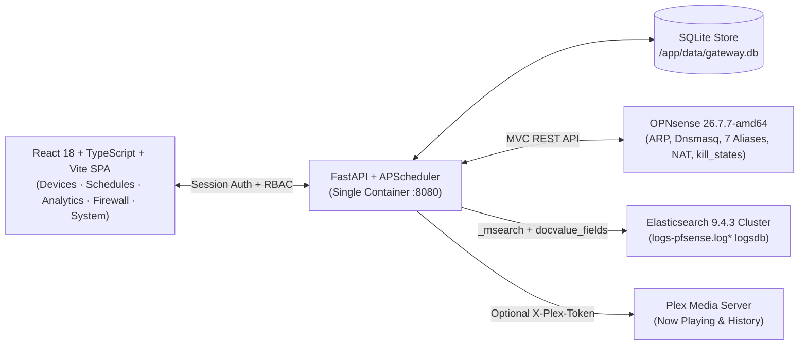

# Gateway Access Control & Analytics Portal (`v1.3.0`)

Self-hosted, single-container Dockerized web application (`http://localhost:8080`) for managing LAN device internet, application, quota, and schedule policies via **OPNsense (`26.7.7-amd64`)**, visualizing real-time network & security telemetry from **Elasticsearch (`9.4.3` — `logs-pfsense.log*` / Elastic `pfSense` Integration `1.25.4`)**, and tracking live media playback via **Plex Media Server**.

> **📖 User Manual & Wiki:** Browse the full step-by-step documentation directly on GitHub in [**`docs/wiki/Home.md`**](docs/wiki/Home.md):
> [Wiki Home](docs/wiki/Home.md) · [01. Installation & OPNsense Setup](docs/wiki/01-Installation-and-OPNsense-Setup.md) · [02. Devices, Groups & YouTube Quotas](docs/wiki/02-Devices-Groups-and-YouTube-Quotas.md) · [03. Timers & Recurring Schedules](docs/wiki/03-Timers-and-Recurring-Schedules.md) · [04. Analytics, 9-App Telemetry & Domain/ASN Blocking](docs/wiki/04-Analytics-App-Telemetry-and-Domain-ASN-Blocking.md) · [05. Firewall Inspector, GeoIP & WAN Blocking](docs/wiki/05-Firewall-Inspector-GeoIP-and-WAN-Blocking.md) · [06. System Admin, HA & Backups](docs/wiki/06-System-Administration-HA-and-Troubleshooting.md)

---

## System Architecture (`v1.3.0`)



---

## 1. Key Capabilities (`v1.3.0`)

### 1. Devices, Profiles & Daily YouTube Quotas ([User Manual](docs/wiki/02-Devices-Groups-and-YouTube-Quotas.md))
- **Live Discovery & IP-Drift Healing:** Auto-discovers LAN clients from OPNsense ARP (`get_arp`) and Dnsmasq DHCP leases (`/api/dnsmasq/leases/search`) keyed by MAC address, automatically migrating active firewall/YouTube rules when DHCP leases change.
- **Full Internet & Selective YouTube Blocking:** Toggle full WAN blocking (`gateway_blocked_devices`) or YouTube-only blocking (`gateway_youtube_blocked_devices` + `gateway_youtube_domains`) per device or group with instant active connection termination (`kill_states`), keeping Plex (`:32400`) and general browsing online.
- **Device Groups & Unified Controls:** Collapsible **Device Groups & Profiles** section with uniform `Filter`, `Analytics`, `YouTube`, `Timer`, and `Internet` controls, inline **`+ Group`** row assignment, and a **Current Group Members** card with 1-click removal inside the group editor.
- **Group Daily YouTube Time Quotas:** Configure `daily_youtube_limit_minutes` (`1–1440`) per group so background reconciliation automatically blocks YouTube once combined group watch time hits the daily cap—and automatically unblocks eligible members if you remove or raise the quota *(with strict Bonus Timer precedence)*.
- **Clean Inventory Views & Offline Archiving:** Defaults to a remembered `Online` filter (`localStorage`), unified **`Blocked`** filter *(internet + YouTube)*, clickable column sorting, mobile-compact table columns (`< 640px`), and **Archive / Restore / Delete** for offline devices.

### 2. Temporary Timers & Recurring Schedules ([User Manual](docs/wiki/03-Timers-and-Recurring-Schedules.md))
- **Pause & Bonus Reward Timers:** Centered timer modal supporting Pause presets (`15m`, `30m`, `1h`, `2h`, `Until 07:00`) and Bonus Reward presets (`20m`, `40m`, `60m`) plus custom durations (`1–1440` minutes), live countdown pills, and automatic expiration reconciliation every 60s.
- **7-Day / 24-Hour Weekly Coverage Timeline:** Interactive matrix displaying **Full Internet** vs. **YouTube-Only** windows, overnight splits, and snoozed intervals across Monday–Sunday.
- **Flexible Schedule Controls:** Create rules for Devices or Groups, switch targets while editing, **Clone** existing schedules, or **Snooze** active rules (`30m`, `60m`, `Skip Window`, or `Resume`).
- **Deterministic Policy Precedence:** `Protected Guardrail` -> `Bonus / Pause Timer Override` -> `Manual Block` -> `Group Daily YouTube Quota` -> `Active Recurring Schedule` -> `Default Allow`.

### 3. Network Analytics, 9-App Telemetry & Domain/ASN Blocking ([User Manual](docs/wiki/04-Analytics-App-Telemetry-and-Domain-ASN-Blocking.md))
- **High-Speed Multi-Window Telemetry:** Query **`Today`** *(default)*, `1h`, `24h`, `7d`, and `30d` windows backed by Elasticsearch `9.4.3` `_msearch` consolidation, `docvalue_fields`, breadth-first ordinal pruning, and background 180s cache pre-warming.
- **9-App Configurable Telemetry Catalog & Synced Modal:** Track active 5-minute usage slots across **YouTube**, **Plex**, **Netflix**, **Disney+**, **Twitch**, **TikTok**, **Discord**, **Facebook & Threads** *(combined `facebook.com`, `fbcdn.net`, `instagram.com`, `threads.*`, Meta ASN)*, and **Gaming**. Toggle enabled categories via the **`Configure Apps`** modal right inside **Application Usage Stats** *(bi-directionally synced with `System -> Application Telemetry Visibility`)*.
- **Plex *Now Playing* & Expanded App Detail Modal:** Click any Application Usage card across Overview, Device Drawer, or Group Drawer to view untruncated Plex stream cards (user, show/episode, player, resolution, transcode bitrate, playback progress `%`) and full per-device usage rankings.
- **Client Attribution & 1-Click Domain/ASN Blocking:** Click any FQDN, registered domain, or BGP ASN organization to see which LAN devices accessed it, and block domains or ASNs **per-device** or **globally** via OPNsense aliases (`gateway_custom_blocked_domains`, `gateway_custom_blocked_asns`, `gateway_custom_blocked_devices`).

### 4. Firewall Security Inspector, GeoIP Maps & WAN Blocking ([User Manual](docs/wiki/05-Firewall-Inspector-GeoIP-and-WAN-Blocking.md))
- **Noisy LAN & Open WAN Port D-NAT Visibility:** Compact **Noisy LAN** controls with an **`Inspect`** trigger opening `DeviceAnalyticsDrawer`, plus **Active Inbound WAN Exposure (Open Ports)** showing OPNsense D-NAT descriptions (*e.g., Plex Media Server, WireGuard VPN*) and `Last Seen` timestamps over a 30-day lookback.
- **External Connections Drawer & GeoIP Google Maps Links:** Inspect connecting WAN IPs per open port (Country summary bar, ISP/ASN, connection duration, TCP flags, TTL) and click any GeoIP badge on scanners or external sessions to open Google Maps centered with a marker pin in a new tab.
- **Persistent External WAN IP Blocklist (`gateway_wan_blocked_ips`):** Auto-provisioned on OPNsense at boot and managed via 1-click **`Block at WAN`** buttons or the dedicated **Blocked External WAN IPs** card (manual public IPv4 validation, click-to-filter IP pills, and 1-click **`Unblock`** backed by OPNsense config API + `alias_util` + `kill_states`).
- **Interactive Click-to-Filter Packet Log Explorer:** Click `Interface`, `Protocol`, `Source IP`, `Destination IP`, or `Port` cells in recent packet logs to stack removable filter chips, choose `50` / `100` / `250` rows, and export **CSV** or **JSON**.

### 5. System Admin, Multi-Node HA, UX Themes & Backups ([User Manual](docs/wiki/06-System-Administration-HA-and-Troubleshooting.md))
- **4-Service Live Health & Dynamic Versions:** Monitors **OPNsense**, **Elasticsearch** *(cluster health, node count, assigned/unassigned shards, total docs, per-node status)*, **Plex Media Server**, and **Local SQLite Store** *(WAL/SHM storage size & record counts)* with dynamic server version headers.
- **Multi-Node HA & Runtime Overrides:** Configure comma-separated cluster URLs for Elasticsearch and Plex (in `.env` or live inside **Integration Settings** encrypted in SQLite) and run **`Test All Connections`** with rounded multi-node averaged ping latency.
- **Multi-User RBAC, Security & Themes:** NGINX-style **First-Boot Admin Setup**, `Admin` vs. read-only `Operator` roles, **5 Dark-Room Color Themes** (`Default Slate`, `Crimson & Obsidian`, `Ocean & Navy`, `Emerald & Forest`, `Amber & Carbon`), centered **Change My Password** modal, sticky desktop header, mobile bottom navigation bar, and **`Ctrl+K` / `Cmd+K`** Global Quick Search.
- **Audit History & Config Backups:** Auto-loaded, paginated, CSV-exportable **Audit & Event History** *(including `DIAGNOSTIC_ERROR` and `PERFORMANCE_ANALYSIS` timing telemetry + pruning)* alongside **1-Click JSON Config Backup & Restore**.

---

## 2. Managed OPNsense Firewall Aliases

| Alias Name (Default `.env`) | Type | Managed By | Purpose |
| :--- | :---: | :--- | :--- |
| `gateway_blocked_devices` | `Host(s)` | `Devices`, `Timers`, `Schedules` | Full WAN internet block for LAN devices *(preserves local LAN & DHCP)*. |
| `gateway_youtube_blocked_devices` | `Host(s)` | `Devices`, `Schedules`, Group Quotas | Selective YouTube block for LAN devices *(keeps Plex & web open)*. |
| `gateway_youtube_domains` | `Host(s)` | Auto-provisioned (`13` FQDNs) | YouTube & Google Video FQDNs resolved via OPNsense `filterdns`. |
| `gateway_custom_blocked_domains` | `Host(s)` | `Analytics` Custom Blocking | Admin-blocked destination domains (`target_type: "domain"`). |
| `gateway_custom_blocked_asns` | `BGP ASN` | `Analytics` Custom Blocking | Admin-blocked destination BGP ASNs (`target_type: "asn"`). |
| `gateway_custom_blocked_devices` | `Host(s)` | `Analytics` Per-Device Blocking | LAN device IPs scoped to custom per-device domain/ASN rules. |
| `gateway_wan_blocked_ips` | `Host(s)` | Boot & `Firewall` WAN Blocking | Blocked external public WAN IPv4 addresses dropped at WAN ingress. |

See [`docs/API_KEYS_SETUP.md`](docs/API_KEYS_SETUP.md) for the complete OPNsense `svc_gateway_ui` least-privilege ACL list, LAN/WAN rule setup, Elasticsearch read-only API key instructions, and optional Plex token configuration.

---

## 3. Quick Start (Single-Container Docker Deployment)

1. **Prepare `.env` & OPNsense Rules:**
   - Follow [`docs/API_KEYS_SETUP.md`](docs/API_KEYS_SETUP.md) (Steps 1A–1F, Step 2A, and optional Section 3).
   - Copy [`.env.example`](.env.example) to `.env`, generate a 64-character hex `APP_SECRET_KEY`, and set your OPNsense and Elasticsearch credentials *(leave `ADMIN_PASSWORD` empty/placeholder to configure your admin password via the browser on first boot, or set it directly in `.env`)*.

2. **Build & Start the Container:**
   ```bash
   docker compose -f docker/docker-compose.yml --env-file .env up -d --build
   ```

3. **Open the Portal:**
   - Browse to **`http://localhost:8080`** and press `Ctrl+K` / `Cmd+K` anytime to search devices, groups, schedules, or tabs.
   - SQLite persistence lives on the mounted volume at `./data/gateway.db`.

---

## 4. Local Development & Quality Verification

- **Backend (`Python 3.12`, `pytest`, `ruff`, `mypy`):**
  ```bash
  pytest backend/tests --cov=app
  ruff check backend
  mypy backend/app
  ```
- **Frontend (`Node 22`, `Vitest`, `TypeScript`, `Vite`):**
  ```bash
  cd frontend
  npm test
  npm run build
  ```
- **`v1.3.0` Release Quality Gates Verified:** `156 / 156` backend tests (`85%` coverage, `0` ruff/mypy issues) and `45 / 45` frontend tests across `11` suites (`91.12%` coverage, `0` TypeScript/Vite build errors).

---

## 5. Documentation & Governance Index (`docs/`)

| Document | Description |
| :--- | :--- |
| [**`docs/wiki/Home.md`**](docs/wiki/Home.md) | Complete Multi-Page User Manual & Operational Wiki (`01` through `06`). |
| [`docs/API_KEYS_SETUP.md`](docs/API_KEYS_SETUP.md) | Least-privilege OPNsense ACLs (`svc_gateway_ui`), aliases, LAN/WAN firewall rules, Elasticsearch API key & Plex setup. |
| [`PLAN.md`](PLAN.md) | Master architecture & execution roadmap across `v1.0.x` (Phases 1–7), `v1.1.0` (Phases 8–11), `v1.2.x` (Phases 12–15.1), and `v1.3.0` (Phases 16–19). |
| [`docs/development/FEATURE_BACKLOG.md`](docs/development/FEATURE_BACKLOG.md) | Complete backlog of implemented and evaluated user requests (`FB-P4-*` through `FB-P19-*`). |
| [`docs/development/TEST_AND_BUG_LOG.md`](docs/development/TEST_AND_BUG_LOG.md) | Cumulative test & bug resolution ledger (`BUG-P1-*` through `BUG-P19-*`). |
| [`docs/development/PHASE_EXIT_REPORTS.md`](docs/development/PHASE_EXIT_REPORTS.md) | End-of-phase retrospectives, metrics, and unplanned-information audits across Phases 1–19. |
| [`docs/development/PHASE_1_TRACKING.md`](docs/development/PHASE_1_TRACKING.md) .. [`PHASE_19_TRACKING.md`](docs/development/PHASE_19_TRACKING.md) | Step-by-step phase execution and checkpoint trackers (`CP-1.*` – `CP-19.*`). |
| [`docs/development/Validation/`](docs/development/Validation/) | Live container UI validation sign-off checklists (`PHASE8-Verify.md` – `PHASE19-Verify.md`). |
