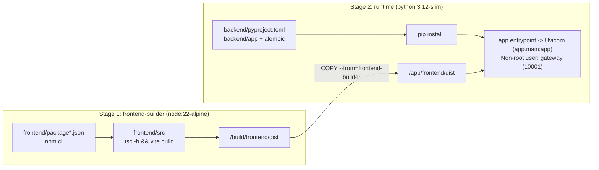

# Docker Packaging & Deployment Guide (`gateway-front-end`)

This directory contains all Docker-specific build and orchestration files for running the **Gateway Access Control & Telemetry Portal** as a single, self-hosted container.

---

## 1. Container Architecture Overview

The application is packaged using a two-stage build defined in [`Dockerfile`](Dockerfile):



1. **Stage 1 (`frontend-builder` — `node:22-alpine`):**
   - Installs deterministic frontend dependencies via `npm ci`.
   - Runs TypeScript type-checking (`tsc -b`) and compiles the optimized React 19 + Tailwind CSS v4 production bundle into `/build/frontend/dist`.
2. **Stage 2 (`runtime` — `python:3.12-slim`):**
   - Creates a dedicated non-root system user and group (`gateway`, `UID=10001`, `GID=10001`).
   - Installs the FastAPI backend (`uvicorn`, `pydantic-settings`, `sqlalchemy[asyncio]`, `aiosqlite`, `httpx`, `elasticsearch[async]`, `argon2-cffi`, `PyJWT`, `APScheduler`).
   - Copies only the compiled static assets (`/build/frontend/dist` → `/app/frontend/dist`), keeping Node.js and `node_modules` out of the final runtime image.
   - Runs `python -m app.entrypoint`, which ensures `/app/data` ownership for `gateway` (`10001:10001`), drops root privileges, and launches `uvicorn app.main:app --host 0.0.0.0 --port 8000` serving both:
     - REST API endpoints under `/api/v1/*`
     - Compiled React Single-Page Application (SPA) at `/` with client-side route fallback.

---

## 2. Files in This Directory

| File | Purpose |
| :--- | :--- |
| [`Dockerfile`](Dockerfile) | Multi-stage image build definition (`node:22-alpine` → `python:3.12-slim`). |
| [`docker-compose.yml`](docker-compose.yml) | Compose service definition using `context: ..`, `env_file: ../.env`, and volume `../data:/app/data`. |
| [`Dockerfile.dockerignore`](Dockerfile.dockerignore) / [`.dockerignore`](.dockerignore) | BuildKit context exclusion rules ensuring `.env`, `.git`, `.uv`, `.venv`, `node_modules`, and local `data/*.db` files are never copied into the image build context. |
| [`README.md`](README.md) | This Docker build, configuration, and operations guide. |

---

## 3. Prerequisites & `.env` Configuration

Before building or starting the container, ensure the hidden **`.env`** file exists in the **repository root** (`../.env`).

1. If you have not created `../.env` yet, copy the template from the repository root:
   ```bash
   cp .env.example .env
   ```
2. Populate all required secrets in `../.env` (see [`../docs/API_KEYS_SETUP.md`](../docs/API_KEYS_SETUP.md) for step-by-step instructions):
   - `APP_SECRET_KEY` — 64-character hex string (`32+` bytes) used to sign `HttpOnly` JWT session cookies.
   - `ADMIN_USERNAME` & `ADMIN_PASSWORD` — Built-in web administrator credentials (plaintext or `$argon2id$...` hash).
   - `OPNSENSE_BASE_URL` — Base URL of your OPNsense firewall (e.g., `https://opnsense.example.local`).
   - `OPNSENSE_API_KEY` & `OPNSENSE_API_SECRET` — Scoped `svc_gateway_ui` credentials.
   - `ELASTICSEARCH_URL` — Base URL of your Elasticsearch cluster (e.g., `https://elasticsearch.example.local:9200`).
   - `ELASTICSEARCH_API_KEY` — Read-only Base64-encoded API key scoped to `logs-pfsense.log*`.

> **Security Note:** The root `.env` file is excluded from Git via `../.gitignore` and excluded from the Docker build context via [`Dockerfile.dockerignore`](Dockerfile.dockerignore). Secrets are injected solely at container runtime via `env_file`.

---

## 4. Building & Running the Container

You can run Docker Compose either from inside the `docker/` folder or from the repository root.

### Option A: Run from inside the `docker/` directory
```bash
cd docker
docker compose up -d --build
```

### Option B: Run from the repository root directory (Recommended)
```bash
docker compose -f docker/docker-compose.yml --env-file .env up -d --build
```

### Option C: Standalone `docker build` & `docker run` (Without Compose)
From the repository root:
```bash
# 1. Build the image
docker build -f docker/Dockerfile -t gateway-front-end:latest .

# 2. Run the container
docker run -d \
  --name gateway-front-end \
  --restart unless-stopped \
  --env-file .env \
  -e SQLITE_DB_PATH=/app/data/gateway.db \
  -p 8080:8000 \
  -v "$(pwd)/data:/app/data" \
  gateway-front-end:latest
```

Once running, open **`http://localhost:8080`** (or the host's LAN IP/hostname on the configured `APP_PORT`) in your browser.

---

## 5. Persistent Storage, Permissions & Networking

### 5.1 SQLite Volume Persistence (`../data:/app/data`)
- The container stores its SQLite database at `/app/data/gateway.db` (mounted from `<repo-root>/data` on the host).
- On container startup, `app.entrypoint` automatically ensures `/app/data` is owned by `gateway` (`10001:10001`) before dropping root privileges.

### 5.2 Internal DNS Resolution (Optional)
- If your Docker daemon uses external DNS (e.g., `1.1.1.1` or `8.8.8.8`) and cannot resolve internal LAN hostnames for OPNsense or Elasticsearch, add `dns` or `extra_hosts` in [`docker-compose.yml`](docker-compose.yml):
  ```yaml
    dns:
      - 192.168.1.1
  ```

### 5.3 Custom Internal CA Certificates (Optional)
- If OPNsense or Elasticsearch uses an internal Root CA not present in Debian's default `ca-certificates` bundle:
  1. Mount your `.crt` file read-only into the container under `volumes:` in [`docker-compose.yml`](docker-compose.yml):
     ```yaml
     volumes:
       - ../data:/app/data
       - ../certs/internal-ca.crt:/app/certs/internal-ca.crt:ro
     ```
  2. Set `OPNSENSE_CA_CERT_PATH=/app/certs/internal-ca.crt` and/or `ELASTICSEARCH_CA_CERT_PATH=/app/certs/internal-ca.crt` in `../.env`.

---

## 6. Health Checks, Logs & Day-2 Operations

### Built-in Container Healthcheck
The container executes a lightweight liveness probe every `30s`:
- **Endpoint:** `GET http://127.0.0.1:8000/api/v1/system/ping`
- **Expected Response:** `200 OK` (`{"status": "ok", "version": "1.0.1"}`)
- **Deep Connectivity Health (Authenticated):** `GET /api/v1/system/health` (verifies SQLite, OPNsense API credentials/ARP/leases/block-alias, and Elasticsearch `9.4.3` `logs-pfsense.log*` status).

### Common Commands
```bash
# Check container status and healthcheck state
docker compose -f docker/docker-compose.yml --env-file .env ps

# Follow live application logs
docker compose -f docker/docker-compose.yml --env-file .env logs -f gateway-front-end

# Rebuild and restart after pulling updates
docker compose -f docker/docker-compose.yml --env-file .env up -d --build
```
