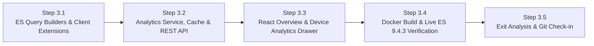

# Phase 3 Execution & Checkpoint Tracking (`PHASE_3_TRACKING.md`)

> **Phase:** 3 of 7 (Test Cycle 3 — Elasticsearch `9.4.3` Analytics: Usage Stats, Access Time & Visited Domains)  
> **Branch:** `phase3`  
> **Complexity Rating:** **3.5 / 5 (Medium–High)**  
> **Status:** `COMPLETE (Ready for Git Check-in)`  

---

## 1. Phase 3 Objectives & Waterfalled Inputs from Phases 1–2

1. **Elasticsearch `9.4.3` Analytics Engine (`logs-pfsense.log*` — `pfSense 1.25.4` Integration):**
   - **Waterfall Update 3A (Verified Provider & ECS Field Filters):**
     - Query `event.provider: "filterlog"` (`3.63M+` docs) for bandwidth (`network.bytes`), packet actions (`event.action: "pass" | "block"`), and destination ASN organization (`destination.as.organization.name`).
     - Query `event.provider: "unbound"` (`3.02M+` docs) for DNS domain resolution (`dns.question.name`, `dns.question.registered_domain`, `dns.question.subdomain` correlated by `source.ip` / `client.ip`).
   - **Waterfall Update 3B (SQLite Device Metadata Enrichment):**
     - Enrich top-device IP buckets (`source.ip` / `client.ip`) from Elasticsearch with local SQLite `Device` records (`id`, `effective_name`, `mac_address`, `vendor`, `is_blocked`, `is_online`), and return a clean zero-state payload when a device has no `ipv4_address`.
   - **Short-TTL In-Memory Cache & Graceful Fallback:**
     - Cache aggregation results for `20s` per query signature and ensure OPNsense blocking controls continue working normally even if Elasticsearch is temporarily unreachable (`degraded` banner instead of crashing).
2. **REST API Endpoints (`/api/v1/analytics/*` & `/api/v1/devices/{device_id}/analytics`):**
   - `GET /api/v1/analytics/overview?window=1h|24h|7d|30d`: Network-wide traffic volume (`network.bytes`), allowed vs. blocked packet timeline (`date_histogram`), Top Active Devices by bytes/events, Top Visited Domains (`dns.question.name` & `dns.question.registered_domain`), and Top Destination Organizations (`destination.as.organization.name`).
   - `GET /api/v1/devices/{device_id}/analytics?window=1h|24h|7d|30d&domain_search=...`:
     - **Usage Statistics:** Bytes transferred, total allowed vs. blocked events, and activity time-series histogram.
     - **Access Time (24-Hour Activity Profile):** Hourly distribution (`00:00`–`23:00` in configured `TZ`) showing exact hours of the day when the device is active online, plus first/last active timestamps in the window.
     - **Web Pages / Domains Visited:** Top queried domains (`dns.question.name` & `dns.question.registered_domain`), top destination ASN organizations (`destination.as.organization.name`), and a searchable chronological feed of recent DNS domain queries (`@timestamp`, `dns.question.name`, `dns.question.type`).
3. **React Analytics Views (`Recharts` + Interactive Device Detail Drawer):**
   - **Network Analytics Overview Tab / Panel:** Time-window selector (`Last 1h`, `24h`, `7d`, `30d`), network traffic & allowed/blocked timeline chart, Top Devices card, and Top Domains card.
   - **Interactive Device Detail Drawer:** Clicking any row (or **"View Usage & Domains"** button) in the Device Inventory opens a slide-over drawer displaying:
     - Instant Block/Unblock & Protection controls right in the drawer header.
     - **Usage Over Time** chart (`Recharts` area/bar chart).
     - **Access Time (Hourly Activity)** chart showing when the device is online across the day.
     - **Visited Domains & Destination Organizations** tables + live domain search input.

---

## 2. Step-by-Step Execution & Checkpoint Tracker

### Progress Summary Table

| Step | Checkpoint | Description | Status | Verified Date |
| :--- | :--- | :--- | :---: | :---: |
| **Step 3.1** | `CP-3.1` | `ElasticsearchClient` Aggregation Query Builders & Response Normalizers (`filterlog` + `unbound`) + Unit Tests | `[x] Complete` | 2026-10-31 |
| **Step 3.2** | `CP-3.2` | `AnalyticsService` (Device Enrichment + TTL Cache + Graceful Fallback) & `/api/v1/analytics` Endpoints + Unit Tests | `[x] Complete` | 2026-10-31 |
| **Step 3.3** | `CP-3.3` | React Network Overview Tab & Interactive Device Analytics Drawer (`Recharts`) + Unit Tests | `[x] Complete` | 2026-10-31 |
| **Step 3.4** | `CP-3.4` | Docker Container Rebuild (`http://localhost:8080`) & Live Elasticsearch `9.4.3` Smoke Verification | `[x] Complete` | 2026-10-31 |
| **Step 3.5** | `CP-3.5` | Phase 3 QA Gate, Bug Ledger, Exit Analysis, Learnings Checkpoint & Git Push | `[x] Complete` | 2026-10-31 |

---

## 3. Detailed Step Breakdown & Verification Checkpoints

### Step 3.1 — `ElasticsearchClient` Aggregation Query Builders & Response Normalizers
- **Tasks:**
  - [x] Add pure synchronous query-builder and response-normalizer functions in `backend/app/clients/elasticsearch.py` (following the Phase 2 `sys.monitoring` best practice):
    - Time-window bounds & interval mapping (`1h` → `5m` buckets, `24h` → `1h` buckets, `7d` → `6h` buckets, `30d` → `1d` buckets) with configured `TZ` support.
    - Network overview aggregation query (`filterlog` bytes/actions timeline, RFC1918 LAN `source.ip` top devices, top destination AS organizations; `unbound` top `dns.question.name` & `dns.question.registered_domain`).
    - Per-device aggregation & recent-domain query filtered by `source.ip` / `client.ip` / `destination.ip` (usage timeline, 24-hour-of-day access distribution, top domains, top destination orgs, and chronological domain feed with optional wildcard/substring filter).
  - [x] Write unit tests in `backend/tests/test_elasticsearch_analytics.py` testing query construction, timezone bucketing, response normalization with realistic `logs-pfsense.log*` fixtures, and error/timeout handling.
- **Checkpoint `CP-3.1` Verification Criteria:**
  - [x] `pytest backend/tests/test_elasticsearch_analytics.py` passes 100% with `>= 85%` coverage (`77/77` backend tests passing in `2.02s`, `97%` coverage on `app/clients/elasticsearch.py`, `95%` total backend coverage; `ruff` and `mypy` `0` errors).
  - [x] Any defects found are logged in `docs/TEST_AND_BUG_LOG.md`.

---

### Step 3.2 — `AnalyticsService`, TTL Cache & `/api/v1/analytics` REST API
- **Tasks:**
  - [x] Implement `backend/app/services/analytics_service.py`:
    - Short-TTL (`20s`) in-memory cache so rapid tab/window switches do not overload Elasticsearch.
    - Join top IP buckets with SQLite `Device` records (**Waterfall Update 3B**) and handle devices without an `ipv4_address`.
    - Graceful fallback (`es_reachable=False`, `warning` message, empty series) when Elasticsearch times out or returns `5xx`.
  - [x] Implement `backend/app/api/analytics.py`:
    - `GET /api/v1/analytics/overview`
    - `GET /api/v1/devices/{device_id}/analytics`
    - Register router in `backend/app/main.py`.
  - [x] Write unit tests in `backend/tests/test_analytics_api.py` covering authenticated access, SQLite device enrichment, zero-IP devices, TTL cache hit/expiration, and graceful ES degradation.
- **Checkpoint `CP-3.2` Verification Criteria:**
  - [x] `pytest backend/tests/` passes 100% with `>= 85%` coverage, and `ruff` + `mypy` report `0` errors (`79/79` backend tests passing in `2.02s`, `100%` coverage on `analytics_service.py` and `api/analytics.py`, `95%` total backend coverage).
  - [x] Any defects found are logged in `docs/TEST_AND_BUG_LOG.md`.

---

### Step 3.3 — React Network Analytics Overview & Interactive Device Detail Drawer (`Recharts`)
- **Tasks:**
  - [x] Extend `frontend/src/api/client.ts` with typed Analytics models (`TimeWindow`, `NetworkOverviewResponse`, `DeviceAnalyticsResponse`, `TimelineBucketItem`, `TopDomainItem`, `RecentDomainQueryItem`, `HourlyAccessPoint`, `formatBytes`) and client methods (`getNetworkOverview`, `getDeviceAnalytics`).
  - [x] Create `frontend/src/components/DeviceAnalyticsDrawer.tsx`:
    - Slide-over drawer for any selected device showing online/blocked/protected status, quick Block/Allow button, time-window selector (`1h`, `24h`, `7d`, `30d`), **Usage & Activity** chart, **24-Hour Access Time** chart, **Top Visited Domains** & **Top Destination Organizations**, and a searchable **Recent Domains Feed**.
  - [x] Create `frontend/src/pages/AnalyticsPage.tsx` (and add **Traffic & DNS Analytics** tab to `AppLayout.tsx` + **"Usage & Domains"** button on each device row in `DevicesPage.tsx`).
  - [x] Write frontend unit tests in `frontend/src/__tests__/Analytics.test.tsx`.
- **Checkpoint `CP-3.3` Verification Criteria:**
  - [x] `npm run test` (`Vitest --coverage`) and `npm run build` (`tsc -b && vite build`) pass with zero errors and `>= 85%` coverage (`10/10` frontend tests passing across 3 test suites, `95.71%` statement/line coverage, `0` build errors).
  - [x] Any defects found are logged in `docs/TEST_AND_BUG_LOG.md` (`BUG-P3-001`).

---

### Step 3.4 — Docker Container Rebuild & Live Elasticsearch `9.4.3` Smoke Verification
- **Tasks:**
  - [x] Rebuild and restart the Docker container (`docker compose -f docker/docker-compose.yml --env-file .env up -d --build`).
  - [x] Verify `/api/v1/analytics/overview` and `/api/v1/devices/{id}/analytics` inside the running container at `http://localhost:8080` against live Elasticsearch `9.4.3` (`https://elasticsearch.example.local:9200`, `logs-pfsense.log*`).
- **Checkpoint `CP-3.4` Verification Criteria:**
  - [x] Container reaches `healthy` status and user confirms live Usage Stats, Access Time charts, and Visited Domains at `http://localhost:8080`.

---

### Step 3.5 — Phase 3 QA Audit, Exit Analysis, Learnings Checkpoint & Git Check-in
- **Tasks:**
  - [x] Run full backend (`pytest --cov=app`, `ruff check`, `mypy`) and frontend (`vitest run --coverage`, `npm run build`) quality gates.
  - [x] Finalize all Phase 3 entries in `docs/TEST_AND_BUG_LOG.md`.
  - [x] Complete **Phase 3 Exit Report** in `docs/PHASE_EXIT_REPORTS.md` and waterfall any new findings into [PLAN.md](PLAN.md).
- **Checkpoint `CP-3.5` (Phase 3 Exit Sign-Off):**
  - [x] Review Phase 3 Exit Report with user, commit to `phase3` branch, merge to `main`, and push to GitHub.

