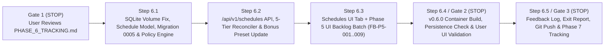

# Phase 6 Execution & Checkpoint Tracking (`docs/PHASE_6_TRACKING.md`)

> **Phase:** 6 of 7 (Test Cycle 6 — Control Feature #4: Recurring Schedules & Bedtime Rules + Phase 5 UI & Persistence Backlog Integration)  
> **Branch:** `phase6`  
> **Complexity Rating:** **4.5 / 5 (High)**  
> **Status:** `COMPLETE (v0.6.0)`  

---

## 1. Phase 6 Objectives & Waterfalled Inputs from Phases 1–5

### 1.1 Scheduled Phase 5 UI & Persistence Feedback Batch (`docs/FEATURE_BACKLOG.md` — Waterfall Update 6A)
1. **`FB-P5-001` (Centered Modal Dialog for Timer Controls):**
   - Replace the inline dropdown popover in `frontend/src/components/TimerPopoverMenu.tsx` with a **centered screen modal dialog** (`fixed inset-0 z-50 flex items-center justify-center bg-slate-950/75 p-4 backdrop-blur-xs`) so it is always visible without scrolling (even on the bottom row or when search filters the list to 1 item) and prevents multiple timer menus from opening simultaneously.
2. **`FB-P5-002` (Active Countdown & Mode Color Directly on the Timer Button):**
   - When a timer is active on a device or group, merge the live countdown directly into the **`Timer` button itself** (colored `amber` when Paused and `emerald` on Bonus Time, e.g., `Paused · 28m left` / `Bonus · 19m left`) instead of rendering a separate badge next to the button. Clicking the active button opens the centered Timer modal where the user can cancel or replace the active timer (in addition to an inline quick-cancel `X` icon).
3. **`FB-P5-003` (Duration-Only Preset Button Labels in Timer Modal):**
   - Change the preset buttons inside the Timer modal under **Pause Internet Access** and **Grant Bonus Access** to show **only the duration** (`15m`, `30m`, `1h`, `2h`, `Until 07:00` and `20m`, `40m`, `60m`) without repeating the word `Pause` or `Bonus` inside each button.
4. **`FB-P5-004` (Bonus Access Default Presets `20m`, `40m`, `60m`):**
   - Update Bonus Access preset buttons to **`20m`**, **`40m`**, and **`60m`**, and add `"20m": 20`, `"40m": 40`, `"60m": 60` to `PRESET_MINUTES` in `backend/app/services/timer_service.py` and `TimerPresetKey` in `frontend/src/api/client.ts`.
5. **`FB-P5-005` (Match Timer Button Height on Device Groups & Profiles Cards):**
   - Standardize the `Timer` button height and padding (`px-2.5 py-1.5 text-xs font-semibold`) to match the adjacent `Filter`, `Analytics`, `Allow All`, and `Block All` buttons on Group cards.
6. **`FB-P5-006` (Header `Logout` Button Label):**
   - Change the top header button in `frontend/src/components/AppLayout.tsx` from `Sign Out` to `Logout`.
7. **`FB-P5-007` (Stable Group Card `Filter` Button Layout):**
   - Keep the Group card `Filter` button text constant as `Filter` (`whitespace-nowrap`) and only toggle its highlighted active border/background (`border-indigo-400 bg-indigo-500/25 text-indigo-100`) so clicking `Filter` never widens the button or causes the Group card buttons to wrap/stack.
8. **`FB-P5-008` (Remove `(gateway_blocked_devices)` from Devices Header Description):**
   - Remove ``(`gateway_blocked_devices`)`` from the subtitle in `frontend/src/pages/DevicesPage.tsx`.
9. **`FB-P5-009` (24-Hour `Synced: HH:MM:SS` Clock Under `Sync from OPNsense` Button):**
   - Format `Synced: HH:MM:SS` using a 24-hour clock (`hour12: false`, single line, no `AM`/`PM`) and position it directly underneath the `Sync from OPNsense` button in the `DevicesPage.tsx` header.
10. **`FB-P5-010` (Persistent SQLite Volume Across Container Restarts & Rebuilds):**
    - Wire `SQLITE_DB_PATH` (`/app/data/gateway.db`) into `Settings.database_url` in `backend/app/config.py` (and set `DATABASE_URL=sqlite+aiosqlite:////app/data/gateway.db` in `docker/Dockerfile` and `docker/docker-compose.yml`) so SQLite writes to the host-mounted `<repo-root>\data\gateway.db` volume rather than `/app/backend/data/gateway.db`.
    - Add non-destructive startup schema migration helper in `backend/app/db/__init__.py` so adding columns/tables across phases preserves all existing devices, nicknames, groups, timers, and schedules.

---

### 1.2 Control Feature #4 — Recurring Schedules & Bedtime Rules (`schedules` + Policy Engine)
1. **Recurring Schedule Data Model (`RecurringSchedule` in `backend/app/models/__init__.py` + Alembic Migration `0005_phase6_schedules.py`):**
   - Assignable to either a **Single Device** (`target_type="device"`, `device_id`) or a **Device Group** (`target_type="group"`, `group_id`).
   - Fields:
     - `name` (e.g., *"School Night Bedtime"*, *"Weekend Late Night"*, *"Homework Focus Hours"*)
     - `description` (optional notes)
     - `target_type` (`"device"` | `"group"`), `device_id`, `group_id`
     - `days_of_week` (comma-separated ISO weekday indices `0..6` where `0=Mon .. 6=Sun`, e.g., `"0,1,2,3,6"` for Sun–Thu school nights)
     - `start_time` (`"HH:MM"` 24-hour local time, e.g., `"21:00"`)
     - `end_time` (`"HH:MM"` 24-hour local time, e.g., `"07:00"`)
     - `timezone` (IANA timezone string, defaults to `settings.tz`, e.g., `"America/Los_Angeles"`)
     - `is_enabled` (`bool`, default `True`)
     - `created_at`, `updated_at`
   - **Device Block-Source Tracking (`Device.is_manually_blocked` / `blocked_reason`):**
     - Distinguish between a **Manual Permanent Block** (`is_manually_blocked=True`) and an automated **Schedule Block** or **Timer Block**, so that when a recurring schedule window ends at `07:00`, devices blocked *only* by that schedule are automatically unblocked, while devices that were manually permanently blocked remain blocked.
2. **Overnight & Midnight-Spanning Window Evaluation (`ScheduleService`):**
   - Pure synchronous evaluator `is_schedule_window_active(days_of_week, start_time, end_time, tz_name, now_utc)`:
     - **Same-day window (`start_time < end_time`, e.g., `15:00`–`17:00`):** Active when local time `t` satisfies `start_time <= t < end_time` AND `local_dt.weekday()` is in `days_of_week`.
     - **Overnight window crossing midnight (`start_time > end_time`, e.g., `21:00`–`07:00`):**
       - Active during the **evening segment (`t >= 21:00`)** if **today's** weekday is in `days_of_week`.
       - Active during the **early-morning segment (`t < 07:00`)** if **yesterday's** weekday (`(weekday - 1) % 7`) is in `days_of_week` *(so a "Sun–Thu 21:00–07:00" rule blocks Thursday night `21:00` through Friday morning `07:00`, and does NOT block Friday night after `21:00`)*.
3. **Deterministic 5-Tier Policy Precedence Engine & DHCP IP Drift Reconciliation:**
   - Evaluated every 60 seconds (and immediately whenever a schedule, timer, or manual block is created/toggled/deleted):
     1. **Tier 1 — Protected Device / Protected IP (`is_protected` or in `OPNSENSE_PROTECTED_IPS`):** Always **Allowed**.
     2. **Tier 2 — Active Temporary Override (Phase 5 `TemporaryOverride`):**
        - If `mode == "bonus"` is active → **Allowed** *(lets an admin grant `20m`, `40m`, or `60m` Bonus Time during an active bedtime schedule without disabling the schedule!)*.
        - If `mode == "pause"` is active → **Blocked**.
     3. **Tier 3 — Manual Permanent Block (`is_manually_blocked == True`):** **Blocked** until manually unblocked by admin.
     4. **Tier 4 — Active Recurring Schedule Block Window:** If any enabled device or group schedule covering the device is currently active → **Blocked** (with `active_schedule` badge showing rule name and window end time). When the window ends and no higher tier blocks the device → **Automatically Unblocked**.
     5. **Tier 5 — Default Policy:** **Allowed**.
   - **DHCP IP Drift Sync:** If a blocked device's MAC address receives a new IPv4 lease from OPNsense ARP/Dnsmasq during sync/reconciliation, the policy engine removes the stale IPv4 from `gateway_blocked_devices`, adds the new IPv4, and runs `kill_states`.
4. **React Schedules Management Tab (`SchedulesPage.tsx` & `ScheduleFormModal.tsx`):**
   - New **Schedules** tab in the top navigation bar (`AppLayout.tsx`).
   - Visual schedule cards showing target badge (`Device` or `Group`), active/inactive status pill (`Active Now — Blocking until 07:00` vs. `Standby`), day-of-week pills (`M T W T F S S`), 24-hour time window (`21:00 → 07:00`), one-click Enable/Disable toggle switch, Edit button, and Delete button.
   - `ScheduleFormModal.tsx` with quick day presets (`School Nights (Sun–Thu)`, `Weekends (Fri–Sat)`, `Weekdays (Mon–Fri)`, `Every Day`), 24-hour time inputs, and target Device/Group selector.
   - Active Schedule badges on Device rows and Group cards in `DevicesPage.tsx`.

---

## 2. Step-by-Step Execution & Checkpoint Tracker

### Progress Summary Table

| Step | Checkpoint | Description | Status | Verified Date |
| :--- | :--- | :--- | :---: | :---: |
| **Step 6.1** | `CP-6.1` | Fix `SQLITE_DB_PATH` Persistence (`FB-P5-010`), `RecurringSchedule` Model, Migration `0005`, and `ScheduleService` 5-Tier Policy & Overnight Evaluator + Unit Tests | `[x] Complete` | 2026-11-01 |
| **Step 6.2** | `CP-6.2` | `/api/v1/schedules` CRUD & Reconcile Endpoints, 60s Unified Policy/IP-Drift Loop, and `20m`/`40m`/`60m` Bonus Presets (`FB-P5-004`) + Unit Tests | `[x] Complete` | 2026-11-01 |
| **Step 6.3** | `CP-6.3` | React `SchedulesPage`, `ScheduleFormModal`, Active Schedule Badges, and Phase 5 UI Backlog Batch (`FB-P5-001`..`009`) + Unit Tests | `[x] Complete` | 2026-11-01 |
| **Step 6.4** | `CP-6.4` | **Gate 2 (STOP for User UI Validation):** Bump to `v0.6.0`, Rebuild Docker Container, Verify Persistence Across Container Restart, and Prompt User for UI Validation | `[x] Complete` | 2026-11-01 |
| **Step 6.5** | `CP-6.5` | **Gate 3 (STOP Before Phase 7):** Log Phase 6 User Feedback in `docs/FEATURE_BACKLOG.md`, Complete Phase 6 Exit Report, Git Push `v0.6.0`, and Create `docs/PHASE_7_TRACKING.md` | `[x] Complete` | 2026-11-01 |

---

## 3. Detailed Step Breakdown & Verification Checkpoints

### Step 6.1 — SQLite Volume Persistence Fix (`FB-P5-010`), `RecurringSchedule` ORM Model, Migration `0005` & `ScheduleService` Policy Engine
- **Files to Create / Modify:**
  - `backend/app/config.py` & `docker/Dockerfile` & `docker/docker-compose.yml`:
    - Add `sqlite_db_path: str = ""` support in `Settings` so when `SQLITE_DB_PATH` is set (e.g., `/app/data/gateway.db`), `database_url` automatically resolves to `sqlite+aiosqlite:////app/data/gateway.db` unless `DATABASE_URL` is explicitly overridden (`FB-P5-010`).
  - `backend/app/db/__init__.py`:
    - Add non-destructive SQLite schema migration helper `_ensure_sqlite_columns()` inside `init_db()` so existing `/app/data/gateway.db` files on the mounted host volume seamlessly gain any newly added columns (`is_manually_blocked` on `devices`) without losing existing groups, nicknames, or devices.
  - `backend/app/models/__init__.py`:
    - Add `is_manually_blocked: Mapped[bool]` to `Device` (default `False`).
    - Add `RecurringSchedule` model (`schedules` table) and validation helpers (`parse_days_of_week`, `validate_time_hhmm`).
  - `backend/alembic/versions/0005_phase6_schedules.py`:
    - Alembic migration creating `schedules` table and adding `is_manually_blocked` to `devices`.
  - `backend/app/services/schedule_service.py`:
    - Pure synchronous helpers:
      - `is_schedule_window_active()` (handles same-day and midnight-spanning overnight windows + timezone/DST conversions).
      - `evaluate_device_effective_policy()` (implements the 5-Tier Precedence Matrix: `Protected -> Active Bonus/Pause Timer -> Manual Block -> Active Schedule -> Allowed`).
      - `detect_dhcp_ip_drift()` (identifies blocked devices whose IPv4 changed so old IPs are removed and new IPs are added to `gateway_blocked_devices`).
    - Async CRUD & reconciliation methods (`list_schedules`, `create_schedule`, `update_schedule`, `toggle_schedule`, `delete_schedule`, `reconcile_schedules_and_policies`).
  - `backend/tests/test_schedule_models_and_service.py`:
    - Unit tests covering overnight windows (`21:00`–`07:00` across all 7 weekdays), DST boundary transitions, the full 5-Tier Precedence Matrix, DHCP IP drift detection, and `SQLITE_DB_PATH` volume URL resolution (`FB-P5-010`).
- **Checkpoint `CP-6.1` Verification Criteria:**
  - `pytest backend/tests/test_schedule_models_and_service.py` passes 100% with `>= 85%` coverage and `0` `ruff`/`mypy` errors.

---

### Step 6.2 — `/api/v1/schedules` REST API, 60-Second Unified Reconciliation Loop & Bonus Preset Update (`FB-P5-004`)
- **Files to Create / Modify:**
  - `backend/app/services/timer_service.py`:
    - Add `"20m": 20`, `"40m": 40`, and `"60m": 60` to `PRESET_MINUTES` (`FB-P5-004`).
    - Ensure timer expiry (`reconcile_expired_overrides`) delegates to or coordinates with the 5-Tier Policy Evaluator so an expiring Bonus Timer during an active Bedtime Schedule immediately re-blocks the device, and an expiring Pause Timer only unblocks the device if no Manual Block or Active Schedule is currently blocking it.
  - `backend/app/services/device_service.py` & `backend/app/services/group_service.py`:
    - Attach `active_schedule: ActiveScheduleInfo | None = None` to `DeviceResponse` and `GroupResponse`.
    - Set `device.is_manually_blocked = True` on manual `block` and `False` on manual `unblock`.
  - `backend/app/api/schedules.py` & `backend/app/main.py`:
    - Implement `GET /api/v1/schedules`, `POST /api/v1/schedules`, `PUT /api/v1/schedules/{schedule_id}`, `PATCH /api/v1/schedules/{schedule_id}/toggle`, `DELETE /api/v1/schedules/{schedule_id}`, and `POST /api/v1/schedules/reconcile`.
    - Update the 60-second `APScheduler` job in `backend/app/main.py` to run both expired timer reconciliation and recurring schedule / policy reconciliation.
  - `backend/tests/test_schedules_api.py`:
    - API integration tests covering schedule CRUD, immediate OPNsense enforcement when creating/enabling an active schedule, granting Bonus Time during an active schedule, and automatic unblock when a schedule window ends.
- **Checkpoint `CP-6.2` Verification Criteria:**
  - Full backend suite (`pytest backend/tests/`) passes 100% with `>= 85%` coverage and `0` `ruff`/`mypy` errors.

---

### Step 6.3 — React `SchedulesPage`, `ScheduleFormModal` & Phase 5 UI Backlog Batch (`FB-P5-001` – `FB-P5-009`)
- **Files to Create / Modify:**
  - `frontend/src/api/client.ts`:
    - Add `ActiveScheduleInfo`, `ScheduleRule`, `ScheduleCreatePayload`, `ScheduleUpdatePayload`, `ScheduleListResponse`, `ScheduleReconcileResponse`, and schedule API methods (`getSchedules`, `createSchedule`, `updateSchedule`, `toggleSchedule`, `deleteSchedule`, `reconcileSchedules`).
    - Update `TimerPresetKey` to include `'20m' | '40m' | '60m'` (`FB-P5-004`).
  - `frontend/src/components/TimerPopoverMenu.tsx`:
    - **`FB-P5-001`:** Convert popover to a centered screen modal dialog (`fixed inset-0 z-50 flex items-center justify-center bg-slate-950/75 p-4 backdrop-blur-xs`).
    - **`FB-P5-002`:** Merge active countdown into the `Timer` button itself (`Paused · Xm left` in amber, `Bonus · Xm left` in emerald) with inline cancel (`X`) and modal cancel button.
    - **`FB-P5-003`:** Show duration-only button labels (`15m`, `30m`, `1h`, `2h`, `Until 07:00` and `20m`, `40m`, `60m`).
    - **`FB-P5-004`:** Use `20m`, `40m`, and `60m` for Bonus Access preset buttons.
    - **`FB-P5-005`:** Match button height (`px-2.5 py-1.5 text-xs font-semibold`) to Group card buttons.
  - `frontend/src/components/AppLayout.tsx` & `frontend/src/App.tsx`:
    - **`FB-P5-006`:** Change `Sign Out` button text to `Logout`.
    - Add `Schedules` tab (`schedules`) to the top navigation bar.
  - `frontend/src/pages/DevicesPage.tsx`:
    - **`FB-P5-007`:** Keep Group card `Filter` button text constant as `Filter` and only highlight its active border/background without changing button width or stacking.
    - **`FB-P5-008`:** Remove ``(`gateway_blocked_devices`)`` from the page subtitle.
    - **`FB-P5-009`:** Format `Synced: HH:MM:SS` as a 24-hour clock (`hour12: false`) on a single line directly beneath the `Sync from OPNsense` button.
    - Render `ActiveScheduleInfo` badges on Group cards and Device rows when a schedule is actively blocking a target.
  - `frontend/src/components/ScheduleFormModal.tsx` & `frontend/src/pages/SchedulesPage.tsx`:
    - Build the complete Recurring Schedules & Bedtime Rules management UI.
  - `frontend/src/__tests__/SchedulesAndFeedback.test.tsx` (and updates to `Timers.test.tsx` / `App.test.tsx` / `Groups.test.tsx`):
    - Unit tests verifying the centered Timer modal, unified active Timer button countdown, `20m`/`40m`/`60m` Bonus presets, `Logout` button, 24h `Synced:` clock, stable Group `Filter` button, and creating/toggling/deleting recurring schedules.
- **Checkpoint `CP-6.3` Verification Criteria:**
  - `Vitest --coverage` and `tsc -b && vite build` pass 100% with `>= 85%` coverage and `0` build errors.

---

### Step 6.4 (Gate 2 — STOP for User UI Validation) — Version Bump (`v0.6.0`), Container Rebuild & Persistence Verification
- **Tasks:**
  - [x] Bump version from `0.5.0` to `0.6.0` across `backend/app/__init__.py`, `backend/pyproject.toml`, and `frontend/package.json`.
  - [x] Rebuild and restart the Docker container (`docker compose -f docker/docker-compose.yml --env-file .env up -d --build`).
  - [x] Verify `/app/data/gateway.db` persists on host `<repo-root>\data\gateway.db` across a `docker compose restart` (`FB-P5-010`).
  - [x] **STOP & PROMPT USER** for live UI validation and feedback at `http://localhost:8080`.

---

### Step 6.5 (Gate 3 — STOP Before Phase 7) — Feedback Logging, Phase 6 Exit Report, Git Push & Phase 7 Tracking
- **Tasks:**
  - [x] Log all user Phase 6 feedback in `docs/FEATURE_BACKLOG.md` and update completed statuses for `FB-P5-001`..`FB-P5-010`.
  - [x] Finalize Phase 6 bug ledger in `docs/TEST_AND_BUG_LOG.md` and write the **Phase 6 Exit Analysis & Retrospective** in `docs/PHASE_EXIT_REPORTS.md`.
  - [x] Commit on `phase6`, merge `--no-ff` to `main`, tag `v0.6.0`, and push to GitHub.
  - [x] Create `docs/PHASE_7_TRACKING.md` and **STOP & PROMPT USER** to review before starting Phase 7.

