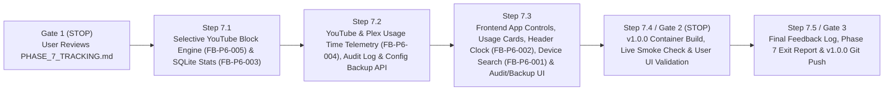

# Phase 7 Execution & Checkpoint Tracking (`docs/PHASE_7_TRACKING.md`)

> **Phase:** 7 of 7 (Test Cycle 7 — Selective Application Blocking [YouTube vs. Plex], YouTube/Plex Usage Time Telemetry, Audit Log, Config Backup/Restore & Phase 6 UI Backlog Integration)  
> **Branch:** `phase7`  
> **Complexity Rating:** **4 / 5 (Medium–High)**  
> **Status:** `COMPLETE (v1.0.0 Released)`  

---

## 1. Phase 7 Objectives & Scheduled Phase 6 Backlog Items

### 1.1 Scheduled Phase 6 User Feedback & Feature Requests (`docs/FEATURE_BACKLOG.md` — Waterfall Update 7A)
1. **`FB-P6-001` (Single-Device Search Input in New Schedule Modal):**
   - In [`frontend/src/components/ScheduleFormModal.tsx`](frontend/src/components/ScheduleFormModal.tsx), when `Apply Schedule To` is set to **Single Device**, render a live search field (`Search device by name, IP, hostname, or MAC...`) directly above the Target Device selector that filters the device list in real time and auto-selects the first matching device.
2. **`FB-P6-002` (Per-Second Live System Clock Below `Logout` Button in Top Header):**
   - In [`frontend/src/components/AppLayout.tsx`](frontend/src/components/AppLayout.tsx), add a live 1-second updating system clock (`HH:MM:SS` 24-hour monospace) positioned directly underneath the `Logout` button in the top-right header.
3. **`FB-P6-003` (System Connectivity Tab — `Local SQLite Store` Storage Size & Record Count Stats):**
   - Enhance `/api/v1/system/health` (`sqlite.details`) in [`backend/app/api/system.py`](backend/app/api/system.py) to report on-disk SQLite storage size (`storage_bytes` & `storage_size_formatted`, summing `gateway.db` + `-wal` + `-shm`) and total/per-table record counts (`total_records`, `devices_count`, `groups_count`, `timers_count`, `schedules_count`, `audit_logs_count`).
   - Display **Storage Size** and **Total Records** inside the `Local SQLite Store` service card on [`frontend/src/pages/StatusPage.tsx`](frontend/src/pages/StatusPage.tsx).
4. **`FB-P6-004` (Application Usage Stats — Active Usage Time Tracking for YouTube & Plex):**
   - Extend [`backend/app/clients/elasticsearch.py`](backend/app/clients/elasticsearch.py) and [`backend/app/services/analytics_service.py`](backend/app/services/analytics_service.py) with an **Application Usage Aggregator** over `logs-pfsense.log*`:
     - **YouTube Signature:** DNS queries (`event.dataset: "pfsense.unbound"`) matching `youtube.com`, `*.youtube.com`, `googlevideo.com`, `*.googlevideo.com`, `ytimg.com`, `*.ytimg.com`, `youtu.be`, `youtubei.googleapis.com`, `youtube-nocookie.com`.
     - **Plex Signature:** DNS queries matching `plex.tv`, `*.plex.tv`, `plex.direct`, `*.plex.direct`, `plex.bz`, `plexapp.com`, `*.plexapp.com` plus firewall events (`event.dataset: "pfsense.filterlog"`) on port `32400`.
     - **Active Time Calculation (`active_minutes`):** Bucket activity into 5-minute intervals (`fixed_interval: "5m"`) so each active 5m bucket contributes 5 minutes of active usage (`active_minutes = active_buckets * 5`), alongside `event_count`, `bytes`, and `last_active_at`.
   - Render **Application Usage (YouTube & Plex)** cards showing active usage time (e.g., `1h 20m` / `35m`), event counts, and bandwidth in:
     - [`DeviceAnalyticsDrawer.tsx`](frontend/src/components/DeviceAnalyticsDrawer.tsx)
     - [`GroupAnalyticsDrawer.tsx`](frontend/src/components/GroupAnalyticsDrawer.tsx)
     - [`AnalyticsPage.tsx`](frontend/src/pages/AnalyticsPage.tsx)
5. **`FB-P6-005` (Selective Application Blocking — Block YouTube While Allowing Plex & Everything Else):**
   - Add `is_youtube_blocked: Mapped[bool]` (default `False`) to `Device` in [`backend/app/models/__init__.py`](backend/app/models/__init__.py) (and non-destructive startup column migration in [`backend/app/db/__init__.py`](backend/app/db/__init__.py) + Alembic migration `0006_phase7_youtube_block.py`).
   - Extend [`OPNsenseClient`](backend/app/clients/opnsense.py) to manage OPNsense's selective YouTube block aliases:
     - `gateway_youtube_blocked_devices` (`host` alias containing IPv4s of devices with YouTube blocked)
     - `gateway_youtube_domains` (`host` alias containing YouTube FQDNs `youtube.com`, `www.youtube.com`, `m.youtube.com`, `youtu.be`, `googlevideo.com`, `ytimg.com`, `i.ytimg.com`, `s.ytimg.com`, `youtubei.googleapis.com`, `youtube-nocookie.com`)
     - Auto-ensures both aliases exist on OPNsense via `/api/firewall/alias/*` and adds/removes device IPs in `gateway_youtube_blocked_devices` via `/api/firewall/alias_util/*` + `kill_states`, leaving **Plex** (`plex.tv`, `plex.direct`, `:32400`) and all other internet traffic completely allowed!
   - Add REST endpoints:
     - `POST /api/v1/devices/{device_id}/youtube/block` & `/unblock`
     - `POST /api/v1/groups/{group_id}/youtube/block` & `/unblock`
   - Expose one-click **YouTube Block / Allow** controls on Device rows, Group cards, and inside the Analytics Drawer's **Application Usage & Control (YouTube & Plex)** panel.

---

### 1.2 Core Phase 7 Deliverables (Audit Log, Configuration Backup/Restore & `v1.0.0` Production Hardening)
1. **Audit & Event History API & UI (`GET /api/v1/audit-logs`):**
   - Filterable, paginated timeline of all administrative and automated actions (`admin`, `timer`, `schedule`, `system_reconcile`), including device/group internet blocks, YouTube blocks, timer expirations, schedule transitions, and DHCP IP-drift swaps, with automatic 90-day retention pruning.
2. **Configuration Export & Import (`GET /api/v1/system/backup` & `POST /api/v1/system/restore`):**
   - One-click JSON export and restore of local metadata (device nicknames, protection flags, YouTube block flags, device groups/memberships, and recurring schedules) without exposing `.env` secrets.
3. **Production Hardening & `v1.0.0` Release:**
   - Security response headers (`X-Content-Type-Options: nosniff`, `X-Frame-Options: DENY`, `Referrer-Policy: same-origin`), updated `README.md` runbook, and semantic version bump to `v1.0.0`.

---

## 2. Step-by-Step Execution & Checkpoint Tracker

### Progress Summary Table

| Step | Checkpoint | Description | Status | Verified Date |
| :--- | :--- | :--- | :---: | :---: |
| **Gate 1** | `GATE-7.0` | **Pre-Phase User Review Gate:** Review `docs/PHASE_7_TRACKING.md` and scheduled `FB-P6-001`..`005` items before starting Phase 7 | `[x] Complete` | 2026-11-01 |
| **Step 7.1** | `CP-7.1` | Selective YouTube Blocking Engine (`FB-P6-005`), Migration `0006`, OPNsense YouTube Aliases, and SQLite Storage/Record Telemetry (`FB-P6-003`) + Unit Tests | `[x] Complete` | 2026-11-01 |
| **Step 7.2** | `CP-7.2` | Elasticsearch YouTube & Plex Active Usage Time Aggregator (`FB-P6-004`), `/api/v1/audit-logs`, and `/api/v1/system/{backup,restore}` + Unit Tests | `[x] Complete` | 2026-11-01 |
| **Step 7.3** | `CP-7.3` | React YouTube Block Toggles, YouTube/Plex Usage Cards, Schedule Device Search (`FB-P6-001`), Per-Second Header Clock (`FB-P6-002`), SQLite Stats (`FB-P6-003`) & Audit/Backup UI + Unit Tests | `[x] Complete` | 2026-11-01 |
| **Step 7.4** | `CP-7.4` | **Gate 2 (STOP for User UI Validation):** Bump to `v1.0.0`, Rebuild Docker Container, Run Live Smoke Verification, and Prompt User for UI Validation | `[x] Complete` | 2026-11-01 |
| **Step 7.5** | `CP-7.5` | **Gate 3 (Final Release):** Process Final Feedback, Complete Phase 7 Exit Report & Project Retrospective, Commit/Merge/Tag `v1.0.0`, and Push to GitHub | `[x] Complete` | 2026-11-02 |

---

## 3. Detailed Step Breakdown & Verification Checkpoints

### Step 7.1 — Selective YouTube Blocking Engine (`FB-P6-005`) & SQLite Storage/Record Count Telemetry (`FB-P6-003`)
- **Files to Create / Modify:**
  - `backend/app/config.py`:
    - Add `opnsense_youtube_block_alias: str = "gateway_youtube_blocked_devices"` and `opnsense_youtube_domains_alias: str = "gateway_youtube_domains"`.
  - `backend/app/models/__init__.py`, `backend/app/db/__init__.py`, & `backend/alembic/versions/0006_phase7_youtube_block.py`:
    - Add `is_youtube_blocked: Mapped[bool]` (default `False`) to `Device` and non-destructive `ALTER TABLE devices ADD COLUMN is_youtube_blocked BOOLEAN NOT NULL DEFAULT 0` in `init_db()`.
  - `backend/app/clients/opnsense.py`:
    - Add `ensure_youtube_aliases_exist()`, `list_youtube_blocked_ips()`, `add_ip_to_youtube_block_alias(ip)`, and `remove_ip_from_youtube_block_alias(ip)`.
  - `backend/app/services/device_service.py`, `backend/app/services/group_service.py`, `backend/app/api/devices.py`, & `backend/app/api/groups.py`:
    - Add `is_youtube_blocked` to `DeviceResponse` and `youtube_blocked_devices` / `youtube_status` to `GroupResponse`.
    - Implement `block_device_youtube`, `unblock_device_youtube`, `block_group_youtube`, and `unblock_group_youtube` endpoints (`POST /api/v1/devices/{id}/youtube/block`, `/unblock`, `POST /api/v1/groups/{id}/youtube/block`, `/unblock`).
  - `backend/app/api/system.py`:
    - Enhance `_probe_sqlite()` (`FB-P6-003`) to calculate on-disk SQLite storage size (`storage_bytes`, `storage_size_formatted`) and record counts (`total_records`, `devices_count`, `groups_count`, `timers_count`, `schedules_count`, `audit_logs_count`).
  - `backend/tests/test_youtube_block_and_sqlite_stats.py`:
    - Unit tests covering single-device and group YouTube block/unblock, OPNsense alias auto-provisioning, and SQLite storage size / record count telemetry.
- **Checkpoint `CP-7.1` Verification Criteria:**
  - `pytest backend/tests` passes 100% with `>= 85%` coverage and `0` `ruff`/`mypy` errors.

---

### Step 7.2 — YouTube & Plex Active Usage Time Telemetry (`FB-P6-004`), Audit Logs & Config Backup/Restore API
- **Files to Create / Modify:**
  - `backend/app/clients/elasticsearch.py` & `backend/app/services/analytics_service.py`:
    - Add `app_usage` sub-aggregation (`youtube` and `plex` filter buckets with 5-minute `date_histogram`, `sum(network.bytes)`, and `max(@timestamp)`) to `query_device_analytics`, `query_group_analytics`, and `query_network_overview`.
    - Return `application_usage: list[AppUsageItem]` (`app_key: "youtube" | "plex"`, `display_name: "YouTube" | "Plex"`, `active_minutes: int`, `event_count: int`, `dns_queries: int`, `bytes: int`, `last_active_at: str | None`) on `DeviceAnalyticsResponse`, `GroupAnalyticsResponse`, and `NetworkOverviewResponse`.
  - `backend/app/services/audit_and_backup_service.py` & `backend/app/api/system.py`:
    - Implement `GET /api/v1/audit-logs` (filterable by `actor`, `action`, `search`, `limit`), automatic 90-day audit log pruning, `GET /api/v1/system/backup` (exports devices metadata, groups, and schedules as portable JSON), and `POST /api/v1/system/restore` (non-destructively restores nicknames, protection flags, YouTube block flags, groups, and schedules).
  - `backend/tests/test_app_usage_audit_and_backup.py`:
    - Unit tests verifying YouTube & Plex active minutes computation, audit log filtering/pruning, and JSON configuration backup & restore.
- **Checkpoint `CP-7.2` Verification Criteria:**
  - `pytest backend/tests` passes 100% with `>= 85%` coverage and `0` `ruff`/`mypy` errors.

---

### Step 7.3 — Frontend YouTube Block Controls, YouTube/Plex Usage Cards, UI Backlog (`FB-P6-001`..`003`) & Audit/Backup UI
- **Files to Create / Modify:**
  - `frontend/src/api/client.ts`:
    - Add `AppUsageItem`, `AuditLogItem`, `AuditLogListResponse`, `ConfigBackupPayload`, `ConfigRestoreResponse`, and API methods (`blockDeviceYoutube`, `unblockDeviceYoutube`, `blockGroupYoutube`, `unblockGroupYoutube`, `getAuditLogs`, `exportBackup`, `restoreBackup`).
  - `frontend/src/components/AppLayout.tsx` (`FB-P6-002`):
    - Add live 1-second updating system clock (`HH:MM:SS` 24-hour monospace, `data-testid="header-system-clock"`) directly below the `Logout` button.
  - `frontend/src/components/ScheduleFormModal.tsx` (`FB-P6-001`):
    - Add a device search input (`data-testid="schedule-device-search"`) directly above the Target Device selector when creating a single-device schedule.
  - `frontend/src/pages/DevicesPage.tsx`:
    - Add one-click **YouTube Allowed / YouTube Blocked** toggle button on Device rows and Group cards so admins can block YouTube while keeping Plex and general internet allowed (`FB-P6-005`).
  - `frontend/src/components/DeviceAnalyticsDrawer.tsx`, `frontend/src/components/GroupAnalyticsDrawer.tsx`, & `frontend/src/pages/AnalyticsPage.tsx` (`FB-P6-004` & `FB-P6-005`):
    - Render the **Application Usage & Control (YouTube & Plex)** panel displaying active usage time (`Xh Ym` / `Zm`), query/packet counts, bandwidth, and a direct **Block YouTube / Allow YouTube** button inside the drawer.
  - `frontend/src/pages/StatusPage.tsx` (`FB-P6-003` + Audit Log & Backup/Restore):
    - Display **Storage Size** and **Total Records** inside the `Local SQLite Store` service card (`FB-P6-003`).
    - Add the **Configuration Backup & Restore** panel and **Audit & Event History** filterable table.
  - `frontend/src/__tests__/Phase7Features.test.tsx`:
    - Frontend unit tests covering all `FB-P6-001`..`005` features, YouTube block toggles, YouTube/Plex usage cards, SQLite stats, and Audit/Backup UI.
- **Checkpoint `CP-7.3` Verification Criteria:**
  - `Vitest --coverage` and `tsc -b && vite build` pass 100% with `>= 85%` coverage and `0` build errors.

---

### Step 7.4 (Gate 2 — STOP for User UI Validation) — Version Bump (`v1.0.0`), Container Rebuild & Live Smoke Check
- **Tasks:**
  - [ ] Bump version from `0.6.0` to `1.0.0` across `backend/app/__init__.py`, `backend/pyproject.toml`, and `frontend/package.json`.
  - [ ] Rebuild and restart the Docker container (`docker compose -f docker/docker-compose.yml --env-file .env up -d --build`).
  - [ ] Run automated container smoke verification (`/api/v1/system/health` `version == "1.0.0"`, SQLite storage/record metrics, YouTube block endpoints, YouTube/Plex usage stats, `/api/v1/audit-logs`, `/api/v1/system/backup`).
  - [ ] **STOP & PROMPT USER** for live UI validation and feedback at `http://localhost:8080`.

---

### Step 7.5 (Gate 3 — Final Project Release) — Feedback Log, Phase 7 Exit Report & `v1.0.0` Git Push
- **Tasks:**
  - [ ] Process any final user feedback, complete the **Phase 7 Exit Report & Project Retrospective** in `docs/PHASE_EXIT_REPORTS.md`, update `README.md`, commit on `phase7`, merge `--no-ff` to `main`, tag `v1.0.0`, and push to GitHub.

