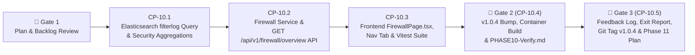

# Phase 10 Execution & Checkpoint Tracking (`docs/development/PHASE_10_TRACKING.md`)

> **Target Version:** `v1.0.4` (Third Phase of the `v1.1` Release Cycle)  
> **Branch:** `phase10`  
> **Phase Status:** `COMPLETE (v1.0.4 — Merged & Tagged)`

---

## 1. Phase 10 Objectives & Scheduled Backlog Items (`FB-P10-001`)

Phase 10 delivers a dedicated **`Firewall & Security` Navigation Tab (`FB-P10-001`)** powered by the live Elasticsearch 9.4.3 `logs-pfsense.log*` (`filterlog`) stream so administrators and operators can inspect firewall activity, identify noisy LAN devices or external scanners (with 1-click LAN device blocking), audit active inbound WAN port exposures, and search/filter firewall packet logs:

| Backlog ID | Target Area | Summary of Deliverable |
| :--- | :--- | :--- |
| **`FB-P10-001`** | `backend/app/clients/elasticsearch.py`, `backend/app/services/firewall_service.py`, `backend/app/api/firewall.py`, `frontend/src/pages/FirewallPage.tsx`, `frontend/src/components/AppLayout.tsx` | **Dedicated `Firewall & Security` Tab (`v1.0.4`):** 1. **Firewall Activity KPI Summary:** Total Firewall Packets, Allowed (`pass`) Packets, Blocked (`block`/`reject`) Packets + `(XX.X%)`, Inbound vs. Outbound packet split, and Unique External Source IPs across `1h`, `24h`, `7d`, and `30d` windows. 2. **Firewall Activity Timeline Bar Graph:** `Allowed` vs. `Blocked` packet timeline bar chart using `TelemetryBarChart` (with `Stacked \| Total` view toggle and visible X/Y axis labels). 3. **Side-by-Side Security Insights Panels:** &nbsp;&nbsp;• **Noisy / Blocked LAN Devices & Suspected Scanners:** Top internal LAN devices triggering blocked firewall packets (correlated with SQLite device names and a **1-Click Block Device** action button) + Top external WAN source IPs probing/blocked at the perimeter. &nbsp;&nbsp;• **Active Inbound WAN Exposure (Open Ports):** Aggregated table of external public WAN -> internal destination `IP:Port` (`network.transport` + `destination.ip` + `destination.port`) connections where `event.action == "pass"`, highlighting potentially dangerous or unintended open inbound ports. 4. **Searchable & Filterable Firewall Log Explorer:** Paginated/recent `filterlog` event table searchable by IP, port, protocol (`tcp`/`udp`/`icmp`), interface (`lan`/`wan`), direction (`in`/`out`), and action (`pass`/`block`), with `Updated: HH:MM:SS` below the Refresh button. |

*(Note on `FB-P9-005` / `BUG-P9-002` from Phase 9 Gate 2)*: Direct **Plex Media Server API (`X-Plex-Token`) Integration** for Tautulli-style per-device streaming telemetry has been logged in [`docs/development/FEATURE_BACKLOG.md`](file:///d:/source/gateway-front-end/docs/development/FEATURE_BACKLOG.md) as a dedicated future feature (`v1.2` / post-`v1.1`) per user direction.

---

## 2. Phase 10 Workflow & Checkpoint Summary Table

| Step | Checkpoint ID | Description | Status | Completed Date |
| :--- | :--- | :--- | :---: | :---: |
| **Step 10.1** | `CP-10.1` | Elasticsearch `filterlog` Query Builder & Security Aggregations (KPIs, Timeline, Bad Actors/Scanners, Inbound WAN Open Ports & Searchable Events) | `[x] Complete` | `2026-11-04` |
| **Step 10.2** | `CP-10.2` | Firewall Analytics Service (SQLite Device Name/Status Correlation) & `/api/v1/firewall/overview` FastAPI Router + Backend Unit Tests (`pytest`, `ruff`, `mypy`) | `[x] Complete` | `2026-11-04` |
| **Step 10.3** | `CP-10.3` | Frontend `FirewallPage.tsx` (`Firewall & Security` Tab, KPIs, Timeline Bar Graph, Bad Actors with 1-Click Block, Inbound WAN Open Ports, Searchable Log Table) + `Vitest` Suite | `[x] Complete` | `2026-11-04` |
| **Step 10.4** | `CP-10.4` | **🛑 GATE 2:** Bump Version to `1.0.4`, Rebuild Docker Container, Live Smoke Check & Publish `docs/development/Validation/PHASE10-Verify.md` | `[x] Complete` | `2026-11-04` |
| **Step 10.5** | `CP-10.5` | **🛑 GATE 3:** Log User Feedback from `PHASE10-Verify.md`, Phase 10 Exit Report, Merge/Tag `v1.0.4`, Push to GitHub & Create `docs/development/PHASE_11_TRACKING.md` | `[x] Complete` | `2026-11-06` |

---

## 3. Detailed Step-by-Step Breakdown

### Step 10.1 (`CP-10.1`) — Elasticsearch `filterlog` Query Builder & Security Aggregations
- **Files to Modify:**
  - [`backend/app/clients/elasticsearch.py`](file:///d:/source/gateway-front-end/backend/app/clients/elasticsearch.py):
    - Add pure synchronous query/extraction helpers `_build_firewall_overview_query()` and `_extract_firewall_overview_response()` plus async method `ElasticsearchServiceClient.query_firewall_overview()`:
      - Filter `logs-pfsense.log*` where `process.name: "filterlog"` (or `event.dataset: "pfsense.firewall"`) within the requested time window (`1h`, `24h`, `7d`, `30d`), plus optional filters (`action`: `all` | `pass` | `block`, `direction`: `all` | `in` | `out`, `protocol`: `all` | `tcp` | `udp` | `icmp`, and free-text `search` across `source.ip`, `destination.ip`, `destination.port`, `observer.ingress.interface.name`, and `rule.description`).
      - Compute aggregations for:
        1. **Summary KPIs:** `total_packets`, `allowed_packets`, `blocked_packets`, `inbound_packets`, `outbound_packets`, `total_bytes`.
        2. **Timeline Buckets:** `allowed_packets`, `blocked_packets`, `total_events`, `bytes` over time.
        3. **Top Blocked / Noisy LAN Sources:** Internal RFC1918 `source.ip` buckets ordered by blocked packet count (with total events, bytes, top destination ports).
        4. **Top Blocked External Scanners:** Non-RFC1918 public `source.ip` buckets blocked inbound on WAN (with ASN organization `source.as.organization.name`, packet count, and targeted destination ports).
        5. **Active Inbound WAN Exposure (Open Ports):** Passed (`event.action: "pass"`) traffic from external public `source.ip` (`!RFC1918`) to internal destination IP/Port (`destination.ip` + `destination.port` + `network.transport`), showing packet count, bytes, unique external sources, and last seen timestamp.
        6. **Recent Searchable Firewall Events (`hits`):** Up to 100 recent matching `filterlog` records (`timestamp`, `action`, `direction`, `interface`, `protocol`, `source_ip`, `source_port`, `destination_ip`, `destination_port`, `bytes`, `rule_label`).

### Step 10.2 (`CP-10.2`) — Firewall Service & `/api/v1/firewall/overview` Endpoint
- **Files to Create / Modify:**
  - [`backend/app/services/firewall_service.py`](file:///d:/source/gateway-front-end/backend/app/services/firewall_service.py):
    - Correlate LAN `source.ip` and `destination.ip` addresses in the Firewall Overview response with SQLite `Device` inventory (`device_id`, `effective_name`, `mac_address`, `is_blocked`, `is_protected`, `is_online`) so operators can see friendly device names and trigger 1-click device blocks directly from the Firewall tab.
  - [`backend/app/api/firewall.py`](file:///d:/source/gateway-front-end/backend/app/api/firewall.py) & [`backend/app/main.py`](file:///d:/source/gateway-front-end/backend/app/main.py):
    - Register `GET /api/v1/firewall/overview` accepting `window`, `action`, `direction`, `protocol`, `search`, and `refresh`.
  - [`backend/tests/test_phase10_firewall.py`](file:///d:/source/gateway-front-end/backend/tests/test_phase10_firewall.py):
    - Unit and integration tests for `_build_firewall_overview_query`, `_extract_firewall_overview_response`, LAN vs. WAN RFC1918 classification, open port exposure extraction, SQLite device correlation, and `/api/v1/firewall/overview`.
- **Verification Criteria (`CP-10.1` & `CP-10.2`):**
  - `pytest backend/tests --cov=app` (`100%` pass, `>= 85%` coverage), `ruff check backend` (`0` errors), `mypy backend/app` (`0` issues).

### Step 10.3 (`CP-10.3`) — Frontend `FirewallPage.tsx`, Navigation Tab & `Vitest` Suite
- **Files to Create / Modify:**
  - [`frontend/src/api/client.ts`](file:///d:/source/gateway-front-end/frontend/src/api/client.ts):
    - Add TypeScript interfaces (`FirewallOverviewResponse`, `FirewallKpiSummary`, `FirewallBadActorItem`, `FirewallExternalScannerItem`, `FirewallOpenPortExposureItem`, `FirewallLogEventItem`) and `apiClient.getFirewallOverview()`.
  - [`frontend/src/components/AppLayout.tsx`](file:///d:/source/gateway-front-end/frontend/src/components/AppLayout.tsx) & [`frontend/src/App.tsx`](file:///d:/source/gateway-front-end/frontend/src/App.tsx):
    - Add the **`Firewall & Security`** (`'firewall'`) navigation tab in the top navigation bar.
  - [`frontend/src/pages/FirewallPage.tsx`](file:///d:/source/gateway-front-end/frontend/src/pages/FirewallPage.tsx):
    - Build the complete Firewall & Security view:
      - Window selector (`1h`, `24h`, `7d`, `30d`), `Refresh Firewall` button, and `Updated: HH:MM:SS` indicator.
      - 4 KPI cards: **Total Firewall Packets**, **Passed Packets**, **Blocked Packets** (with `(XX.X%)`), and **Inbound / Outbound Split & Active WAN Ports**.
      - **Firewall Activity Timeline** bar chart (`TelemetryBarChart` with `Stacked | Total` toggle and X/Y axes).
      - Side-by-side **Security Insights** panels:
        1. **Noisy / Blocked LAN Devices & External Scanners** (with 1-click **Block Device** / **Allowed** toggle for LAN devices).
        2. **Active Inbound WAN Exposure (Passed External to Internal Ports)** highlighting open ports reachable from the WAN.
      - **Searchable Firewall Log Explorer** with search input (`IP, port, interface...`), action filter (`All`, `Passed`, `Blocked`), direction filter (`All`, `Inbound`, `Outbound`), protocol filter (`All`, `TCP`, `UDP`, `ICMP`), and chronological packet table.
  - [`frontend/src/__tests__/Phase7Features.test.tsx`](file:///d:/source/gateway-front-end/frontend/src/__tests__/Phase7Features.test.tsx):
    - Add unit tests verifying `FirewallPage` rendering, KPIs, timeline chart, 1-click LAN device block from the Bad Actors panel, Inbound WAN Open Ports table, and log filtering.
- **Verification Criteria (`CP-10.3`):**
  - `npm test` (`100%` pass, `>= 85%` coverage) and `npm run build` (`0` errors).

### Step 10.4 (`CP-10.4` — 🛑 GATE 2) — Version Bump (`1.0.4`), Container Rebuild & `PHASE10-Verify.md`
- Increment version to `1.0.4` in `backend/app/__init__.py`, `backend/pyproject.toml`, and `frontend/package.json`.
- Rebuild and restart Docker container (`docker compose -f docker/docker-compose.yml --env-file .env up -d --build`).
- Run live container smoke check verifying `/api/v1/system/health` (`1.0.4`) and `/api/v1/firewall/overview`.
- Create [`docs/development/Validation/PHASE10-Verify.md`](file:///d:/source/gateway-front-end/docs/development/Validation/PHASE10-Verify.md) and **STOP** for user live UI validation.

### Step 10.5 (`CP-10.5` — 🛑 GATE 3) — Feedback Logging, Phase 10 Exit Report, Git Tag `v1.0.4` & Phase 11 Tracking
- Process user feedback from `PHASE10-Verify.md`, update `FEATURE_BACKLOG.md` and `TEST_AND_BUG_LOG.md`, append Phase 10 Exit Report to `PHASE_EXIT_REPORTS.md`, merge/tag `v1.0.4`, push to GitHub, and create `docs/development/PHASE_11_TRACKING.md`.

