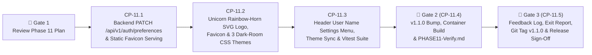

# Phase 11 Execution & Checkpoint Tracking (`docs/development/PHASE_11_TRACKING.md`)

> **Target Version:** `v1.1.0` (Fourth & Final Phase of the `v1.1` Release Cycle)  
> **Branch:** `phase11`  
> **Phase Status:** `COMPLETE (v1.1.0 — Merged & Tagged)`

---

## 1. Phase 11 Objectives & Scheduled Backlog Items (`FB-P11-001`, `FB-P11-002`)

Phase 11 completes the **`v1.1.0` Release** by delivering the custom **Side-Profile Unicorn with Rainbow Horn Logo & Browser Favicon (`FB-P11-001`)** and the **Clickable Header User Name Settings Menu with 3 Eye-Friendly Dark-Room Color Themes (`FB-P11-002`)**:

| Backlog ID | Target Area | Summary of Deliverable |
| :--- | :--- | :--- |
| **`FB-P11-001`** | `frontend/public/unicorn-favicon.svg`, `frontend/index.html`, `frontend/src/components/UnicornLogo.tsx`, `frontend/src/components/AppLayout.tsx`, `frontend/src/pages/LoginPage.tsx` | **Side-Profile Unicorn with Rainbow Horn Logo & Browser Favicon (`v1.1.0`):** 1. Create a crisp vector SVG (`UnicornLogo.tsx` & `frontend/public/unicorn-favicon.svg`) depicting a clean side-profile silhouette of a unicorn head with a multi-stop rainbow gradient horn (`red -> orange -> amber -> emerald -> cyan -> indigo -> violet`). 2. Replace the shield icon in the top navigation bar (`AppLayout.tsx`) and on the Login / First-Boot Setup screen (`LoginPage.tsx`) with `<UnicornLogo />`. 3. Wire `<link rel="icon" type="image/svg+xml" href="/unicorn-favicon.svg" />` in `frontend/index.html` and configure FastAPI (`backend/app/main.py`) to serve `/unicorn-favicon.svg` so the rainbow-horned unicorn appears next to the page title in browser tabs. |
| **`FB-P11-002`** | `backend/app/api/auth.py`, `backend/app/services/user_service.py`, `frontend/src/index.css`, `frontend/src/context/AuthContext.tsx`, `frontend/src/components/AppLayout.tsx` | **Clickable Header User Name Menu & 3 Eye-Friendly Dark-Room Color Themes (`v1.1.0`):** 1. **Backend Self-Service Preference Endpoint (`PATCH /api/v1/auth/preferences`):** Allow any authenticated user (`admin` or `operator`) to persist their chosen `theme_preference` (`"default"` \| `"crimson"` \| `"ocean"`) in SQLite (`User.theme_preference`), refresh the session cookie, and record an audit log entry. 2. **3 Dark-Room-Friendly Color Themes (`index.css` & `data-theme` attribute on `<html>`):** &nbsp;&nbsp;• **`Default Slate` (`default`):** Existing dark slate (`#020617` / `#0f172a`) with soft indigo/cyan accents. &nbsp;&nbsp;• **`Crimson & Obsidian` (`crimson`):** Deep obsidian/charcoal backgrounds (`#090507` / `#130b0e` / `#1d1115`) with warm muted crimson & rose accents (`#e11d48` / `#f43f5e` / `#fda4af`) tuned for zero neon glare in a dark room. &nbsp;&nbsp;• **`Ocean & Navy` (`ocean`):** Deep midnight navy backgrounds (`#040b16` / `#0a1526` / `#102038`) with soft ocean blue & sky accents (`#0284c7` / `#38bdf8` / `#7dd3fc`). 3. **Clickable User Name Menu in Top Header (`AppLayout.tsx`):** Make the signed-in user's badge (`admin` / username) in the top-right header clickable to open a **User Settings Popover** displaying account role and interactive theme cards (`Default Slate`, `Crimson & Obsidian`, `Ocean & Navy`) that apply immediately and persist across reloads/logins. |

---

## 2. Phase 11 Workflow & Checkpoint Summary Table

| Step | Checkpoint ID | Description | Status | Completed Date |
| :--- | :--- | :--- | :---: | :---: |
| **Step 11.1** | `CP-11.1` | Backend Self-Service Theme Preference Endpoint (`PATCH /api/v1/auth/preferences`) & `/unicorn-favicon.svg` Static Asset Route + `pytest` Suite | `[x] Complete` | `2026-11-06` |
| **Step 11.2** | `CP-11.2` | Custom Side-Profile Unicorn with Rainbow Horn Component (`UnicornLogo.tsx`), Browser Favicon (`unicorn-favicon.svg`), and 3 Eye-Friendly Dark-Room CSS Themes (`index.css`) | `[x] Complete` | `2026-11-06` |
| **Step 11.3** | `CP-11.3` | Clickable Header User Name Settings Menu (`AppLayout.tsx`), Real-Time Theme Switching (`AuthContext.tsx`), and Frontend `Vitest` Suite | `[x] Complete` | `2026-11-06` |
| **Step 11.4** | `CP-11.4` | **🛑 GATE 2:** Bump Version to `1.1.0`, Rebuild Docker Container, Live Smoke Check & Publish `docs/development/Validation/PHASE11-Verify.md` | `[x] Complete` | `2026-11-06` |
| **Step 11.5** | `CP-11.5` | **🛑 GATE 3:** Process User Feedback from `PHASE11-Verify.md`, Phase 11 Exit Report, Merge/Tag `v1.1.0`, and Push Release to GitHub | `[x] Complete` | `2026-11-06` |

---

## 3. Detailed Step-by-Step Breakdown

### Step 11.1 (`CP-11.1`) — Backend Self-Service Theme Preference Endpoint & Static Favicon Route
- **Files to Modify:**
  - [`backend/app/services/user_service.py`](file:///d:/source/gateway-front-end/backend/app/services/user_service.py):
    - Add `UserPreferencesUpdatePayload(BaseModel)` validating `theme_preference: Literal["default", "crimson", "ocean"]` and pure/async helper `update_current_user_preferences()` that updates `User.theme_preference` in SQLite (or creates/updates the user row if authenticated via fallback), records an `AuditLog` (`USER_MGMT`), and returns the updated `theme_preference`.
  - [`backend/app/api/auth.py`](file:///d:/source/gateway-front-end/backend/app/api/auth.py):
    - Add `PATCH /api/v1/auth/preferences` (protected by `require_admin_session` so both `admin` and `operator` users can save their own theme preference), re-issue the signed session cookie with the new `theme_preference`, and return `AuthUserResponse`.
  - [`backend/app/main.py`](file:///d:/source/gateway-front-end/backend/app/main.py):
    - Serve `/unicorn-favicon.svg` from `frontend/dist/unicorn-favicon.svg` alongside `/assets` and SPA routes.
  - [`backend/tests/test_phase9_users_settings_audit.py`](file:///d:/source/gateway-front-end/backend/tests/test_phase9_users_settings_audit.py) (or `backend/tests/test_phase11_branding_themes.py`):
    - Add unit and API tests verifying `PATCH /api/v1/auth/preferences` for valid themes (`default`, `crimson`, `ocean`), invalid theme rejection (`422`), persistence across `GET /api/v1/auth/me`, and `/unicorn-favicon.svg` serving.
- **Verification Criteria (`CP-11.1`):**
  - `pytest backend/tests --cov=app` (`100%` pass, `>= 85%` coverage), `ruff check backend` (`0` errors), `mypy backend/app` (`0` issues).

### Step 11.2 (`CP-11.2`) — Side-Profile Unicorn with Rainbow Horn Logo, Browser Favicon & 3 Dark-Room CSS Themes
- **Files to Create / Modify:**
  - [`frontend/public/unicorn-favicon.svg`](file:///d:/source/gateway-front-end/frontend/public/unicorn-favicon.svg) & [`frontend/index.html`](file:///d:/source/gateway-front-end/frontend/index.html):
    - Create the vector SVG browser tab icon featuring a dark rounded badge, crisp side-profile unicorn head/mane silhouette, and vibrant rainbow-gradient horn (`#ff4d6d`, `#ff9e00`, `#ffd166`, `#06d6a0`, `#4cc9f0`, `#7209b7`).
    - Link `/unicorn-favicon.svg` in `frontend/index.html`.
  - [`frontend/src/components/UnicornLogo.tsx`](file:///d:/source/gateway-front-end/frontend/src/components/UnicornLogo.tsx):
    - Reusable React SVG component (`data-testid="unicorn-logo"`) rendering the side-profile unicorn with a rainbow-gradient horn for the top header (`AppLayout.tsx`) and login card (`LoginPage.tsx`).
  - [`frontend/src/index.css`](file:///d:/source/gateway-front-end/frontend/src/index.css):
    - Define eye-friendly dark-room color overrides triggered by `html[data-theme="crimson"]` (**Crimson & Obsidian** — soft dark red, warm rose highlights, and deep obsidian/black surfaces) and `html[data-theme="ocean"]` (**Ocean & Navy** — soft ocean blue, sky highlights, and deep midnight navy surfaces) while preserving semantic status indicators (emerald online/allowed, amber warning, rose blocked) and comfortable contrast for dark-room viewing.

### Step 11.3 (`CP-11.3`) — Clickable Header User Name Menu, Theme Persistence & `Vitest` Suite
- **Files to Modify:**
  - [`frontend/src/api/client.ts`](file:///d:/source/gateway-front-end/frontend/src/api/client.ts) & [`frontend/src/context/AuthContext.tsx`](file:///d:/source/gateway-front-end/frontend/src/context/AuthContext.tsx):
    - Add `ThemePreference = 'default' | 'crimson' | 'ocean'` and `apiClient.updateUserPreferences({ theme_preference })`.
    - In `AuthContext.tsx`, synchronize `document.documentElement.dataset.theme` (`default` | `crimson` | `ocean`) and `localStorage.getItem('gateway_theme_preference')` with `user.theme_preference`, and expose `updateThemePreference(theme)`.
  - [`frontend/src/components/AppLayout.tsx`](file:///d:/source/gateway-front-end/frontend/src/components/AppLayout.tsx) & [`frontend/src/pages/LoginPage.tsx`](file:///d:/source/gateway-front-end/frontend/src/pages/LoginPage.tsx):
    - Replace `<Shield />` brand icons with `<UnicornLogo />`.
    - Convert the signed-in user badge in `AppLayout.tsx` (`data-testid="header-user-menu-button"`) into an interactive button that opens a **User Settings Popover** (`data-testid="header-user-menu-popover"`) showing the user's name, role badge, and the 3 selectable color theme options (`Default Slate`, `Crimson & Obsidian`, `Ocean & Navy`) with color swatch previews.
  - [`frontend/src/__tests__/Phase7Features.test.tsx`](file:///d:/source/gateway-front-end/frontend/src/__tests__/Phase7Features.test.tsx):
    - Add unit tests verifying `<UnicornLogo />` rendering in `AppLayout` and `LoginPage`, opening the User Settings menu by clicking the user's name in the header, switching between `Default Slate`, `Crimson & Obsidian`, and `Ocean & Navy`, verifying `document.documentElement.dataset.theme` updates immediately, and confirming `apiClient.updateUserPreferences` is called.
- **Verification Criteria (`CP-11.3`):**
  - `npm test` (`100%` pass, `>= 85%` coverage) and `npm run build` (`0` errors).

### Step 11.4 (`CP-11.4` — 🛑 GATE 2) — Version Bump (`1.1.0`), Container Rebuild & `PHASE11-Verify.md`
- Increment version to `1.1.0` across `backend/app/__init__.py`, `backend/pyproject.toml`, and `frontend/package.json` (plus any version assertions in tests).
- Rebuild and restart the Docker container (`docker compose -f docker/docker-compose.yml --env-file .env up -d --build`).
- Run live container smoke check verifying `/api/v1/system/health` (`version == "1.1.0"`), `/unicorn-favicon.svg`, and `PATCH /api/v1/auth/preferences`.
- Update `docs/development/FEATURE_BACKLOG.md` statuses for `FB-P11-001` and `FB-P11-002` to `COMPLETED (Phase 11 — v1.1.0)`.
- Create [`docs/development/Validation/PHASE11-Verify.md`](file:///d:/source/gateway-front-end/docs/development/Validation/PHASE11-Verify.md) and **STOP** for user live UI validation.

### Step 11.5 (`CP-11.5` — 🛑 GATE 3) — Feedback Logging, Phase 11 Exit Report & Git Tag `v1.1.0`
- Process user feedback from `PHASE11-Verify.md`, append Phase 11 Exit Report to `PHASE_EXIT_REPORTS.md`, update `PLAN.md`, merge `phase11` (`--no-ff`) into `main`, create annotated release tag `v1.1.0`, and push to GitHub.

