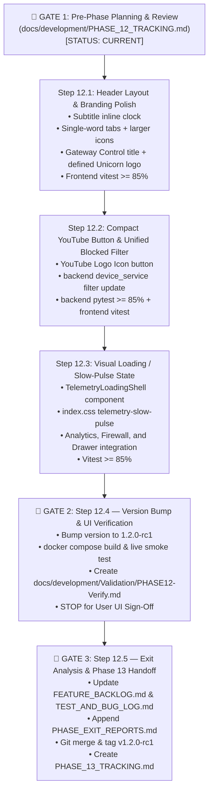

# Phase 12 Execution & Checkpoint Tracker (`PHASE_12_TRACKING.md`)

> **Phase 12 Goal:** Implement streamlined top header alignment with inline subtitle clock, single-word navigation tabs with larger icons, concise `Gateway Control` branding with inline version badge and defined Unicorn logo, compact YouTube logo toggle button on device rows, unified `Blocked` status filter including YouTube-blocked devices, and a greyed-out slow-pulse loading/refreshing visual state for analytics windows (`FB-P11-005`, `FB-P11-006`, `FB-P11-007`).

---

## 1. Phase Objectives & Scheduled Backlog Items

- [x] **`FB-P11-005` — Top Header Layout, Alignment, Single-Word Tab Labels, Streamlined Title & Defined Unicorn Icon:**
  - Relocate the `HH:MM:SS` clock from underneath the `Logout` button to inline next to the subtitle: `Access & Telemetry Portal  v1.2.0-rc1 • HH:MM:SS` under `Gateway Control`.
  - Align `Logout`, the User Name menu button, the `HEALTHY` status badge, and the Navigation tabs on a single shared vertical center line (`items-center`).
  - Shorten navigation tabs to single-word labels with larger icons (`h-4.5 w-4.5`): **`Devices`**, **`Schedules`**, **`Analytics`**, **`Firewall`**, and **`System`**.
  - Change brand title from `OPNsense Gateway Control` to **`Gateway Control`**, remove `OPNsense 26.7.7 & Elasticsearch 9.4.3` from subtitle, keep **`Access & Telemetry Portal`**, and place the version badge inline with the subtitle.
  - Enlarge `<UnicornLogo />` container (`h-11 w-11`) with a defined border and crisp silhouette outline so the unicorn profile and rainbow horn stand out distinctly.
- [x] **`FB-P11-006` — Compact YouTube Logo Toggle Button & Unified `Blocked` Filter:**
  - Replace the wide `YT Allowed` / `YT Blocked` text button on device rows with a compact YouTube Logo Icon Button that is vivid red/bright when allowed and dim/muted when blocked.
  - Update `device_service.py` and `DevicesPage.tsx` so the `Blocked` status filter pill in `Devices & Access Control` returns devices that have either full internet blocked (`is_blocked === true`) or YouTube blocked (`is_youtube_blocked === true`).
- [x] **`FB-P11-007` — Visual Loading / Refreshing State for Analytics Windows:**
  - Create a reusable telemetry loading/refreshing shell and `@keyframes telemetry-slow-pulse` in `index.css` applying `opacity-45 saturate-50 pointer-events-none` with a subtle floating `Refreshing telemetry…` indicator during queries/refetches across `AnalyticsPage`, `FirewallPage`, `DeviceAnalyticsDrawer`, and `GroupAnalyticsDrawer`.

---

## 2. Mermaid Workflow & Checkpoint Progress

| Checkpoint | Target Description | Status |
| :--- | :--- | :--- |
| **`CP-12.1`** | Top header layout, inline subtitle clock, single-word tabs, larger icons, streamlined title, and defined Unicorn logo (`FB-P11-005`). | [x] Complete |
| **`CP-12.2`** | Compact YouTube logo toggle button & unified `Blocked` filter including YouTube-blocked devices (`FB-P11-006`). | [x] Complete |
| **`CP-12.3`** | Visual loading/refreshing state with slow pulse and dimming across Analytics, Firewall, and Drawers (`FB-P11-007`). | [x] Complete |
| **`CP-12.4`** | Version increment to `1.2.0-rc1`, Docker container rebuild, and creation of `PHASE12-Verify.md` (Gate 2). | [x] Complete |
| **`CP-12.5`** | Feedback audit, `PHASE_EXIT_REPORTS.md`, Git check-in/tag, and Phase 13 handoff (Gate 3). | [x] Complete |

---

## 3. Step-by-Step Execution Plan

### Step 12.1: Header Layout, Streamlined Branding, Single-Word Tabs & Defined Unicorn Logo (`FB-P11-005`)
- **Files to Modify:**
  - `frontend/src/components/AppLayout.tsx`
  - `frontend/src/components/UnicornLogo.tsx`
  - `frontend/src/tests/AppLayout.test.tsx`
  - `frontend/src/tests/UnicornLogo.test.tsx`
- **Implementation:**
  - Remove the vertical flex column under `Logout` so `Logout`, user menu button, and health badge sit side-by-side on the same baseline.
  - Place `systemClock` inline next to the subtitle: `Access & Telemetry Portal` `v{version}` `•` `{systemClock}`.
  - Shorten navigation tabs to `Devices`, `Schedules`, `Analytics`, `Firewall`, `System` and increase icon size to `h-4.5 w-4.5`.
  - Enlarge `<UnicornLogo />` container to `h-11 w-11` and add a subtle dark contrast stroke to the SVG unicorn silhouette.
- **Verification:**
  - `npm test` (`vitest run --coverage` >= 85%) and `npm run build` (`0` TypeScript errors).

### Step 12.2: Compact YouTube Logo Toggle Button & Unified `Blocked` Filter (`FB-P11-006`)
- **Files to Modify:**
  - `frontend/src/components/YouTubeLogoIcon.tsx` (new component)
  - `frontend/src/pages/DevicesPage.tsx`
  - `backend/app/services/device_service.py`
  - `backend/tests/test_devices.py`
  - `frontend/src/tests/DevicesPage.test.tsx`
- **Implementation:**
  - Create `<YouTubeLogoIcon />` rendering the classic YouTube play icon.
  - Replace the text button in `DevicesPage.tsx` with a compact button: vivid red/bright when allowed, dim/muted slate when blocked.
  - Update `list_devices()` in `device_service.py` for `status_filter == "blocked"` to include `or_(Device.is_blocked.is_(True), Device.is_youtube_blocked.is_(True))`.
  - Update device status filter counts in `DevicesPage.tsx` so the `Blocked` pill count reflects the union of full-internet and YouTube-blocked devices.
- **Verification:**
  - `pytest backend/tests/test_devices.py --cov=app` >= 85%
  - `npm test frontend/src/tests/DevicesPage.test.tsx` >= 85%

### Step 12.3: Visual Loading / Refreshing State for Analytics Windows (`FB-P11-007`)
- **Files to Modify:**
  - `frontend/src/index.css`
  - `frontend/src/components/TelemetryLoadingShell.tsx` (new component)
  - `frontend/src/pages/AnalyticsPage.tsx`
  - `frontend/src/pages/FirewallPage.tsx`
  - `frontend/src/components/DeviceAnalyticsDrawer.tsx`
  - `frontend/src/components/GroupAnalyticsDrawer.tsx`
  - `frontend/src/tests/TelemetryLoadingShell.test.tsx`
- **Implementation:**
  - Add `@keyframes telemetry-slow-pulse` and `.telemetry-loading-pulse` class to `index.css`.
  - Create `<TelemetryLoadingShell isFetching={...} isLoading={...}>` displaying a soft greyed-out pulsing effect and floating `Refreshing telemetry from Elasticsearch…` badge.
  - Wrap metric grids and chart panels in `AnalyticsPage.tsx`, `FirewallPage.tsx`, `DeviceAnalyticsDrawer.tsx`, and `GroupAnalyticsDrawer.tsx`.
- **Verification:**
  - `npm test` (`vitest run --coverage` >= 85%) and `npm run build` (`0` TypeScript errors).

### Step 12.4: Version Bump, Container Rebuild & Live Validation (Gate 2)
- Increment version to `1.2.0-rc1` across:
  - `backend/app/__init__.py`
  - `backend/pyproject.toml`
  - `frontend/package.json`
- Rebuild container: `docker compose -f docker/docker-compose.yml --env-file .env up -d --build`.
- Verify container health on `0.0.0.0:8080->8000/tcp`.
- Create `docs/development/Validation/PHASE12-Verify.md` with structured verification checklist.
- **STOP & PROMPT USER** for live UI review.

### Step 12.5: Feedback Ingestion, Exit Retrospective & Phase 13 Handoff (Gate 3)
- Process user feedback from `PHASE12-Verify.md`.
- Update `docs/development/FEATURE_BACKLOG.md` and `docs/development/TEST_AND_BUG_LOG.md`.
- Append Phase 12 Exit Retrospective to `docs/development/PHASE_EXIT_REPORTS.md`.
- Commit on `phase12`, merge `--no-ff` into `main`, tag `v1.2.0-rc1`, and push.
- Create `docs/development/PHASE_13_TRACKING.md` and stop for Gate 1 review.

