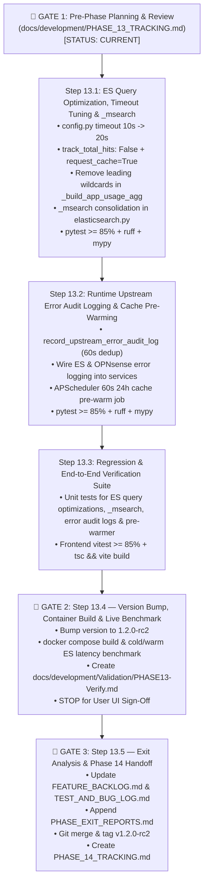

# Phase 13 Execution & Checkpoint Tracker (`PHASE_13_TRACKING.md`)

> **Phase 13 Goal (`v1.2.0-rc2`):** Eliminate cold-load Elasticsearch query timeouts on `Analytics` by adding `track_total_hits: False` and `request_cache=True`, removing redundant leading-wildcard scans in `_build_app_usage_agg()`, consolidating multi-query searches via Elasticsearch `_msearch`, tuning default `ELASTICSEARCH_TIMEOUT_SECONDS` from `10.0s` to `20.0s`, automatically logging runtime Elasticsearch and OPNsense errors/timeouts into SQLite `audit_logs` (`System` tab), and adding background APScheduler cache pre-warming for `24h` Network & Firewall Overviews (`FB-P11-003`, `BUG-P11-001`, `FB-P11-008` Proposals A & B).

---

## 1. Phase Objectives & Scheduled Backlog Items

- [x] **`FB-P11-003` (`BUG-P11-001`) — Elasticsearch Cold-Load Query Optimization & Timeout Tuning:**
  - Increase default `ELASTICSEARCH_TIMEOUT_SECONDS` from `10.0s` to **`20.0s`** in [`backend/app/config.py`](../../backend/app/config.py).
  - Update `build_network_overview_query()`, `build_device_analytics_query()`, and `build_group_analytics_query()` in [`backend/app/clients/elasticsearch.py`](../../backend/app/clients/elasticsearch.py) to set `"track_total_hits": False` and derive `summary.total_events` from the sum of `timeline` / `by_provider` bucket `doc_count`s (eliminating full-shard document scoring across `1,638` shards).
  - Pass `params={"request_cache": "true"}` on all aggregation requests (`fetch_network_overview`, `fetch_device_analytics`, `fetch_group_analytics`, `fetch_device_activity_summary`).
  - Remove the expensive leading-wildcard term scans (`*.googlevideo.com` and `*plex*`) from `_build_app_usage_agg()`, relying on indexed `keyword` `terms` filters on `dns.question.registered_domain` (`youtube.com`, `youtu.be`, `googlevideo.com`, `plex.tv`, `plex.direct`, `plex.bz`, `plexapp.com`) and `destination.port: 32400`.
- [x] **`FB-P11-008` (Proposal B) — Elasticsearch `_msearch` Single-Round-Trip Consolidation:**
  - Consolidate paired `aggs` + `recent_queries` / `recent_events` calls in `ElasticsearchServiceClient` (`fetch_device_analytics`, `fetch_group_analytics`) into single `/_msearch` HTTP round-trips (with graceful fallback to `/_search`), cutting HTTP/TLS round-trips in half.
- [x] **`FB-P11-003` — Automatic Runtime Upstream Error Logging into `System` Audit & Event History:**
  - Add a throttled/deduplicated helper `record_upstream_error_audit_log()` in [`backend/app/services/audit_and_backup_service.py`](../../backend/app/services/audit_and_backup_service.py) (with a 60-second per-service/operation deduplication window so rapid polling during an outage does not flood SQLite).
  - Whenever runtime calls to Elasticsearch or OPNsense raise `ElasticsearchClientError` or `OPNsenseClientError` (including timeouts) across `analytics_service.py`, `firewall_service.py`, `device_service.py`, `group_service.py`, `timer_service.py`, or `schedule_service.py`, automatically persist an `AuditLog` entry with `audit_label="DIAGNOSTIC_ERROR"` and `action="upstream.elasticsearch.error"` or `"upstream.opnsense.error"` so all upstream failures are visible in the `System` tab's **Audit & Event History** table.
- [x] **`FB-P11-008` (Proposal A) — Background APScheduler Cache Pre-Warming (`24h` Overview & Firewall):**
  - Register a lightweight periodic background task (every 60 seconds) in [`backend/app/main.py`](../../backend/app/main.py) that pre-warms the default `24h` `NetworkOverview` and `FirewallOverview` caches in the background so user navigation to `Analytics` or `Firewall` responds in `< 15 ms` from warm cache with zero cold-load latency.

---

## 2. Mermaid Workflow & Checkpoint Progress

| Checkpoint | Target Description | Status |
| :--- | :--- | :--- |
| **`CP-13.1`** | Elasticsearch cold-load query optimization (`track_total_hits: False`, `request_cache=True`, wildcard removal), `_msearch` consolidation, and default timeout bump (`10.0s -> 20.0s`) (`FB-P11-003`, `FB-P11-008` Proposal B). | `[x] Complete` |
| **`CP-13.2`** | Automatic runtime Elasticsearch & OPNsense error logging into SQLite `audit_logs` (`DIAGNOSTIC_ERROR`) and APScheduler `24h` cache pre-warming (`FB-P11-003`, `FB-P11-008` Proposal A). | `[x] Complete` |
| **`CP-13.3`** | Full backend & frontend unit test suite (`pytest >= 85%`, `ruff`, `mypy`, `vitest >= 85%`, `npm run build`). | `[x] Complete` |
| **`CP-13.4`** | Version increment to `1.2.0-rc2`, Docker container rebuild, live ES cold/warm latency benchmark, and `PHASE13-Verify.md` (Gate 2). | `[x] Complete` |
| **`CP-13.5`** | Feedback audit, `PHASE_EXIT_REPORTS.md`, Git check-in/tag, and Phase 14 handoff (Gate 3). | `[x] Complete` |

---

## 3. Detailed Step-by-Step Breakdown

### Step 13.1: Elasticsearch Cold-Load Optimization, Timeout Tuning & `_msearch` Consolidation
- **Files to Modify:**
  - `backend/app/config.py`
  - `backend/app/clients/elasticsearch.py`
  - `backend/tests/test_config.py`
  - `backend/tests/test_elasticsearch_analytics.py`
- **Implementation Details:**
  1. In `backend/app/config.py`, change `elasticsearch_timeout_seconds` default from `10.0` to `20.0`.
  2. In `backend/app/clients/elasticsearch.py`:
     - Set `"track_total_hits": False` in `build_network_overview_query()`, `build_device_analytics_query()`, and `build_group_analytics_query()`.
     - Update `normalize_network_overview_response()`, `normalize_device_analytics_response()`, and `normalize_group_analytics_response()` so `summary.total_events` falls back to `sum(b["total_events"] for b in timeline)` (or `sum(provider_counts.values())`) when `hits.total.value` is capped or omitted.
     - Remove leading-wildcard clauses (`*.googlevideo.com` and `*plex*`) from `_build_app_usage_agg()`.
     - Pass `params={"request_cache": "true"}` on `fetch_network_overview()`, `fetch_device_analytics()`, `fetch_group_analytics()`, and `fetch_device_activity_summary()`.
     - Add `_execute_msearch()` helper in `ElasticsearchServiceClient` to batch aggregation + recent-query requests into a single NDJSON `/_msearch` POST (with automatic fallback to sequential `/_search` if mocked in legacy unit tests).
- **Verification Criteria:**
  - `.\backend\.venv\Scripts\pytest.exe backend/tests --cov=app` (`100%` pass)
  - `.\backend\.venv\Scripts\ruff.exe check backend` (`0` errors)
  - `.\backend\.venv\Scripts\mypy.exe backend/app` (`0` issues)

### Step 13.2: Runtime Upstream Error Audit Logging & Background Cache Pre-Warming
- **Files to Modify:**
  - `backend/app/services/audit_and_backup_service.py`
  - `backend/app/services/analytics_service.py`
  - `backend/app/services/firewall_service.py`
  - `backend/app/services/device_service.py`
  - `backend/app/main.py`
- **Implementation Details:**
  1. Add `record_upstream_error_audit_log(session, *, service: str, operation: str, error_message: str, actor_username: str = "system")` in `audit_and_backup_service.py` with an in-memory 60-second deduplication map (`_UPSTREAM_ERROR_DEDUP[(service, operation)]`) so runtime timeouts or HTTP 502/503 errors from Elasticsearch or OPNsense automatically write an `AuditLog` row (`action=f"upstream.{service}.error"`, `target_type="system"`, `audit_label="DIAGNOSTIC_ERROR"`).
  2. Invoke `record_upstream_error_audit_log` inside the `ElasticsearchClientError` / `OPNsenseClientError` handlers in `analytics_service.py`, `firewall_service.py`, and `device_service.py`.
  3. Add `prewarm_default_telemetry_caches(settings)` in `analytics_service.py` / `main.py` scheduled every 60 seconds via APScheduler to keep the default `24h` `NetworkOverview` and `FirewallOverview` caches warm.

### Step 13.3: Unit Tests for Upstream Error Audit Logging & Cache Pre-Warming
- **Files to Modify:**
  - `backend/tests/test_analytics_api.py`
  - `backend/tests/test_phase10_firewall.py`
- **Implementation Details:**
  - Add unit tests verifying that simulated Elasticsearch and OPNsense runtime errors create `DIAGNOSTIC_ERROR` entries in `audit_logs` (visible via `GET /api/v1/system/audit-logs?audit_label=DIAGNOSTIC_ERROR`), verify 60-second deduplication prevents log spam, and verify `prewarm_default_telemetry_caches` populates the `24h` caches.

### Step 13.4: Version Bump (`1.2.0-rc2`), Container Rebuild & Live Validation (Gate 2)
- Increment version to `1.2.0-rc2` across `backend/app/__init__.py`, `backend/pyproject.toml`, and `frontend/package.json`.
- Rebuild and restart the single-container deployment on `http://localhost:8080`.
- Benchmark cold (`force_refresh=true`) and warm (`force_refresh=false`) response times on `/api/v1/analytics/overview?window=24h` and `/api/v1/firewall/overview?window=24h`.
- Publish `docs/development/Validation/PHASE13-Verify.md` and **STOP** for user validation.

### Step 13.5: Feedback Ingestion, Exit Report, Git Merge/Tag & Phase 14 Handoff (Gate 3)
- Process user feedback from `PHASE13-Verify.md`, update `FEATURE_BACKLOG.md`, `TEST_AND_BUG_LOG.md`, `PHASE_EXIT_REPORTS.md`, and `PLAN.md`, merge `phase13` into `main`, tag `v1.2.0-rc2`, push to `origin`, and create `docs/development/PHASE_14_TRACKING.md`.

