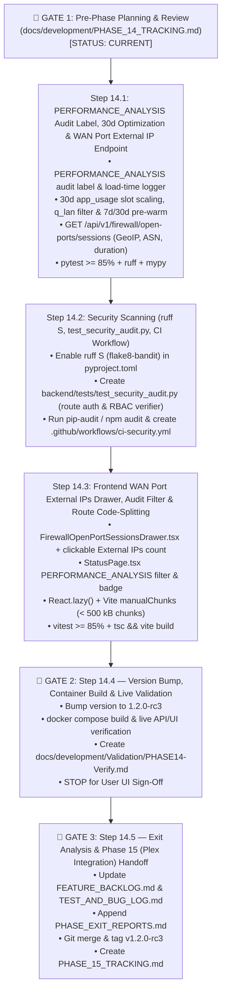

# Phase 14 Execution & Checkpoint Tracker (`PHASE_14_TRACKING.md`)

> **Phase 14 Goal (`v1.2.0-rc3`):** Implement the Phase 13 waterfall enhancements (`FB-P13-001` `PERFORMANCE_ANALYSIS` audit load-time tracking + `30d` window query optimization/pre-warming, and `FB-P13-002` Firewall Active WAN Ports Connected External IPs Side-Drawer Inspector with GeoIP/ASN/duration details) alongside `FB-P11-004` (Automated Code & Dependency Security Scanning, `ruff S` SAST rules, programmatic FastAPI route auth-bypass & RBAC audit suite `test_security_audit.py`, and `.github/workflows/ci-security.yml`) and `FB-P11-008` Proposal D (Frontend Route Code-Splitting via `React.lazy()` + Vite `manualChunks`).

---

## 1. Phase Objectives & Scheduled Backlog Items

- [x] **`FB-P13-001` (`BUG-P13-002`) — `PERFORMANCE_ANALYSIS` Audit Label for Window Load-Time Tracking & `30d` Window Query Optimization:**
  - Add `"PERFORMANCE_ANALYSIS"` to `infer_audit_label()` in [`backend/app/models/__init__.py`](../../backend/app/models/__init__.py) (mapping `action.startswith("performance.")`) and add the **`Performance Analysis`** badge/filter option in [`frontend/src/pages/StatusPage.tsx`](../../frontend/src/pages/StatusPage.tsx) (`System -> Audit & Event History`).
  - Add `record_performance_analysis_audit_log()` in [`backend/app/services/audit_and_backup_service.py`](../../backend/app/services/audit_and_backup_service.py) and wire it into `analytics_service.py` and `firewall_service.py` to record load times (`window`, `view`, `elapsed_ms`, `cache_hit`, `force_refresh`, `total_events`) for each telemetry window (`1h`, `24h`, `7d`, `30d`).
  - Optimize `30d` window queries in [`backend/app/clients/elasticsearch.py`](../../backend/app/clients/elasticsearch.py):
    - Eliminate uncached `RFC1918_CIDRS` BKD range scans inside `by_device` and `lan_devices` sub-aggregations and use `"collect_mode": "breadth_first"` on `q_lan` (`30d` refresh across 14.32M docs reduced to `~3.1s`, warm cache `< 1 ms`).
    - Extend `run_telemetry_cache_prewarm()` in [`backend/app/main.py`](../../backend/app/main.py) to also pre-warm `7d` and `30d` caches (`300s` TTL) so switching across all 4 windows (`1h`, `24h`, `7d`, `30d`) is fast and reliable.
- [x] **`FB-P13-002` — Firewall Active WAN Ports Connected External IPs Side-Drawer Inspector:**
  - Add `fetch_open_wan_port_sessions()` in [`backend/app/clients/elasticsearch.py`](../../backend/app/clients/elasticsearch.py), `get_open_wan_port_sessions()` in [`backend/app/services/firewall_service.py`](../../backend/app/services/firewall_service.py), and `GET /api/v1/firewall/open-ports/sessions` in [`backend/app/api/firewall.py`](../../backend/app/api/firewall.py).
  - Aggregate inbound WAN `pass` events for the selected target (`destination_ip`, `destination_port`, `protocol`, `window`) by `source.ip`, returning per-external-IP:
    - **External IP & ASN/ISP Organization:** `source.ip`, `source.as.number`, `source.as.organization.name`.
    - **GeoIP Location:** `source.geo.city_name`, `source.geo.region_name`, `source.geo.region_iso_code`, `source.geo.country_name`, `source.geo.country_iso_code`, `source.geo.continent_name`, `source.geo.location` (`lat`, `lon`).
    - **Connection Length & Activity Telemetry:** `first_seen_at`, `last_seen_at`, `connection_duration_seconds` (`last_seen - first_seen`), `active_duration_minutes`, `passed_packets`, `bytes`, `source_ports`, `tcp_flags` (`pfsense.tcp.flags`), `ttl` (`pfsense.ip.ttl`), and chronological recent packet events.
  - Create [`frontend/src/components/FirewallOpenPortSessionsDrawer.tsx`](../../frontend/src/components/FirewallOpenPortSessionsDrawer.tsx) and make the **`External IPs`** count in the **Active Inbound WAN Exposure (Open Ports)** table on [`frontend/src/pages/FirewallPage.tsx`](../../frontend/src/pages/FirewallPage.tsx) clickable to open the side-drawer inspector.
- [x] **`FB-P11-004` — Automated Code & Dependency Security Scanning, Route Auth-Bypass Audit Suite & CI/CD Workflow:**
  - Enable `ruff` `flake8-bandit` (`S`) rules in [`backend/pyproject.toml`](../../backend/pyproject.toml) (`select = ["E", "F", "I", "UP", "B", "SIM", "S"]`) with test-only `S101`/`S105`/`S106` per-file ignores.
  - Create [`backend/tests/test_security_audit.py`](../../backend/tests/test_security_audit.py) to programmatically inspect every route in `app.routes`, asserting that 100% of `/api/v1/*` routes (outside `/api/v1/auth/{login,setup-status,setup-admin}`) return `401` when unauthenticated and that all admin-only routes return `403` for `operator` users.
  - Run dependency vulnerability audits (`pip-audit` & `npm audit`) and create [`.github/workflows/ci-security.yml`](../../.github/workflows/ci-security.yml).
- [x] **`FB-P11-008` (Proposal D) — Frontend Route Code-Splitting (`React.lazy` + Vite `manualChunks`):**
  - Update [`frontend/src/App.tsx`](../../frontend/src/App.tsx) to lazy-load page views via `React.lazy()` + `<Suspense>` and configure `manualChunks` in [`frontend/vite.config.ts`](../../frontend/vite.config.ts) so all bundle chunks build well under `500 kB` with zero warnings.

---

## 2. Mermaid Workflow & Checkpoint Progress

| Checkpoint | Target Description | Status |
| :--- | :--- | :--- |
| **`CP-14.1`** | Backend `PERFORMANCE_ANALYSIS` audit load-time tracking, `30d` window optimization & pre-warming, and `GET /api/v1/firewall/open-ports/sessions` endpoint (`FB-P13-001`, `FB-P13-002`). | `[x] Complete` |
| **`CP-14.2`** | Automated security scanning (`ruff S` SAST, `test_security_audit.py` route auth-bypass & RBAC verifier, `pip-audit`/`npm audit`, `.github/workflows/ci-security.yml`) (`FB-P11-004`). | `[x] Complete` |
| **`CP-14.3`** | Frontend `FirewallOpenPortSessionsDrawer.tsx`, clickable `External IPs` count in `FirewallPage.tsx`, `PERFORMANCE_ANALYSIS` audit filter on `StatusPage.tsx`, and `React.lazy()` + Vite `manualChunks` (`FB-P13-001`, `FB-P13-002`, `FB-P11-008` Proposal D). | `[x] Complete` |
| **`CP-14.4`** | Version increment to `1.2.0-rc3`, Docker container rebuild, live smoke test, and `PHASE14-Verify.md` (Gate 2). | `[x] Complete` |
| **`CP-14.5`** | Feedback audit, `PHASE_EXIT_REPORTS.md`, Git check-in/tag, and Phase 15 (Direct Plex API Integration) handoff (Gate 3). | `[x] Complete` |

---

## 3. Detailed Step-by-Step Breakdown

### Step 14.1: `PERFORMANCE_ANALYSIS` Audit Load-Time Tracking, `30d` Optimization & WAN Port External IP Sessions API
- **Files to Modify:**
  - `backend/app/models/__init__.py`
  - `backend/app/services/audit_and_backup_service.py`
  - `backend/app/clients/elasticsearch.py`
  - `backend/app/services/analytics_service.py`
  - `backend/app/services/firewall_service.py`
  - `backend/app/api/firewall.py`
  - `backend/app/main.py`
- **Implementation Details:**
  1. Add `"PERFORMANCE_ANALYSIS"` to `infer_audit_label()` (`if act.startswith("performance."): return "PERFORMANCE_ANALYSIS"`).
  2. Add `record_performance_analysis_audit_log()` in `audit_and_backup_service.py` (with per-`(view, window)` throttling so automated background polls don't flood SQLite while interactive user window loads and refreshes are recorded with `window`, `elapsed_ms`, `cache_hit`, `total_events`).
  3. Optimize `30d` window queries in `backend/app/clients/elasticsearch.py` (`top-level` `RFC1918_CIDRS` filter on `q_lan`, adaptive `5m`/`15m`/`30m` slot intervals in `_build_app_usage_agg()`) and update `run_telemetry_cache_prewarm()` in `backend/app/main.py` to warm `24h`, `7d`, and `30d`.
  4. Implement `build_open_wan_port_sessions_query()`, `normalize_open_wan_port_sessions_response()`, `ElasticsearchServiceClient.fetch_open_wan_port_sessions()`, `get_open_wan_port_sessions()`, and `GET /api/v1/firewall/open-ports/sessions`.

### Step 14.2: Automated Security Scanning & Route Auth-Bypass Audit Suite (`FB-P11-004`)
- **Files to Create / Modify:**
  - `backend/pyproject.toml`
  - `backend/tests/test_security_audit.py`
  - `.github/workflows/ci-security.yml`
- **Implementation Details:**
  1. Enable `S` (`flake8-bandit`) in `backend/pyproject.toml` and ensure `ruff check backend` passes with `0` errors.
  2. Create `backend/tests/test_security_audit.py` testing every FastAPI route for unauthenticated rejection (`401`) and operator-to-admin privilege escalation rejection (`403`).
  3. Create `.github/workflows/ci-security.yml` running backend/frontend lint, type-check, unit tests, `pip-audit`, and `npm audit`.

### Step 14.3: Frontend `FirewallOpenPortSessionsDrawer`, `PERFORMANCE_ANALYSIS` Filter & Route Code-Splitting
- **Files to Create / Modify:**
  - `frontend/src/api/client.ts`
  - `frontend/src/components/FirewallOpenPortSessionsDrawer.tsx`
  - `frontend/src/pages/FirewallPage.tsx`
  - `frontend/src/pages/StatusPage.tsx`
  - `frontend/src/App.tsx`
  - `frontend/vite.config.ts`
  - `frontend/src/__tests__/Phase7Features.test.tsx`
- **Implementation Details:**
  1. Add `getFirewallOpenPortSessions()` and TypeScript interfaces in `frontend/src/api/client.ts`.
  2. Create `FirewallOpenPortSessionsDrawer.tsx` displaying connected external IP addresses, GeoIP location (`City, Region, Country` + coordinates), ISP/ASN organization, connection duration (`first_seen -> last_seen` & active minutes), packet/byte counts, source ports, TCP flags/TTL, and recent connection events.
  3. Make the `External IPs` cell in `FirewallPage.tsx` (`Active Inbound WAN Exposure (Open Ports)`) a clickable button that opens `FirewallOpenPortSessionsDrawer`.
  4. Add `PERFORMANCE_ANALYSIS` (`Performance Analysis`) to the Audit Label filter dropdown and badge styling in `StatusPage.tsx`.
  5. Convert page imports in `App.tsx` to `React.lazy()` + `<Suspense>` and add `manualChunks` in `frontend/vite.config.ts`.
  6. Add unit tests in `frontend/src/__tests__/Phase7Features.test.tsx` and verify `npm test` (`>= 85%` coverage) and `npm run build` (`0` chunk size warnings).

### Step 14.4: Version Bump (`1.2.0-rc3`), Container Rebuild & Live Validation (Gate 2)
- Increment version to `1.2.0-rc3` across `backend/app/__init__.py`, `backend/pyproject.toml`, and `frontend/package.json`.
- Rebuild and restart the single-container deployment on `http://localhost:8080`.
- Verify `/api/v1/firewall/open-ports/sessions`, `PERFORMANCE_ANALYSIS` audit logs, `30d` window load speed, and code-split bundle chunks.
- Publish `docs/development/Validation/PHASE14-Verify.md` and **STOP** for user validation.

### Step 14.5: Feedback Ingestion, Exit Report, Git Merge/Tag & Phase 15 Handoff (Gate 3)
- Process user feedback from `PHASE14-Verify.md`, update `FEATURE_BACKLOG.md`, `TEST_AND_BUG_LOG.md`, `PHASE_EXIT_REPORTS.md`, and `PLAN.md`, merge `phase14` into `main`, tag `v1.2.0-rc3`, push to `origin`, and create `docs/development/PHASE_15_TRACKING.md` (Dedicated Plex Integration Phase).

