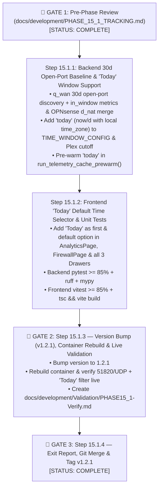

# Phase 15.1 (`v1.2.1` Release) Execution & Checkpoint Tracker (`PHASE_15_1_TRACKING.md`)

> **Phase 15.1 Goal (`v1.2.1` Release):**
> 1. **`BUG-P15-002` — Keep Configured & 30-Day Active Open WAN Ports (Including WireGuard `51820:51820 / UDP`) Visible Across All Time Windows (`Today`, `1h`, `24h`, `7d`, `30d`):** Fix `inbound_wan_passed` / `open_wan_ports` so open WAN ports that had `0` inbound packets during a shorter window (`Today`, `1h`, `24h`) remain visible in **Active Inbound WAN Exposure (Open Ports)** with `Passed: 0`, `External IPs: 0` (for that window), and their most recent `Last Seen` timestamp, rather than disappearing when idle.
> 2. **`FB-P15-001` — Add `Today` Filter as the First & Default Time Window Selector Across All Views & Drawers:** Add `Today` (`today`, from `00:00:00` local timezone to now with `1h` histogram buckets) as the **first** and **default** time window option across `AnalyticsPage.tsx`, `FirewallPage.tsx`, `DeviceAnalyticsDrawer.tsx`, `GroupAnalyticsDrawer.tsx`, and `FirewallOpenPortSessionsDrawer.tsx` (and include `today` in background cache pre-warming).

---

## 1. Phase Objectives & Scheduled Items

- [x] **`BUG-P15-002` — Always Display Open WAN Ports (e.g., WireGuard `51820 / UDP`) Across All Windows (`Today`, `1h`, `24h`, `7d`, `30d`):**
  1. **Root Cause:**
     - `inbound_wan_passed` in [`backend/app/clients/elasticsearch.py`](../../backend/app/clients/elasticsearch.py#L1299-L1335) previously filtered strictly by the active window's time range (`1h` or `24h`). Because the last inbound WireGuard (`51820 / UDP`) packet arrived at `2026-11-06T18:43:09Z` (~28.8h ago), `51820 / UDP` appeared in `7d` (`393` pkts) and `30d` (`891` pkts) but disappeared from `1h` and `24h`.
     - Additionally, `POST /api/firewall/d_nat/searchRule` returned `403 Forbidden` because `svc_gateway_ui` lacked the `Firewall: NAT: Port Forward` privilege, and `build_firewall_overview_response()` did not merge zero-packet open ports from the `30d` baseline or OPNsense D-NAT config.
  2. **Fix:**
     - Query `q_wan` (`inbound_wan_passed`) over a 30-day lookback (`now-30d/m`) with a nested `in_window` filter aggregation scoped to the selected window (`today`, `1h`, `24h`, `7d`, `30d`), and also merge any configured OPNsense Destination NAT rules (`d_nat`).
     - Every open WAN port active in the last 30 days (including WireGuard `51820:51820 / UDP`) or configured in OPNsense D-NAT now appears in **Active Inbound WAN Exposure (Open Ports)** across **all** windows (`Today`, `1h`, `24h`, `7d`, `30d`), showing the selected window's packet/byte/external-IP counts alongside the port's latest `Last Seen` timestamp.
     - Document the `Firewall: NAT: Port Forward` privilege for `svc_gateway_ui` in [`docs/API_KEYS_SETUP.md`](../API_KEYS_SETUP.md).
- [x] **`FB-P15-001` — `Today` Time Window Filter (First & Default Option Across All Time Selectors):**
  1. **Backend (`elasticsearch.py`, `plex_service.py`, `main.py`):**
     - Add `"today": {"es_gte": "now/d", "interval": "1h", "label": "Today"}` as the first entry in `TIME_WINDOW_CONFIG` in `backend/app/clients/elasticsearch.py`.
     - Ensure `@timestamp` range filters pass `"time_zone": safe_tz` when `es_gte == "now/d"` so `Today` starts at `00:00:00` in the configured local timezone (`America/Los_Angeles`).
     - Update `resolve_window_cutoff_datetime()` in `backend/app/services/plex_service.py` to compute local midnight for `window == "today"`.
     - Add `"today"` to `run_telemetry_cache_prewarm()` in `backend/app/main.py` so the default `Today` overview is pre-warmed every 60s.
  2. **Frontend (`client.ts`, `AnalyticsPage.tsx`, `FirewallPage.tsx`, `DeviceAnalyticsDrawer.tsx`, `GroupAnalyticsDrawer.tsx`, `FirewallOpenPortSessionsDrawer.tsx`):**
     - Add `'today'` (`Today`) as the first button/option in every time selector and set `'today'` as the initial default selection.

---

## 2. Mermaid Workflow & Checkpoint Progress

| Checkpoint | Target Description | Status |
| :--- | :--- | :--- |
| **`CP-15.1.1`** | Backend `30d` open WAN port baseline + `in_window` metrics (`BUG-P15-002`) and `today` (`now/d` local midnight) time window support (`FB-P15-001`). | [x] Complete |
| **`CP-15.1.2`** | Frontend `Today` default time selector across all views/drawers + full backend/frontend unit test verification (`>= 85%` coverage). | [x] Complete |
| **`CP-15.1.3`** | Bump version to `1.2.1`, rebuild Docker container, run live smoke test, and publish `PHASE15_1-Verify.md` (Gate 2). | [x] Complete |
| **`CP-15.1.4`** | Complete exit report, merge `v1.2.1` to `main`, and tag `v1.2.1` (Gate 3). | [x] Complete |
