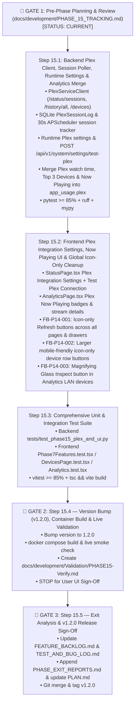

# Phase 15 Execution & Checkpoint Tracker (`PHASE_15_TRACKING.md`)

> **Phase 15 Goal (`v1.2.0` Final Release):** Implement direct **Plex Media Server API (`X-Plex-Token` / Tautulli-style) Session & Playback History Integration** (`FB-P9-005` / `BUG-P9-002` / `FB-P11-008` Proposal C) so same-subnet L2 Smart TVs (`LGwebOSTV`, Apple TV, Roku, etc.) report exact active streaming minutes, live "Now Playing" session details, and Top 3 Devices, alongside the Phase 14 UI Cleanup Backlog (`FB-P14-001` Icon-Only Refresh Buttons across all views/drawers, `FB-P14-002` Icon-Only Mobile-Friendly Device Action Buttons in `DevicesPage.tsx`, and `FB-P14-003` Magnifying Glass `Inspect` Button in `AnalyticsPage.tsx`).

---

## 1. Phase Objectives & Scheduled Backlog Items

- [x] **`FB-P9-005` (`BUG-P9-002` / `FB-P11-008` Proposal C) — Direct Plex Media Server API & Tautulli-Style Session / Playback History Integration:**
  1. **Configuration & Runtime Integration Settings (`backend/app/config.py`, `backend/app/services/runtime_settings_service.py`, `backend/app/api/system.py`, `frontend/src/pages/StatusPage.tsx`):**
     - Add `PLEX_BASE_URL`, `PLEX_API_TOKEN` (`SecretStr`), `PLEX_VERIFY_SSL` (`default=False`), and `PLEX_TIMEOUT_SECONDS` (`default=8.0`) to `Settings` in `backend/app/config.py` and `.env.example`.
     - Extend `runtime_settings_service.py` and `StatusPage.tsx` (`System -> Integration Settings`) so administrators can configure `Plex Media Server URL` (`http://...:32400` or `https://...:32400`), `Plex API Token (X-Plex-Token)`, and `Verify SSL` directly from the UI (encrypted at rest in SQLite with runtime precedence over `.env`), and test connectivity via a live **Test Plex Connection** diagnostic button (`POST /api/v1/system/settings/test-plex`).
  2. **Async Plex Service Client & Tautulli-Style Session/History Poller (`backend/app/clients/plex.py`, `backend/app/models/__init__.py`, `backend/app/services/plex_service.py`):**
     - Create `PlexServiceClient` (`backend/app/clients/plex.py`) querying the official Plex Media Server HTTP/JSON API (`Accept: application/json`, `X-Plex-Token`):
       - `GET /identity` & `GET /` — Server health, friendly name, version, and machineIdentifier.
       - `GET /status/sessions` — Active live playback sessions (`Metadata`, `Player.address`, `Player.title`, `Player.product`, `Player.platform`, `Player.state` = `playing`/`paused`/`buffering`, `User.title`, `Media`, `TranscodeSession` direct-play vs. transcode, `viewOffset`, `duration`).
       - `GET /status/sessions/history/all` — Historical playback records (`viewedAt`, `accountID`, `ratingKey`, `title`, `grandparentTitle`, `deviceID`) enriched with `/devices` and `/accounts` lookup.
     - Add a lightweight SQLite `plex_session_logs` table (or session interval tracker in `backend/app/models/__init__.py`) polled every 30 seconds by APScheduler (`run_plex_session_poller()` in `backend/app/main.py`) to record active `playing` session heartbeats with exact `client_ip` (`Player.address`), `device_name` (`Player.title` / `Player.product`), `media_title`, `user_name`, `stream_decision` (`direct play` / `direct stream` / `transcode`), and `duration_seconds` — exactly how Tautulli tracks per-IP watch time even when L2 Smart TV traffic never crosses OPNsense or Unbound DNS.
  3. **Seamless Analytics Integration & Live "Now Playing" Telemetry (`backend/app/services/analytics_service.py`, `frontend/src/pages/AnalyticsPage.tsx`, `DeviceAnalyticsDrawer.tsx`, `GroupAnalyticsDrawer.tsx`):**
     - When Plex is configured (`plex_base_url` + `plex_api_token`), merge direct Plex session/history telemetry into `app_usage.plex` in `analytics_service.py` (correlating `Player.address` and player hostnames/titles to SQLite `Device` rows, with fallback to Elasticsearch DNS/port-32400 heuristics when Plex is unconfigured).
     - Expose `active_sessions` (`Now Playing` count + active stream details: device name, media title, state, direct play / transcode) on the **Plex Usage** card in `AnalyticsPage.tsx` and per-device/per-group drawers.
- [x] **`FB-P14-001` — Icon-Only Refresh Buttons Across All Views & Drawers:**
  - Remove the text labels from all Refresh buttons across `DevicesPage.tsx` (`Sync from OPNsense`), `SchedulesPage.tsx`, `AnalyticsPage.tsx` (`Refresh Analytics`), `FirewallPage.tsx` (`Refresh Firewall`), `StatusPage.tsx` (`Refresh Health` / `Refresh Audit Logs`), `DeviceAnalyticsDrawer.tsx` (`Refresh Telemetry`), `GroupAnalyticsDrawer.tsx` (`Refresh Telemetry`), and `FirewallOpenPortSessionsDrawer.tsx` (`Refresh Telemetry`), displaying only the `<RefreshCw />` icon while preserving accessible `aria-label` and `title` attributes.
- [x] **`FB-P14-002` — Icon-Only, Larger Mobile-Friendly Action Buttons in `Devices` Inventory List:**
  - In `frontend/src/pages/DevicesPage.tsx` (and `TimerPopoverMenu.tsx` when rendered inside device rows), convert the per-device action buttons (`Inspect`/`Analytics`, `Timer`, `YouTube`, and `Allowed`/`Blocked` internet access toggle) to slightly larger touch-friendly icon-only buttons (`h-9 w-9` / `min-h-9 min-w-9 p-2`) with clear semantic colors and tooltips/`aria-label`s for easy clicking on mobile devices.
- [x] **`FB-P14-003` — Magnifying Glass Icon-Only `Inspect` Button in `Analytics` Top Active LAN Devices List:**
  - In `frontend/src/pages/AnalyticsPage.tsx` (`Top Active LAN Devices` table), replace the text `Inspect` button with an icon-only Magnifying Glass (`<Search className="h-4 w-4" />`) button (`aria-label="Inspect ..."`, `title="Inspect device analytics"`).
- [x] **`FB-P14-004` — Clean Up Search Field Placeholder in External Connection Side-Drawer (`FirewallOpenPortSessionsDrawer.tsx`):**
  - Update the search input placeholder in `FirewallOpenPortSessionsDrawer.tsx` from `"Filter by external IP, city, country, or ISP/ASN..."` to `"Filter by external IP, city, country, or ISP"` so it fits cleanly without clipping at `"or ISP/"`.

---

## 2. Mermaid Workflow & Checkpoint Progress

| Checkpoint | Target Description | Status |
| :--- | :--- | :--- |
| **`CP-15.1`** | Backend `PlexServiceClient`, SQLite session/history tracking, runtime Plex settings (`test-plex`), and `analytics_service.py` integration (`FB-P9-005`). | [x] Complete |
| **`CP-15.2`** | Frontend Plex Integration Settings (`StatusPage.tsx`), `Now Playing` telemetry (`AnalyticsPage.tsx`), and global icon-only UI cleanup (`FB-P14-001`, `FB-P14-002`, `FB-P14-003`, `FB-P14-004`). | [x] Complete |
| **`CP-15.3`** | Full backend (`pytest`, `ruff`, `mypy`) and frontend (`vitest`, `tsc && vite build`) test verification (`>= 85%` coverage). | [x] Complete |
| **`CP-15.4`** | Version increment to `1.2.0`, Docker container rebuild, live smoke test, and `PHASE15-Verify.md` (Gate 2). | [x] Complete |
| **`CP-15.5`** | Feedback audit, `PHASE_EXIT_REPORTS.md`, Git check-in, and `v1.2.0` release tag (Gate 3). | [x] Complete |

---

## 3. Detailed Step-by-Step Breakdown

### Step 15.1: Backend Plex Media Server Client, Tautulli-Style Session Tracker & Analytics Integration (`FB-P9-005`)
- **Files to Create / Modify:**
  - `backend/app/config.py` & `.env.example`
  - `backend/app/models/__init__.py`
  - `backend/app/clients/plex.py` (new)
  - `backend/app/services/plex_service.py` (new)
  - `backend/app/services/runtime_settings_service.py`
  - `backend/app/api/system.py`
  - `backend/app/services/analytics_service.py`
  - `backend/app/main.py`
- **Implementation Details:**
  1. Add `plex_base_url: str = ""`, `plex_api_token: SecretStr = SecretStr("")`, `plex_verify_ssl: bool = False`, and `plex_timeout_seconds: float = 8.0` to `Settings`.
  2. Create `PlexServiceClient` in `backend/app/clients/plex.py` supporting `check_health()`, `fetch_active_sessions()` (`/status/sessions`), and `fetch_playback_history()` (`/status/sessions/history/all` + `/devices`).
  3. Create `PlexSessionLog` SQLAlchemy model in `backend/app/models/__init__.py` and `plex_service.py` to record active session heartbeats and compute per-device active watch minutes, `last_seen_at`, `top_devices`, and live `active_sessions` across `1h`, `24h`, `7d`, and `30d`.
  4. Extend `runtime_settings_service.py` and `api/system.py` (`GET/PUT /api/v1/system/settings`, `POST /api/v1/system/settings/test-plex`) so Plex credentials can be configured and tested live in the UI.
  5. Wire `plex_service.enrich_app_usage_with_plex()` into `analytics_service.py` so `app_usage.plex` reflects direct Plex API watch time, Top 3 Devices (resolving `LGwebOSTV` and LAN players by IP/hostname), and live `Now Playing` sessions.

### Step 15.2: Frontend Plex Settings, `Now Playing` UI & Icon-Only Button Cleanup (`FB-P9-005`, `FB-P14-001`..`FB-P14-003`)
- **Files to Modify:**
  - `frontend/src/api/client.ts`
  - `frontend/src/pages/StatusPage.tsx`
  - `frontend/src/pages/AnalyticsPage.tsx`
  - `frontend/src/pages/DevicesPage.tsx`
  - `frontend/src/pages/FirewallPage.tsx`
  - `frontend/src/pages/SchedulesPage.tsx`
  - `frontend/src/components/TimerPopoverMenu.tsx`
  - `frontend/src/components/DeviceAnalyticsDrawer.tsx`
  - `frontend/src/components/GroupAnalyticsDrawer.tsx`
  - `frontend/src/components/FirewallOpenPortSessionsDrawer.tsx`
- **Implementation Details:**
  1. Add Plex fields (`plex_base_url`, `plex_api_token`, `plex_verify_ssl`) and **Test Plex Connection** button to `System -> Integration Settings` in `StatusPage.tsx`.
  2. Enhance the **Plex Usage** card on `AnalyticsPage.tsx` to display active `Now Playing` stream badges (device name, media title, direct play / transcode state) when live sessions are active.
  3. **`FB-P14-001`:** Convert all Refresh buttons across all pages and drawers to icon-only (`<RefreshCw />`) buttons while preserving `aria-label` and `title` attributes so screen-reader and unit-test queries (`getByRole('button', { name: /refresh.../i })`) continue to work seamlessly.
  4. **`FB-P14-002`:** Convert the per-device row action buttons in `DevicesPage.tsx` (`Analytics`/`Inspect`, `Timer`, `YouTube`, `Allowed`/`Blocked`) to icon-only, slightly larger mobile-friendly buttons (`min-h-9 min-w-9 p-2`) with clear semantic colors and `aria-label`/`title` attributes.
  5. **`FB-P14-003`:** Replace the text `Inspect` button in the `Top Active LAN Devices` table on `AnalyticsPage.tsx` with a Magnifying Glass (`<Search className="h-4 w-4" />`) icon button.

### Step 15.3: Unit & Integration Testing
- Add backend unit/API tests for `PlexServiceClient`, `plex_service.py`, `POST /api/v1/system/settings/test-plex`, and `analytics_service.py` Plex enrichment.
- Update and expand frontend Vitest tests to verify the Plex integration settings, `Now Playing` card badges, icon-only Refresh buttons (`FB-P14-001`), mobile-friendly icon-only device row buttons (`FB-P14-002`), and Magnifying Glass `Inspect` button (`FB-P14-003`).

### Step 15.4: Version Bump (`1.2.0`), Container Rebuild & Live Validation (Gate 2)
- Increment version to `1.2.0` across `backend/app/__init__.py`, `backend/pyproject.toml`, and `frontend/package.json`.
- Rebuild and restart the single-container deployment on `http://localhost:8080`.
- Publish `docs/development/Validation/PHASE15-Verify.md` and **STOP** for user validation.

### Step 15.5: Feedback Ingestion, Exit Report & `v1.2.0` Release Sign-Off (Gate 3)
- Process user feedback from `PHASE15-Verify.md`, update `FEATURE_BACKLOG.md`, `TEST_AND_BUG_LOG.md`, `PHASE_EXIT_REPORTS.md`, and `PLAN.md`, merge `phase15` into `main`, tag `v1.2.0`, and push to `origin`.

