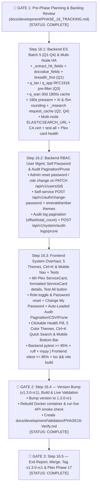

# Phase 16 Execution & Checkpoint Tracker (`PHASE_16_TRACKING.md`)

> **Phase 16 Goal (`v1.3.0-rc1`):** Execute the **Elasticsearch 9.4.3 (`logsdb`) Batch 5 Read Optimizations (`Q1`–`Q4`)** documented in [`docs/development/Optimizations-suggestions.md`](Optimizations-suggestions.md) paired with **Multi-Node Elasticsearch HA Failover**, overhaul the **`System` Tab** (4th `Plex Media Server` Service Health Card, formatted Service Details, expanded Enforcement KPI counters, User Password/Role Management, auto-loaded & paginated Audit History with CSV export & performance-log pruning), and deliver **Global Header, Navigation & Color Theme** upgrades (`HEALTHY` badge click navigation to `System`, `Emerald & Forest` and `Amber & Carbon` themes, `Ctrl+K` quick-search modal, and mobile bottom navigation bar).

---

## 1. Phase Objectives & Scheduled Backlog Items

- [x] **`FB-P16-001` — Apply Batch 5 Elasticsearch 9.4.3 (`logsdb`) Read Optimizations (`Q1`–`Q4`):**
  1. **`Q1` (`build_open_wan_port_sessions_query` & `normalize_open_wan_port_sessions_response` in `backend/app/clients/elasticsearch.py`):**
     - Add `_extract_hit_fields(hit)` helper supporting both legacy `_source` payloads (preserving all existing mock unit tests) and Elasticsearch `docvalue_fields` (`fields`) including `"lat, lon"` `source.geo.location` parsing.
     - Disable synthetic `_source` reconstruction (`"_source": False`, `"docvalue_fields": source_fields`) inside `latest_sample.top_hits` (and `recent_body`), set `"collect_mode": "breadth_first"` on `external_ips.terms`, and sort `latest_sample.top_hits` deterministically by `[{"@timestamp": {"order": "desc"}}]` (`2–11 ms` vs `1.3s–17.2s`).
  2. **`Q3` (`fetch_network_overview` in `backend/app/clients/elasticsearch.py`):**
     - Restore `{"terms": {"source.ip": RFC1918_CIDRS}}` directly inside `q_lan["query"]["bool"]["filter"]` and keep the `RFC1918_CIDRS` filter intact inside `q_app`'s `lan_devices` / `by_device` sub-aggregation instead of replacing it with `{"match_all": {}}`, eliminating external WAN scanner IP cardinality bloat (`~1.1s–3.4s` speedup).
  3. **`Q2` (`run_telemetry_cache_prewarm` in `backend/app/main.py` & `fetch_firewall_overview` in `backend/app/clients/elasticsearch.py`):**
     - Decouple the `now-30d/h` open WAN port discovery aggregation (`q_wan`) into a dedicated `AnalyticsCache` entry (`"firewall:wan_ports_30d"`, `ttl = 1800.0` seconds) so `today`/`1h`/`24h` refreshes never re-scan 30 days of `filterlog` shards every 60 seconds.
     - Extend telemetry cache TTLs (`"today": 180s`, `"7d": 900s`, `"30d": 1800s`) and increase `prewarm_default_telemetry_caches` scheduler interval from `60s` to `180s` (warming `today` + `24h` continuously while `7d`/`30d` respect their longer TTLs).
  4. **`Q4` (`_round_es_gte`, `_msearch` `request_cache`, & `track_total_hits` in `backend/app/clients/elasticsearch.py`):**
     - Update `_round_es_gte(es_gte)` so `"7d"` and `"30d"` round to `/h` (`now-7d/h`, `now-30d/h`) and `"24h"` rounds to `/5m` (`now-24h/5m`), stopping 60-second shard request cache invalidation across historical rolled-over shards.
     - Enable rounding consistently across `build_network_overview_query`, `build_device_analytics_query`, and `build_group_analytics_query`.
     - Explicitly pass `"request_cache": True` on every `size: 0` aggregation `_msearch` sub-request header (and `"request_cache": False` on `recent_body`), and add `"track_total_hits": False` to `build_device_recent_domains_query()` and `build_group_recent_domains_query()`.

- [x] **`FB-P16-002` — Multi-Node Elasticsearch HA Failover, `CA Cert Path` & `Test All Connections`:**
  - Parse comma-separated URLs in `Settings` / `ElasticsearchServiceClient` (`[u.strip() for u in url.split(",") if u.strip()]`) and support optional `ELASTICSEARCH_CA_CERT_PATH` across `.env.example`, `config.py`, `elasticsearch.py`, `runtime_settings_service.py`, and `StatusPage.tsx`.
  - Probe cluster nodes in `ElasticsearchServiceClient.check_health()` via `_nodes/stats` or `/_cat/nodes` (with graceful single-node fallback) so the Elasticsearch Health Card displays per-node connectivity badges (`green`/`degraded`/`unreachable`).
  - Add a **Test All Connections** diagnostic button (`POST /api/v1/system/settings/test-all`) in `System -> Integration Settings` that concurrently runs OPNsense, Elasticsearch, and Plex connectivity diagnostics and displays a unified results summary.

- [x] **`FB-P16-003` — `System` Tab 4th Service Card (`Plex Media Server`), Formatted Card Details & Expanded Enforcement KPIs:**
  - Include `plex` in `GET /api/v1/system/health` (`system.py`), calculating `overall_status` gracefully (unconfigured Plex returns `not_configured` / healthy exclusion rather than degrading core gateway health; configured & reachable returns healthy with version, friendly name, active streams, and latency; configured & unreachable returns degraded).
  - Add a **4th Service Health Card for `Plex Media Server`** on `StatusPage.tsx` (updating the grid to `md:grid-cols-2 xl:grid-cols-4`).
  - Format raw `details` keys inside every `ServiceCard` into clean human-readable labels (`Cluster Name`, `Dnsmasq Leases`, `ARP Entries`, etc.) with a collapsible **Technical Details** toggle for raw diagnostic attributes.
  - Add **YouTube Blocked** and **Custom Domain/ASN Blocks** KPI cards/counters to **Gateway Enforcement & Inventory Synchronization Summary** (`GET /api/v1/system/health` + `DevicesPage` summary enrichment).

- [x] **`FB-P16-004` — User Password/Role Management, Self-Service Password Change & Audit History Pagination / CSV Export / Pruning:**
  - Extend `PATCH /api/v1/users/{user_id}` (`user_service.py`, `api/users.py`) to allow admins to reset another user's password (`min_length=8`) or switch their role (`admin` <-> `operator`), while strictly protecting the built-in `admin` user from role demotion or deletion.
  - Add `POST /api/v1/auth/change-password` (`api/auth.py`, `user_service.py`) requiring `current_password` + `new_password` and wire a **Change My Password** section inside the top Header User Menu popover (`AppLayout.tsx`).
  - Auto-load **Audit & Event History** on `StatusPage.tsx` by default with a collapsible card header whose open/closed preference is persisted in `localStorage`.
  - Add `offset` + `total_count` pagination (`50` / `100` / `250` per page) to `GET /api/v1/system/audit-logs`, an **Export CSV** button on `StatusPage.tsx`, and a **Prune Performance Logs** admin endpoint (`POST /api/v1/system/audit-logs/prune`) & UI confirmation button to clean up old `PERFORMANCE_ANALYSIS` / `DIAGNOSTIC_ERROR` entries.

- [x] **`FB-P16-005` — Global Header Health Link, 2 New Dark-Room Color Themes, `Ctrl+K` Quick-Search & Mobile Bottom Nav:**
  - Make the top header **`HEALTHY` / `DEGRADED` / `DOWN`** status pill an interactive button (`aria-label="System health status, click to view System tab"`) that navigates directly to the `System` (`status`) tab.
  - Add **`Emerald & Forest`** (`emerald` — matrix green on dark charcoal) and **`Amber & Carbon`** (`amber` — warm gold on carbon black) themes across `frontend/src/index.css`, `AppLayout.tsx`, `ThemePreference` types, and `backend/app/auth/__init__.py` (`5` themes total persisted per user).
  - Create `<GlobalQuickSearchModal />` triggered via `Ctrl+K` / `Cmd+K` (or a subtle header search button) allowing instant navigation across all 5 tabs and quick jump/inspect for any discovered LAN device or Group.
  - Add a responsive sticky **Mobile Bottom Navigation Bar** (`md:hidden`) in `AppLayout.tsx` with single-tap icons & labels for all 5 tabs.

---

## 2. Mermaid Workflow & Checkpoint Progress

| Checkpoint | Target Description | Status |
| :--- | :--- | :--- |
| **`CP-16.1`** | Backend Batch 5 ES `logsdb` read optimizations (`Q1`–`Q4`), multi-node HA failover, CA cert support, `Plex` service health & `test-all` endpoint (`FB-P16-001`, `FB-P16-002`, `FB-P16-003`). | [x] Complete |
| **`CP-16.2`** | Backend Admin user password/role updates, self-service password change, `emerald`/`amber` theme support, and Audit pagination + pruning (`FB-P16-004`, `FB-P16-005`). | [x] Complete |
| **`CP-16.3`** | Frontend `System` tab overhaul, 5 color themes, clickable Health pill, `Ctrl+K` quick search, mobile bottom nav & >= 85% test suites (`pytest`, `ruff`, `mypy`, `vitest`, `vite build`). | [x] Complete |
| **`CP-16.4`** | Bump version to `1.3.0-rc1`, rebuild Docker container, run live API smoke check, and publish `docs/development/Validation/PHASE16-Verify.md` (Gate 2). | [x] Complete |
| **`CP-16.5`** | Ingest validation feedback, resolve `BUG-P16-005`, log `FB-P16-007`, write exit analysis, merge `phase16`, tag `v1.3.0-rc1`, and create `PHASE_17_TRACKING.md` (Gate 3). | [x] Complete |

---

## 3. Detailed Step-by-Step Breakdown

### Step 16.1: Backend Elasticsearch Batch 5 (`Q1`–`Q4`), Multi-Node HA & Health Card Enrichment (`CP-16.1`)
- **Files to Modify:**
  - `.env.example`, `backend/app/config.py`
  - `backend/app/clients/elasticsearch.py`
  - `backend/app/services/runtime_settings_service.py`
  - `backend/app/services/analytics_service.py`
  - `backend/app/services/firewall_service.py`
  - `backend/app/main.py`
  - `backend/app/api/system.py`
- **Implementation & Verification Criteria:**
  1. Add `ELASTICSEARCH_CA_CERT_PATH` (`Optional[str]`) to `Settings`, parse comma-separated `ELASTICSEARCH_URL` lists cleanly into `list[str]` for `AsyncElasticsearch` automatic multi-node failover, and support updating/testing CA cert path & comma-separated URLs via `runtime_settings_service.py` and `StatusPage.tsx`.
  2. Implement `_extract_hit_fields()` and apply `Q1` (`breadth_first`, `_source: False`, `docvalue_fields`, deterministic `@timestamp desc` sort) to `build_open_wan_port_sessions_query()` and `normalize_open_wan_port_sessions_response()`.
  3. Apply `Q3` in `fetch_network_overview()` by placing `{"terms": {"source.ip": RFC1918_CIDRS}}` inside `q_lan["query"]["bool"]["filter"]` and preserving `RFC1918_CIDRS` filtering on `q_app`.
  4. Apply `Q2` & `Q4`: update `_round_es_gte()` (`/h` for `7d`/`30d`, `/5m` for `24h`), enable rounding on `build_network_overview_query`, `build_device_analytics_query`, and `build_group_analytics_query`, add `"request_cache": True` on `size: 0` `_msearch` sub-requests, add `"track_total_hits": False` on recent-domain queries, cache `"firewall:wan_ports_30d"` for `1800s`, extend `7d`/`30d`/`today` TTLs (`900s`/`1800s`/`180s`), and tune `prewarm_default_telemetry_caches` to `180s`.
  5. Enrich `GET /api/v1/system/health` with per-node ES health metadata (`nodes`: name, role, transport/http status), a `plex` service card entry (`active_streams`, `server_name`, `version`, `latency_ms`), and `youtube_blocked_count` / `custom_domain_asn_blocks_count` counters; add `POST /api/v1/system/settings/test-all`.

### Step 16.2: Backend User Management, Self-Service Password & Audit Log Pagination / Pruning (`CP-16.2`)
- **Files to Modify:**
  - `backend/app/auth/__init__.py`
  - `backend/app/api/auth.py`
  - `backend/app/services/user_service.py`
  - `backend/app/api/users.py`
  - `backend/app/services/audit_and_backup_service.py`
  - `backend/app/api/system.py`
- **Implementation & Verification Criteria:**
  1. Expand `ThemePreference` literal in `backend/app/auth/__init__.py` and `backend/app/api/auth.py` to `Literal["default", "crimson", "ocean", "emerald", "amber"]`.
  2. Add `POST /api/v1/auth/change-password` verifying the user's current password via `verify_password_hash()` (supporting both `.env` admin fallback and SQLite user hash updates) and hashing the new password with Argon2id.
  3. Extend `UserUpdateRequest` and `PATCH /api/v1/users/{user_id}` so admins can update `password` and `role` (`"admin"` / `"operator"`) for non-default users while keeping built-in `admin` protected against role demotion, disabling, or deletion.
  4. Extend `GET /api/v1/system/audit-logs` with `offset: int = 0` and return `total_count` in the response payload, plus add `POST /api/v1/system/audit-logs/prune` (admin-only, accepts `older_than_days` or `audit_label="PERFORMANCE_ANALYSIS"`, returns `deleted_count` and records a summary audit event).

### Step 16.3: Frontend `System` Overhaul, Themes, Quick-Search, Mobile Nav & Unit Tests (`CP-16.3`)
- **Files to Create / Modify:**
  - `frontend/src/index.css`
  - `frontend/src/api/client.ts`
  - `frontend/src/components/AppLayout.tsx`
  - `frontend/src/components/GlobalQuickSearchModal.tsx` (new)
  - `frontend/src/pages/StatusPage.tsx`
  - `backend/tests/test_elasticsearch_analytics.py`, `backend/tests/test_phase9_users_settings_audit.py`, `backend/tests/test_phase10_firewall.py`, `backend/tests/test_phase16_system_and_optimizations.py` (new)
  - `frontend/src/__tests__/Phase11BrandingThemes.test.tsx`, `frontend/src/__tests__/Phase9Features.test.tsx`, `frontend/src/__tests__/App.test.tsx`, `frontend/src/__tests__/Phase16Features.test.tsx` (new)
- **Quality Gate Targets:**
  - `.\backend\.venv\Scripts\pytest.exe backend/tests --cov=app` -> 100% pass rate, `>= 85%` coverage.
  - `.\backend\.venv\Scripts\ruff.exe check backend` -> 0 errors.
  - `.\backend\.venv\Scripts\mypy.exe backend/app` -> 0 issues.
  - `npm test` (`vitest run --coverage`) -> 100% pass rate, `>= 85%` coverage.
  - `npm run build` (`tsc -b && vite build`) -> 0 errors.

### Step 16.4: Version Increment (`1.3.0-rc1`), Container Rebuild & Live Validation (`CP-16.4` — Gate 2)
- Bump version to `1.3.0-rc1` in `backend/app/__init__.py`, `backend/pyproject.toml`, and `frontend/package.json`.
- Rebuild and restart Docker container (`docker compose -f docker/docker-compose.yml --env-file .env up -d --build`).
- Execute live smoke tests verifying Batch 5 ES query response times, `GET /api/v1/system/health` (`plex` card + multi-node ES info + `1.3.0-rc1`), `test-all`, `change-password` / `users`, `audit-logs` pagination/pruning, and new UI components.
- Publish [`docs/development/Validation/PHASE16-Verify.md`](Validation/PHASE16-Verify.md) and **STOP** for user verification.

### Step 16.5: Feedback Ingestion, Exit Report & `v1.3.0-rc1` Release Merge (`CP-16.5` — Gate 3)
- Record user validation feedback from `PHASE16-Verify.md` into `FEATURE_BACKLOG.md` & `TEST_AND_BUG_LOG.md`.
- Complete Phase 16 Exit Analysis in `PHASE_EXIT_REPORTS.md` and update `PLAN.md`.
- Merge `phase16` `--no-ff` into `main`, tag `v1.3.0-rc1`, push to `origin`, create `docs/development/PHASE_17_TRACKING.md`, and **STOP** for Gate 1 review of Phase 17.
