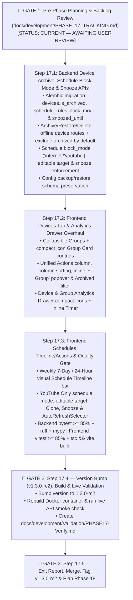

# Phase 17 Execution & Checkpoint Tracker (`PHASE_17_TRACKING.md`)

> **Phase 17 Goal (`v1.3.0-rc2`):** Overhaul the **`Devices`** Tab (collapsible `Device Groups & Profiles` section, compact mobile-friendly Group Card icons, unified right-aligned `Actions` column, clickable Device Table column sorting, inline `+ Group` quick assignment, and offline device archiving/restoring/deletion), align **Device & Group Analytics Drawer** header controls with an inline **`Timer`**, and expand **`Schedules`** capabilities (**`YouTube Only`** block mode, editable target, **`Duplicate / Clone`**, 7-Day / 24-Hour visual weekly timeline bar, compact Schedule Card controls, **Snooze / Skip Next Window**, and header auto-refresh).

---

## 1. Phase Objectives & Scheduled Backlog Items

- [ ] **`FB-P17-001` — `Devices` Tab Collapsible Group Section & Compact Icon Group Action Controls:**
  - Add a collapsible/compact header toggle (state persisted in `localStorage`) for the **Device Groups & Profiles** section on `DevicesPage.tsx`.
  - Convert Group Card action buttons (`Filter`, `Analytics`, `YouTube`, `Timer`, `Allow/Block Group`) to compact icon-only touch-friendly buttons matching the Device Table rows.
  - Ensure inline/quick group membership visibility and compact card spacing on both desktop and narrow screens.

- [ ] **`FB-P17-002` — `Devices` Tab Unified `Actions` Column, Column Sorting, Inline `+ Group` Popover & Offline Device Archiving:**
  - Merge `Telemetry` and `Internet Access` into a single right-aligned **`Actions`** column (`Analytics`, `YouTube`, `Timer`, `Internet Access`) with clean spacing and mobile legibility.
  - Make Device Inventory column headers clickable to sort ascending/descending (`Name`, `IPv4`, `Online`, `Vendor`, `Blocked`).
  - Add an inline **`+ Group`** popover trigger directly on each device row (and inside inline row editing) to assign or remove group memberships in one click without opening the full Group modal.
  - Add **`is_archived`** (`Boolean`, default `False`) to the `Device` model with an Alembic migration, add archive/restore/delete endpoints (`POST /api/v1/devices/{id}/archive`, `POST /api/v1/devices/{id}/restore`, `DELETE /api/v1/devices/{id}` for offline archived devices), and add an **`Archived`** filter pill (`All` excludes archived devices by default).

- [ ] **`FB-P17-003` — Device & Group Analytics Drawer Compact Header Controls & Inline Timer:**
  - Convert header enforcement toggles (`Internet Access`, `YouTube`) inside `DeviceAnalyticsDrawer.tsx` and `GroupAnalyticsDrawer.tsx` into consistent compact icon buttons matching `DevicesPage.tsx`.
  - Embed `<TimerPopoverMenu />` directly inside both drawer headers so temporary allow/block/YouTube timers can be set without closing the drawer.

- [ ] **`FB-P17-004` — `Schedules` Tab Expanded Rule Capabilities (`YouTube Only` Mode, Editable Target & Clone Rule):**
  - Add **`block_mode`** (`Literal["internet", "youtube"]`, default `"internet"`) to `ScheduleRule` (SQLite + Alembic migration, backup/restore export/import, and scheduler enforcement routing via OPNsense YouTube vs. Internet block aliases).
  - Allow switching/editing a Schedule's Target (**`Group`** or **`Device`**) inside `ScheduleFormModal.tsx` when editing an existing rule.
  - Add a **`Duplicate / Clone Schedule`** action (`POST /api/v1/schedules/{id}/clone` or pre-filled modal clone workflow) to duplicate an existing schedule rule quickly.

- [ ] **`FB-P17-005` — `Schedules` Tab Visual 7-Day Weekly Timeline Bar, Compact Card Controls, Snooze & Auto-Refresh:**
  - Add a visual **7-Day / 24-Hour Weekly Schedule Coverage Timeline** bar at the top of `SchedulesPage.tsx` visualizing active Internet blackout and YouTube-Only windows across Monday–Sunday (color-coded by `block_mode`).
  - Convert Schedule Card action buttons (`Edit`, `Clone`, `Enable/Disable`, `Delete`, and active **Snooze / Skip Next Occurrence**) into consistent compact icon/action controls, add backend `POST /api/v1/schedules/{id}/snooze` (`skip_until` / `snoozed_until` field respected by the scheduler engine), and add `AutoRefreshSelector` to the `Schedules` header.

---

## 2. Mermaid Workflow & Checkpoint Progress

| Checkpoint | Target Description | Status |
| :--- | :--- | :--- |
| **`CP-17.1`** | Backend DB migrations & APIs for `devices.is_archived`, archive/restore/delete offline devices, `schedule_rules.block_mode` (`internet` / `youtube`), editable targets, clone & `snoozed_until` enforcement (`FB-P17-002`, `FB-P17-004`, `FB-P17-005`). | Pending |
| **`CP-17.2`** | Frontend `DevicesPage.tsx` overhaul (collapsible groups, compact icons, unified `Actions` column, column sorting, `+ Group` popover, archived filter) and compact Drawer header controls + inline Timer (`FB-P17-001`, `FB-P17-002`, `FB-P17-003`). | Pending |
| **`CP-17.3`** | Frontend `SchedulesPage.tsx` & `ScheduleFormModal.tsx` upgrades (weekly timeline bar, `YouTube Only` mode, editable target, Clone, Snooze, `AutoRefreshSelector`) & >= 85% test suites (`pytest`, `ruff`, `mypy`, `vitest`, `vite build`). | Pending |
| **`CP-17.4`** | Bump version to `1.3.0-rc2`, rebuild Docker container, run live API smoke check, and publish `docs/development/Validation/PHASE17-Verify.md` (Gate 2). | Pending |
| **`CP-17.5`** | Ingest validation feedback, write exit analysis, merge `phase17`, tag `v1.3.0-rc2`, and create `PHASE_18_TRACKING.md` (Gate 3). | Pending |

---

## 3. Detailed Step-by-Step Breakdown

### Step 17.1: Backend Models, Alembic Migrations, Device Archiving & Schedule Enforcement (`CP-17.1`)
- **Files to Create / Modify:**
  - `backend/app/models/__init__.py`
  - `backend/app/db/__init__.py` and `backend/alembic/versions/` (new Phase 17 migration revision)
  - `backend/app/services/device_service.py`, `backend/app/api/devices.py`
  - `backend/app/services/schedule_service.py`, `backend/app/api/schedules.py`
  - `backend/app/services/audit_and_backup_service.py` (preserve `is_archived` and `block_mode` / `snoozed_until` in backup/restore)
  - `backend/tests/test_devices_api.py`, `backend/tests/test_schedule_models_and_service.py`, `backend/tests/test_schedules_api.py`, `backend/tests/test_app_usage_audit_and_backup.py`
- **Implementation & Verification Criteria:**
  1. Add `is_archived: bool = False` on `Device` (auto-reconcile unarchiving only on explicit restore; exclude archived offline devices from default `GET /api/v1/devices` unless `include_archived=true`). Block deletion on online or protected devices with clear `400` validation errors; record `AuditLog` entries for archive/restore/delete.
  2. Add `block_mode: Literal["internet", "youtube"] = "internet"` and `snoozed_until: datetime | None = None` on `ScheduleRule`. Update schedule evaluation helpers so `"youtube"` rules apply/release `gateway_youtube_blocked_devices` (preserving general internet access), and skipped/snoozed schedules pause enforcement cleanly until `snoozed_until` expires or snooze is cleared.
  3. Support updating `target_type` + `target_id` in `PATCH /api/v1/schedules/{id}` (reconciling prior target if the rule is currently active) and add `POST /api/v1/schedules/{id}/snooze` (`minutes` / `clear`) + `POST /api/v1/schedules/{id}/clone`.

### Step 17.2: Frontend `Devices` Tab & Analytics Drawers Overhaul (`CP-17.2`)
- **Files to Modify:**
  - `frontend/src/api/client.ts`
  - `frontend/src/pages/DevicesPage.tsx`
  - `frontend/src/components/DeviceAnalyticsDrawer.tsx`
  - `frontend/src/components/GroupAnalyticsDrawer.tsx`
- **Implementation & Verification Criteria:**
  1. Add collapsible header toggle (`localStorage` persisted) for **Device Groups & Profiles**, and convert Group Card actions (`Filter`, `Analytics`, `YouTube`, `Timer`, `Allow/Block Group`) into compact icon buttons.
  2. Refactor Device Table to merge `Telemetry` + `Internet Access` into a single right-aligned `Actions` column, add clickable column sort headers (`Name`, `IPv4`, `Online`, `Vendor`, `Blocked`), add inline `+ Group` multi-select popover on rows and inline edits, and add **Archive / Restore / Delete Offline** controls + `Archived` filter pill.
  3. Convert `DeviceAnalyticsDrawer.tsx` and `GroupAnalyticsDrawer.tsx` header controls to compact icon toggles + inline `<TimerPopoverMenu />`.

### Step 17.3: Frontend `Schedules` Upgrades & Comprehensive Unit Tests (`CP-17.3`)
- **Files to Create / Modify:**
  - `frontend/src/components/ScheduleFormModal.tsx`
  - `frontend/src/components/WeeklyScheduleTimeline.tsx` (new)
  - `frontend/src/pages/SchedulesPage.tsx`
  - `frontend/src/__tests__/DevicesPage.test.tsx`, `frontend/src/__tests__/Phase17Features.test.tsx` (new)
- **Quality Gate Targets:**
  - `.\backend\.venv\Scripts\pytest.exe backend/tests --cov=app` -> 100% pass rate, `>= 85%` coverage.
  - `.\backend\.venv\Scripts\ruff.exe check backend` -> 0 errors.
  - `.\backend\.venv\Scripts\mypy.exe backend/app` -> 0 issues.
  - `npm test` (`vitest run --coverage`) -> 100% pass rate, `>= 85%` coverage.
  - `npm run build` (`tsc -b && vite build`) -> 0 errors.

### Step 17.4: Version Increment (`1.3.0-rc2`), Container Rebuild & Live Validation (`CP-17.4` — Gate 2)
- Bump version to `1.3.0-rc2` in `backend/app/__init__.py`, `backend/pyproject.toml`, and `frontend/package.json`.
- Rebuild and restart Docker container (`docker compose -f docker/docker-compose.yml --env-file .env up -d --build`).
- Execute live smoke tests verifying Alembic migration, device archive/restore/delete, `YouTube Only` schedule mode, snooze/clone endpoints, and updated UI components.
- Publish `docs/development/Validation/PHASE17-Verify.md` and **STOP** for user verification.

### Step 17.5: Feedback Ingestion, Exit Report & `v1.3.0-rc2` Release Merge (`CP-17.5` — Gate 3)
- Record user validation feedback from `PHASE17-Verify.md` into `FEATURE_BACKLOG.md` & `TEST_AND_BUG_LOG.md`.
- Complete Phase 17 Exit Analysis in `PHASE_EXIT_REPORTS.md` and update `PLAN.md`.
- Merge `phase17` `--no-ff` into `main`, tag `v1.3.0-rc2`, push to `origin`, create `docs/development/PHASE_18_TRACKING.md`, and **STOP** for Gate 1 review of Phase 18.
