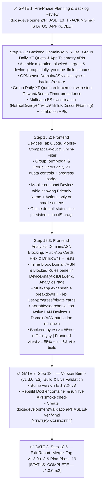

# Phase 18 Execution & Checkpoint Tracker (`PHASE_18_TRACKING.md`)

> **Phase 18 Goal (`v1.3.0-rc3`):** Implement per-device and global **Domain & ASN Organization Blocking** (`FB-P4-007`..`009` / `FB-P18-001`), expand 5-minute active **Application Usage Telemetry** (`Netflix`, `Disney+`, `Twitch`, `TikTok`, `Discord`, `Gaming`) and **Plex `Now Playing`** details (`FB-P18-002`), add sortable/searchable **Top Active LAN Devices** & clickable Domain/ASN client attribution (`FB-P18-003`), and deliver all 3 Phase 17 waterfalled `Devices`/Policy enhancements: **Group Daily YouTube Viewing Time Limits** with strict **Reward / Bonus Timer precedence** (`FB-P17-006`), **Mobile-Compact Devices Table** (`FB-P17-007`), and **Online-by-Default Remembered Status Filter** (`FB-P17-008`).

---

## 1. Phase Objectives & Scheduled Backlog Items

- [x] **`FB-P18-001` (Completing `FB-P4-007`..`009`) — Per-Device & Global Domain and ASN Organization Blocking:**
  - Enrich `Top Destination Organizations (ASN)` payloads with numeric `asn` (`destination.as.number`).
  - Persist custom domain (FQDN / root domain) and ASN block rules in SQLite (with Alembic migration and full Configuration Backup/Restore JSON preservation) and enforce them in OPNsense via managed Host/ASN aliases and filter rules (plus global Unbound/alias toggle support).
  - Add inline **Block** actions inside `Top Visited Domains` and `Top Destination Organizations (ASN)` (in both `DeviceAnalyticsDrawer.tsx` and `AnalyticsPage.tsx`) and build a **Blocked Domains & ASN Organizations** management panel with one-click **Unblock / Remove** controls.

- [x] **`FB-P18-002` — Expanded Multi-App Telemetry (`Netflix`, `Disney+`, `Twitch`, `TikTok`, `Discord`, `Gaming`) & Enhanced Plex `Now Playing`:**
  - Extend active-usage classification in `elasticsearch.py` / `analytics_service.py` / `group_service.py` beyond `YouTube` & `Plex` to track **Netflix**, **Disney+**, **Twitch**, **TikTok**, **Discord**, and **Gaming** (`Sony/PSN`, `Xbox Live`, `Nintendo`, `Steam/Valve`, `Epic`), exposing expandable per-device duration and bandwidth breakdowns.
  - Enhance live Plex **Now Playing** cards in `AnalyticsPage.tsx`, `DeviceAnalyticsDrawer.tsx`, and `GroupAnalyticsDrawer.tsx` with Plex username, playback progress bar & `%`, video resolution, and transcode bitrate details.

- [x] **`FB-P18-003` — `Analytics` Tab Sortable/Searchable LAN Devices Table & Domain/ASN Client Attribution Drilldowns:**
  - Add clickable column sorting (`Device Name`, `DNS Queries`, `Firewall Bytes`, `Total Events`) and a live search filter input to **Top Active LAN Devices** on `AnalyticsPage.tsx`.
  - Make items in **Top Queried Domains (FQDN)**, **Top Registered Root Domains**, and **Top Destination Organizations (ASN)** clickable to open a client-attribution breakdown modal/drawer showing which LAN devices queried that domain or contacted that ASN, with direct actions to inspect (`DeviceAnalyticsDrawer`) or block.

- [x] **`FB-P17-006` (Waterfalled from Phase 17) — Device Group Daily YouTube Viewing Time Quota with Reward / Bonus Precedence:**
  - Add optional `daily_youtube_limit_minutes` (`Integer | None`, e.g., `60` for `1h / day`) to `DeviceGroup` (SQLite + Alembic migration, backup/restore export/import, and `GroupFormModal.tsx` selector/input).
  - Evaluate today's combined group active YouTube viewing duration in the reconciliation policy engine, automatically enforcing a YouTube block for non-protected group members once today's quota is exhausted until the daily rollover (`00:00` local `TZ`).
  - Guarantee deterministic precedence so **active Reward / Bonus Timers (`temporary_overrides` `type="unblock"` / YouTube bonus)** always override daily YouTube quotas and recurring schedules.
  - Surface daily YouTube usage vs. quota progress indicators (`e.g., 42m / 1h 00m today` or `Daily Limit Reached`) on Group Cards and `GroupAnalyticsDrawer.tsx`.

- [x] **`FB-P17-007` (Waterfalled from Phase 17) — `Devices` Tab Mobile-Compact Table Layout:**
  - On narrow mobile viewports (matching the mobile bottom navigation breakpoint `< sm`), show only **Device / Friendly Name** and **Actions** buttons in `DevicesPage.tsx` (`hidden sm:table-cell` on `Online` dot/column if folded into Name status or kept ultra-compact, `IPv4`, `Vendor / OUI`, `Status` text, `Last Seen`) so users can interact with every device with zero horizontal scrolling.

- [x] **`FB-P17-008` (Waterfalled from Phase 17) — `Devices` Tab Default to `Online` Filter & Remember User Selection:**
  - Initialize `statusFilter` in `DevicesPage.tsx` from `localStorage` (`gateway_devices_status_filter`), defaulting to `'online'` on first visit when no saved preference exists, and persist every filter pill selection thereafter.

---

## 2. Mermaid Workflow & Checkpoint Progress

| Checkpoint | Target Description | Status |
| :--- | :--- | :--- |
| **`CP-18.1`** | Backend DB migrations & APIs for Domain/ASN block rules (`FB-P18-001`), `daily_youtube_limit_minutes` quota + Reward/Bonus precedence (`FB-P17-006`), multi-app & Plex enhancements (`FB-P18-002`), and Domain/ASN attribution drilldown (`FB-P18-003`). | `[x] Complete` |
| **`CP-18.2`** | Frontend `Devices` tab & Group upgrades: `daily_youtube_limit_minutes` UI (`FB-P17-006`), mobile-compact Friendly Name + Actions table (`FB-P17-007`), and `localStorage`-persisted `Online` default filter (`FB-P17-008`). | `[x] Complete` |
| **`CP-18.3`** | Frontend `Analytics` & Drawers upgrades: Domain/ASN blocking controls & panel (`FB-P18-001`), expanded app cards + Plex progress/bitrate (`FB-P18-002`), sortable LAN table + attribution drilldowns (`FB-P18-003`), & `>= 85%` test suites (`pytest`, `ruff`, `mypy`, `vitest`, `vite build`). | `[x] Complete` |
| **`CP-18.4`** | Bump version to `1.3.0-rc3`, rebuild Docker container, run live API smoke check, and publish `docs/development/Validation/PHASE18-Verify.md` (Gate 2). | `[x] Complete` |
| **`CP-18.5`** | Ingest validation feedback, write exit analysis, merge `phase18`, tag `v1.3.0-rc3`, and create `PHASE_19_TRACKING.md` (Gate 3). | `[x] Complete` |

---

## 3. Detailed Step-by-Step Breakdown

### Step 18.1: Backend Migrations, Domain/ASN Blocking, Daily YT Quota Engine & Telemetry APIs (`CP-18.1`)
- **Files to Create / Modify:**
  - `backend/app/models/__init__.py`, `backend/app/db/__init__.py`, and `backend/alembic/versions/` (Phase 18 migration revision adding `device_groups.daily_youtube_limit_minutes` and `blocked_targets` table for domain/ASN rules).
  - `backend/app/clients/opnsense.py` (host/domain & BGP ASN alias management + firewall/Unbound sync helpers).
  - `backend/app/clients/elasticsearch.py` & `backend/app/services/analytics_service.py` (ASN `destination.as.number` enrichment, expanded app taxonomy classification, Plex session progress/user/bitrate fields, and Domain/ASN client attribution queries).
  - `backend/app/services/group_service.py` & `backend/app/services/schedule_service.py` (compute daily group YouTube active minutes and enforce quota in reconciliation while preserving strict priority for active Reward / Bonus timers and Protected devices).
  - `backend/app/services/audit_and_backup_service.py` (preserve custom domain/ASN rules and group daily YouTube limits in config JSON backup/restore).
  - `backend/app/api/groups.py`, `backend/app/api/analytics.py`, `backend/app/api/devices.py` (new domain/ASN rule endpoints + attribution endpoint + group quota validation).
  - Unit tests covering precedent matrix (Quota reached + Active Bonus Timer => Allowed; Quota reached + No Bonus => YouTube Blocked; Daily midnight rollover => Reset), OPNsense alias sync, app classification, and backup/restore.

### Step 18.2: Frontend `Devices` Tab Upgrades (`CP-18.2`)
- **Files to Modify:**
  - `frontend/src/api/client.ts` (Phase 18 API types & methods for group quotas, domain/ASN blocks, attribution drilldowns, expanded apps, and Plex metadata).
  - `frontend/src/components/GroupFormModal.tsx` & `frontend/src/pages/DevicesPage.tsx`:
    - Add Daily YouTube Time Limit control (`Unlimited`, `30m`, `1h`, `2h`, custom minutes) in `GroupFormModal.tsx` and quota/usage badge in Group Cards.
    - Add `< sm` responsive column hiding (`hidden sm:table-cell`) in `DevicesPage.tsx` so mobile screens render compact Friendly Name + Action buttons with zero horizontal scroll (`FB-P17-007`).
    - Default `statusFilter` to `'online'` on initial load and persist selection to `'gateway_devices_status_filter'` in `localStorage` (`FB-P17-008`).

### Step 18.3: Frontend `Analytics` & Drawer Upgrades + Full Quality Gate (`CP-18.3`)
- **Files to Create / Modify:**
  - `frontend/src/components/DeviceAnalyticsDrawer.tsx` & `frontend/src/components/GroupAnalyticsDrawer.tsx` (inline Domain/ASN Block controls, blocked rules list, expanded app cards, Plex username/progress bar/bitrate).
  - `frontend/src/pages/AnalyticsPage.tsx` (Blocked Domains & ASN Organizations manager, multi-app expandable device/bandwidth cards, Plex Now Playing enhancements, sortable/searchable `Top Active LAN Devices` table, clickable Domain/ASN client attribution drilldown modal/drawer).
  - `frontend/src/__tests__/Phase18Features.test.tsx` (new) + updates to `DevicesPage.test.tsx`, `Analytics.test.tsx`, `Groups.test.tsx`.
- **Quality Gate Targets:**
  - `.\backend\.venv\Scripts\pytest.exe backend/tests --cov=app` -> 100% pass rate, `>= 85%` coverage.
  - `.\backend\.venv\Scripts\ruff.exe check backend` -> 0 errors.
  - `.\backend\.venv\Scripts\mypy.exe backend/app` -> 0 issues.
  - `npm test` (`vitest run --coverage`) -> 100% pass rate, `>= 85%` coverage.
  - `npm run build` (`tsc -b && vite build`) -> 0 errors.

### Step 18.4: Version Increment (`1.3.0-rc3`), Container Rebuild & Live Validation (`CP-18.4` — Gate 2)
- Bump version to `1.3.0-rc3` in `backend/app/__init__.py`, `backend/pyproject.toml`, and `frontend/package.json`.
- Rebuild and restart Docker container (`docker compose -f docker/docker-compose.yml --env-file .env up -d --build`).
- Execute live smoke tests verifying Alembic migration, Domain/ASN block APIs, Group daily YT quota + Reward precedence, mobile/online-default Devices UX, and Analytics drilldowns.
- Publish `docs/development/Validation/PHASE18-Verify.md` and **STOP** for user verification.

### Step 18.5: Feedback Ingestion, Exit Report & `v1.3.0-rc3` Release Merge (`CP-18.5` — Gate 3)
- Record user validation feedback from `PHASE18-Verify.md` into `FEATURE_BACKLOG.md` & `TEST_AND_BUG_LOG.md`.
- Complete Phase 18 Exit Analysis in `PHASE_EXIT_REPORTS.md` and update `PLAN.md`.
- Merge `phase18` `--no-ff` into `main`, tag `v1.3.0-rc3`, push to `origin`, create `docs/development/PHASE_19_TRACKING.md`, and **STOP** for Gate 1 review of Phase 19.
