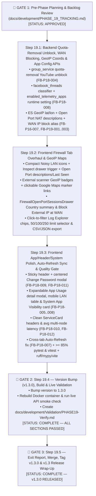

# Phase 19 Execution & Checkpoint Tracker (`PHASE_19_TRACKING.md`)

> **Phase 19 Goal (`v1.3.0` Final Release):** Deliver **`Firewall` Tab Security Drilldowns & WAN Blocking** (`FB-P19-001`, `FB-P19-002` + `FB-P16-007` clickable Google Maps GeoIP links, `FB-P19-003` click-to-filter Log Explorer with limits & CSV/JSON export), and complete all **9 waterfalled Phase 18 refinements** (`FB-P18-004` / `BUG-P18-004` quota removal auto-unblock, `FB-P18-005` expandable Application Usage detail modal, `FB-P18-006` mobile-compact `Top Active LAN Devices` table, `FB-P18-007` / `BUG-P18-005` cross-tab auto-refresh sync fix, `FB-P18-008` System configurable App Telemetry catalog + combined `Facebook & Threads`, `FB-P18-009` centered `Change My Password` modal, `FB-P18-010` clean top 4 System health cards, `FB-P18-011` sticky desktop header, and `FB-P18-012` multi-node average ping latency in `Test All Connections`).

---

## 1. Phase Objectives & Scheduled Backlog Items

### Core Phase 19 (`Firewall` Tab) Deliverables
- [x] **`FB-P19-001` — `Firewall` Tab Compact `Noisy LAN` Controls (`Inspect` Trigger) & Open WAN Port Service Descriptions:**
  - Convert Block/Unblock actions in **Noisy LAN Devices** on `FirewallPage.tsx` to compact touch-friendly icon buttons matching `DevicesPage.tsx` and add a Magnifying Glass (`<Search />`) **`Inspect`** button to open `DeviceAnalyticsDrawer` directly from the `Firewall` tab.
  - Display friendly OPNsense D-NAT rule descriptions (e.g., `Plex Media Server`, `WireGuard VPN`) and `Last Seen` timestamps inside **Active Inbound WAN Exposure (Open Ports)**.

- [x] **`FB-P19-002` + `FB-P16-007` — External WAN Scanner GeoIP Badges, Clickable Google Maps Links & 1-Click `Block External IP at WAN`:**
  - Enrich external WAN scanner and open-port session payloads (`elasticsearch.py` / `firewall_service.py`) with GeoIP Country/City/Region and `latitude`/`longitude` coordinates when available.
  - Display GeoIP Country/City badges on **Top Blocked External WAN Scanners** (`FirewallPage.tsx`, clickable to filter the Packet Log Explorer).
  - Render GeoIP locations across `FirewallPage.tsx` and `FirewallOpenPortSessionsDrawer.tsx` as clickable external links (`target="_blank" rel="noopener noreferrer"`) opening Google Maps centered with a location marker (`?api=1&query=<lat>,<lon>` or encoded place name — `FB-P16-007`).
  - Inside `FirewallOpenPortSessionsDrawer.tsx`, add a Country summary breakdown bar and a **`Block External IP at WAN`** toggle/action backed by SQLite + OPNsense WAN blocklist alias (`gateway_wan_blocked_ips`).

- [x] **`FB-P19-003` — Interactive Click-to-Filter Packet Log Explorer, Row Limits & CSV/JSON Export:**
  - Make `Source IP`, `Destination IP`, `Port`, `Protocol`, and `Interface` cells in **Searchable Firewall Packet Log Explorer** (`FirewallPage.tsx`) clickable to apply removable filter chips instantaneously.
  - Add configurable row limit selectors (`50` / `100` / `250`) plus **Export CSV** and **Export JSON** actions.

### Waterfalled Phase 18 Validation Fixes & UI Refinements (`FB-P18-004` .. `FB-P18-012`)
- [x] **`FB-P18-004` (`BUG-P18-004`) — Auto-Unblock Group YouTube Access When Daily YouTube Quota Is Removed or Raised:**
  - Update `update_group()` in `backend/app/services/group_service.py` so clearing `daily_youtube_limit_minutes` (`None`) or raising it above `today_youtube_minutes` automatically unblocks `is_youtube_blocked` on non-protected member devices not subject to an active `pause` override or active `youtube`-mode schedule, and synchronizes OPNsense `gateway_youtube_blocked_devices`.

- [x] **`FB-P18-005` — Click-to-Expand Application Usage Telemetry Card Modal / Detail View:**
  - Make every Application Usage card clickable across `AnalyticsPage.tsx`, `DeviceAnalyticsDrawer.tsx`, and `GroupAnalyticsDrawer.tsx` to open a detailed view/modal displaying untruncated Plex `Now Playing` show/episode titles, user, player/platform, resolution, transcode status/bitrate, progress bar, and full per-device usage breakdown.

- [x] **`FB-P18-006` — `Analytics` Tab Mobile-Compact `Top Active LAN Devices` Table:**
  - Apply `hidden sm:table-cell` to `IPv4 & Vendor`, `DNS Queries`, and `Firewall Bytes` columns in `overview-top-devices-table` (`AnalyticsPage.tsx`) so mobile (`< 640px`) displays only **Device**, **Total Events**, and **Inspect**.

- [x] **`FB-P18-007` (`BUG-P18-005`) — Consistent Auto-Refresh Timer Execution & `Updated: HH:MM:SS` Across All Tabs:**
  - Update `DevicesPage.tsx` auto-refresh timer ticks to invoke `apiClient.syncDevices()` (keeping live OPNsense state and `Synced: HH:MM:SS` current).
  - Update `AnalyticsPage.tsx` and `FirewallPage.tsx` scheduled `refetchInterval` fetches to pass `refresh: true` (bypassing stale backend cache on periodic timer ticks), keep `FirewallPage.tsx` `windowSnapshots[windowKey]` updated on refetches, and reliably advance `Updated: HH:MM:SS`.

- [x] **`FB-P18-008` — Configurable App Telemetry Catalog in `System` Settings (Default `YouTube` & `Plex`) + Combined `Facebook & Threads`:**
  - Add `facebook_threads` (**Facebook & Threads**: `facebook.com`, `fbcdn.net`, `instagram.com`, `threads.net`, `threads.com`, Meta ASN `AS32934` correlation) as a single grouped category (`9` total trackable apps).
  - Persist `enabled_telemetry_apps` (defaulting to `["youtube", "plex"]`, with the remaining apps opt-in) via `runtime_settings_service.py` / `/api/v1/system/settings`, expose an **Application Telemetry Visibility** toggle section in `StatusPage.tsx`, and filter/display enabled apps consistently across `AnalyticsPage.tsx`, `DeviceAnalyticsDrawer.tsx`, and `GroupAnalyticsDrawer.tsx`.

- [x] **`FB-P18-009` — Centered Screen Modal Popup for User `Change My Password`:**
  - Replace the inline chevron accordion password form inside the Header User Menu dropdown (`AppLayout.tsx`) with a button that opens a centered screen modal popup (`ChangePasswordModal`) to change the signed-in user's password.

- [x] **`FB-P18-010` — `System` Tab Top 4 Service Health Cards — Remove Redundant Subtitle & Status Message Text:**
  - Simplify `ServiceCard` in `StatusPage.tsx` by removing the `subtitle` line (`OPNsense REST API...`, etc.) and `health.message` text underneath the 4 top vertical card titles while keeping status badges, key cluster/storage highlights, and collapsible Technical Details.

- [x] **`FB-P18-011` — Sticky Top Page Header in Desktop / Full-Page Mode:**
  - Change `<header>` in `AppLayout.tsx` to `sticky top-0 z-40` so desktop users always have tab navigation and system status accessible without scrolling back to the top.

- [x] **`FB-P18-012` — `System` Tab `Test All Connections` Popup — Show Average Ping Latency for Multi-Node Services:**
  - Update the `Test All Connections` modal in `StatusPage.tsx` to compute and display the rounded average `latency_ms` when a service has multiple configured nodes (`nodeRows.length > 1`, e.g., 3 Elasticsearch nodes), while single-node services continue displaying their individual ping latency.

### Gate 2 Validation Feedback & Enhancements Completed Before Release (`FB-P19-004` .. `FB-P19-008`, `BUG-P19-002` .. `BUG-P19-003`)
- [x] **`BUG-P19-002` + `FB-P19-004`:** Resolved runtime override & cache-key signature sync for `enabled_telemetry_apps` across Overview/Device/Group Analytics (`GET/PUT /api/v1/system/telemetry-apps`), and added a synchronized **Configure Apps** modal inside **Analytics** -> **Application Usage Stats**.
- [x] **`BUG-P19-003` + `FB-P19-005`:** Fixed OPNsense `26.7.7` `200 []` UUID resolution & persistent config-API sync (`get_item` -> `set_item` -> `reconfigure`) for `gateway_wan_blocked_ips` (plus boot creation), and added the **Blocked External WAN IPs** card on `FirewallPage.tsx` with manual add, filter pills, GeoIP links, and 1-click Unblock.
- [x] **`FB-P19-006`:** Interpolated live connected OPNsense (`26.7.7`) and Elasticsearch (`9.4.3`) versions in the `System` page header subtitle.
- [x] **`FB-P19-007` + `FB-P19-008`:** Standardized Device Group card buttons (`Filter`, `Analytics`, `YouTube`, `Timer`, `Internet`) to `h-9 w-9` and added the **Current Group Members** card with 1-click removal inside `GroupFormModal.tsx`.

---

## 2. Mermaid Workflow & Checkpoint Progress

| Checkpoint | Target Description | Status |
| :--- | :--- | :--- |
| **`CP-19.1`** | Backend fixes & APIs: quota-removal YouTube unblock (`FB-P18-004`), `facebook_threads` + configurable `enabled_telemetry_apps` setting (`FB-P18-008`), ES GeoIP coordinates (`FB-P16-007`), `gateway_wan_blocked_ips` WAN IP blocklist & NAT descriptions (`FB-P19-001`..`002`), Log Explorer `limit` (`FB-P19-003`), plus Gate 2 fixes (`BUG-P19-002` runtime telemetry override/cache sync & `GET/PUT /api/v1/system/telemetry-apps`; `BUG-P19-003` OPNsense `200 []` alias bootstrap & config-API persistence; `FB-P19-006` dynamic OPNsense/ES version health details). | `[x] Complete` (`156 passed`, `85%` cov, `0` ruff/mypy) |
| **`CP-19.2`** | Frontend `Firewall` Tab & Drawer upgrades: compact `Noisy LAN` + `Inspect`, D-NAT labels + `Last Seen`, GeoIP scanner badges + clickable Google Maps links, `Block External IP at WAN`, **Blocked External WAN IPs** card with manual add & 1-click Unblock (`FB-P19-005`), clickable log filter chips, row limits, and CSV/JSON export (`FB-P19-001`..`003`, `FB-P16-007`). | `[x] Complete` (`tsc -b` + `vitest` verified) |
| **`CP-19.3`** | Frontend cross-tab, `Devices` & `System` polish: expandable App Usage detail modal (`FB-P18-005`), synced **Configure Apps** modal (`FB-P19-004`), mobile `Top Active LAN Devices` (`FB-P18-006`), `Devices`/`Analytics`/`Firewall` Auto-Refresh fix (`FB-P18-007`), System App Telemetry selector (`FB-P18-008`), dynamic System header versions (`FB-P19-006`), uniform Group card buttons (`FB-P19-007`), `GroupFormModal` **Current Group Members** card (`FB-P19-008`), centered Change Password modal (`FB-P18-009`), clean `ServiceCard`s (`FB-P18-010`), sticky header (`FB-P18-011`), avg multi-node latency (`FB-P18-012`), and `>= 85%` test suites. | `[x] Complete` (`11` files / `45 passed`, `91.12%` cov, `0` build errors) |
| **`CP-19.4`** | Bump version to `1.3.0`, rebuild Docker container, run live API/OPNsense/Elasticsearch/telemetry-sync smoke probes, and update `docs/development/Validation/PHASE19-Verify.md` for Gate 2 re-validation. | `[x] Complete` (`v1.3.0` container healthy on `:8080`; live probes & `PHASE19-Verify.md` ready) |
| **`CP-19.5`** | Ingest validation feedback, write exit analysis, merge `phase19` `--no-ff` into `main`, tag final release `v1.3.0`, and push. | `[x] Complete` (`v1.3.0` merged to `main`, tagged & pushed) |

---

## 3. Detailed Step-by-Step Breakdown

### Step 19.1: Backend Quota-Removal Unblock, WAN Blocklist, GeoIP Coordinates & App Telemetry Settings (`CP-19.1`)
- **Files to Create / Modify:**
  - `backend/app/services/group_service.py`: In `update_group()`, when `daily_youtube_limit_minutes` is cleared (`None`) or raised above `today_youtube_minutes`, unblock `is_youtube_blocked` on eligible non-protected member devices (not covered by an active `pause` override or active `youtube`-mode schedule) and sync OPNsense `gateway_youtube_blocked_devices` (`FB-P18-004` / `BUG-P18-004`).
  - `backend/app/config.py`, `backend/app/services/runtime_settings_service.py`, `backend/app/api/system.py`: Persist `enabled_telemetry_apps` (default `["youtube", "plex"]`, supporting all 9 apps including `facebook_threads`).
  - `backend/app/clients/elasticsearch.py`, `backend/app/services/analytics_service.py`: Add `facebook_threads` (`Facebook & Threads`) to application usage classification; include `latitude`/`longitude` on GeoIP scanner/external-IP records (`source.geo.location`) and support configurable `limit` (`50`/`100`/`250`) on firewall log queries.
  - `backend/app/clients/opnsense.py`, `backend/app/services/firewall_service.py`, `backend/app/api/firewall.py`, `backend/app/models/__init__.py`: Add `gateway_wan_blocked_ips` alias add/remove/list support (`POST /api/v1/firewall/wan-blocks`, `DELETE /api/v1/firewall/wan-blocks/{ip}`, `GET /api/v1/firewall/wan-blocks`) and surface friendly D-NAT descriptions in open WAN port responses (plus Config Backup/Restore preservation if stored in SQLite).
  - `backend/tests/test_phase19_firewall_and_polish.py` (new): Full unit & API test suite covering quota removal unblocking, `facebook_threads` classification, `enabled_telemetry_apps` settings roundtrip, GeoIP lat/lon extraction, WAN IP blocklist enforcement, and RBAC guards.

### Step 19.2: Frontend `Firewall` Tab Overhaul & Clickable Google Maps GeoIP Links (`CP-19.2`)
- **Files to Modify:**
  - `frontend/src/api/client.ts`: Add types/methods for WAN IP blocking, `enabled_telemetry_apps`, `facebook_threads`, GeoIP `latitude`/`longitude`, NAT descriptions, and firewall log `limit`.
  - `frontend/src/pages/FirewallPage.tsx`:
    - Compact **Noisy LAN Devices** icon Block/Unblock + Magnifying Glass **`Inspect`** button (`DeviceAnalyticsDrawer`).
    - Show friendly NAT descriptions & `Last Seen` in **Active Inbound WAN Exposure (Open Ports)**.
    - Render GeoIP Country/City badges & clickable Google Maps links (`target="_blank" rel="noopener noreferrer"`) on external scanner rows, plus click-to-filter scanner IPs.
    - Make `Source IP`, `Destination IP`, `Port`, `Protocol`, and `Interface` cells in **Searchable Firewall Packet Log Explorer** clickable with removable filter chips, add `50` / `100` / `250` row limit selector + **Export CSV** / **Export JSON**, and fix auto-refresh snapshot updates (`FB-P18-007`).
  - `frontend/src/components/FirewallOpenPortSessionsDrawer.tsx`:
    - Add GeoIP Country breakdown summary bar, clickable Google Maps GeoIP location links (`FB-P16-007`), and **`Block External IP at WAN`** button with live status sync (`FB-P19-002`).

### Step 19.3: Frontend App/Header/System Polish, Auto-Refresh Sync & Full Quality Gate (`CP-19.3`)
- **Files to Create / Modify:**
  - `frontend/src/components/AppLayout.tsx`: Sticky desktop `<header>` (`sticky top-0 z-40` — `FB-P18-011`) and centered **`ChangePasswordModal`** popup opened from the User Menu (`FB-P18-009`).
  - `frontend/src/components/AppUsageDetailModal.tsx` (new) + `AnalyticsPage.tsx` + `DeviceAnalyticsDrawer.tsx` + `GroupAnalyticsDrawer.tsx`: Click-to-expand Application Usage modal (`FB-P18-005`), mobile-compact `Top Active LAN Devices` table (`FB-P18-006`), `enabled_telemetry_apps` visibility filtering (`FB-P18-008`), and cache-bypassing auto-refresh ticks (`FB-P18-007`).
  - `frontend/src/pages/DevicesPage.tsx`: Ensure `useAutoRefresh` ticks trigger `apiClient.syncDevices()` updating live state & `Synced: HH:MM:SS` (`FB-P18-007`).
  - `frontend/src/pages/StatusPage.tsx`: Remove redundant subtitle/status paragraph underneath the top 4 `ServiceCard` headers (`FB-P18-010`), display rounded average ping latency across multi-node services in `Test All Connections` (`FB-P18-012`), and add the **Application Telemetry Visibility** checkboxes/toggles under settings (`FB-P18-008`).
  - `frontend/src/__tests__/Phase19Features.test.tsx` (new) + updates to `App.test.tsx`, `DevicesPage.test.tsx`, `Analytics.test.tsx`.
- **Quality Gate Targets:**
  - `.\backend\.venv\Scripts\pytest.exe backend/tests --cov=app` -> 100% pass rate, `>= 85%` coverage.
  - `.\backend\.venv\Scripts\ruff.exe check backend` -> 0 errors.
  - `.\backend\.venv\Scripts\mypy.exe backend/app` -> 0 issues.
  - `npm test` (`vitest run --coverage`) -> 100% pass rate, `>= 85%` coverage.
  - `npm run build` (`tsc -b && vite build`) -> 0 errors.

### Step 19.4: Version Increment (`1.3.0`), Container Rebuild & Live Validation (`CP-19.4` — Gate 2)
- Bump version to `1.3.0` in `backend/app/__init__.py`, `backend/pyproject.toml`, and `frontend/package.json`.
- Rebuild and restart Docker container (`docker compose -f docker/docker-compose.yml --env-file .env up -d --build`).
- Run live container/API/schema smoke checks, publish `docs/development/Validation/PHASE19-Verify.md`, and **STOP** for user verification.

### Step 19.5: Feedback Ingestion, Final `v1.3.0` Exit Report & Git Release (`CP-19.5` — Gate 3)
- Record user validation feedback into `FEATURE_BACKLOG.md` & `TEST_AND_BUG_LOG.md`.
- Complete Phase 19 Exit Analysis & `v1.3.0` release retrospective in `PHASE_EXIT_REPORTS.md` and `PLAN.md`.
- Commit `phase19`, merge `--no-ff` into `main`, tag `v1.3.0`, and push to `origin`.
