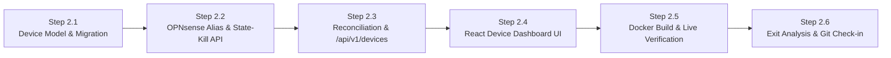

# Phase 2 Execution & Checkpoint Tracking (`PHASE_2_TRACKING.md`)

> **Phase:** 2 of 7 (Test Cycle 2 — Device Inventory & Control Feature #1: Instant Single-Device Block / Unblock)  
> **Branch:** `phase2`  
> **Complexity Rating:** **3 / 5 (Medium)**  
> **Status:** `COMPLETE`  
> **Master Plan Reference:** [PLAN.md](PLAN.md)

---

## 1. Phase 2 Objectives & Waterfalled Inputs from Phase 1

1. **Device Discovery & Reconciliation Engine:**
   - Merge live OPNsense Dnsmasq DHCP leases (`/api/dnsmasq/leases/search`), live ARP table entries (`/api/diagnostics/interface/get_arp`), and the current `gateway_blocked_devices` firewall alias into a unified SQLite `devices` inventory keyed by normalized MAC address.
   - **Waterfall Update 2A (Dnsmasq Schema Normalization):** Map Dnsmasq's `address` → IPv4, `hwaddr` → MAC, `mac_info` → vendor, and `if_descr` → interface alongside ARP's `ip`, `mac`, `manufacturer`, and `intf_description`, and strip Dnsmasq's literal `"*"` placeholder when `hostname` or `client_id` is unknown.
   - Persist user-assigned friendly names (`display_name`), `notes`, and `is_protected` flags across DHCP IP changes.
2. **Control Feature #1 — Instant Single-Device Block / Unblock:**
   - Implement `POST /api/v1/devices/{device_id}/block` and `POST /api/v1/devices/{device_id}/unblock` with strict self-lockout guardrails (`OPNSENSE_PROTECTED_IPS`, `192.168.1.1`, requesting admin IP, and `is_protected` devices cannot be blocked).
   - **Waterfall Update 2B (Dual-Path Alias Mutation):** Support `/api/firewall/alias_util/add` & `delete` with automatic fallback to `/api/firewall/alias/get_alias_uuid` → `get_item` → `set_item` → `reconfigure` when `alias_util` returns `HTTP 403`.
   - Execute `/api/diagnostics/firewall/kill_states` (`{"filter": "<ip>"}`) immediately upon blocking to sever existing active connections, and record every action in `audit_logs`.
3. **React Device Dashboard (v1):**
   - Summary KPI cards (**Total Devices**, **Online Now**, **Currently Blocked**, **Protected**).
   - Searchable, filterable Device Inventory table (`All`, `Online`, `Blocked`, `Protected`, `Unassigned`) with inline friendly-name editing, protection toggle, and one-click **Internet Access (`Allowed` / `Blocked`)** switch.

---

## 2. Step-by-Step Execution & Checkpoint Tracker

### Progress Summary Table

| Step | Checkpoint | Description | Status | Verified Date |
| :--- | :--- | :--- | :---: | :---: |
| **Step 2.1** | `CP-2.1` | SQLite `Device` Model & Alembic Migration (`0002_devices_inventory.py`) + Unit Tests | `[x] Complete` | 2026-10-31 |
| **Step 2.2** | `CP-2.2` | `OPNsenseClient` Block/Unblock (Dual-Path Alias API) & `kill_states` + Unit Tests | `[x] Complete` | 2026-10-31 |
| **Step 2.3** | `CP-2.3` | Device Reconciliation Service & `/api/v1/devices` Endpoints + Unit Tests | `[x] Complete` | 2026-10-31 |
| **Step 2.4** | `CP-2.4` | React Device Inventory Dashboard, KPI Bar, Inline Rename & Block Toggle + Unit Tests | `[x] Complete` | 2026-10-31 |
| **Step 2.5** | `CP-2.5` | Docker Container Rebuild (`http://localhost:8080`) & Live OPNsense Smoke Verification | `[x] Complete` | 2026-10-31 |
| **Step 2.6** | `CP-2.6` | Phase 2 QA Gate, Bug Ledger, Exit Analysis, Learnings Checkpoint & Git Push | `[x] Complete` | 2026-10-31 |

---

## 3. Detailed Step Breakdown & Verification Checkpoints

### Step 2.1 — SQLite `Device` Model & Alembic Migration
- **Tasks:**
  - [x] Add `Device` model to `backend/app/models/__init__.py` with fields: `id`, `mac_address` (unique, normalized lowercase), `ipv4_address`, `hostname`, `display_name`, `vendor`, `interface_name`, `lease_type`, `is_online`, `is_blocked`, `is_protected`, `notes`, `first_seen_at`, `last_seen_at`, `updated_at`, plus `normalize_mac_address()` and `clean_discovered_hostname()`.
  - [x] Create Alembic migration `backend/alembic/versions/0002_devices_inventory.py`.
  - [x] Write unit tests in `backend/tests/test_device_models.py` testing MAC/IP normalization, placeholder hostname stripping (`"*"`), unique constraints, and persistence.
- **Checkpoint `CP-2.1` Verification Criteria:**
  - [x] `pytest backend/tests/test_device_models.py` passes 100% (`21/21` new model tests passing; `54/54` total backend tests passing in `1.33s`, `100%` coverage on `app/models/__init__.py`, `94%` total backend coverage).
  - [x] Any defects found are logged in `docs/development/TEST_AND_BUG_LOG.md`.

---

### Step 2.2 — `OPNsenseClient` Alias Mutation & State-Kill Extensions
- **Tasks:**
  - [x] Add strict IPv4 validation (`validate_ipv4_address()`) in `backend/app/clients/opnsense.py` preventing invalid IPs, wildcards (`0.0.0.0`, `255.255.255.255`), CIDR blocks, or filter injection.
  - [x] Implement `add_ip_to_block_alias(ip: str)` and `remove_ip_from_block_alias(ip: str)` in `OPNsenseClient`:
    - Primary path: `POST /api/firewall/alias_util/add/{alias}` and `POST /api/firewall/alias_util/delete/{alias}`.
    - Automatic `403` fallback (**Waterfall Update 2B**): `get_alias_uuid` → `get_item/{uuid}` → update `alias.content` newline list → `set_item/{uuid}` → `POST /api/firewall/alias/reconfigure`.
  - [x] Implement `kill_states_for_ip(ip: str)` calling `POST /api/diagnostics/firewall/kill_states` (`{"filter": ip}`).
  - [x] Write unit tests in `backend/tests/test_opnsense_mutations.py` using `respx` (testing `alias_util` success, `403` config API fallback, idempotent add/remove, `kill_states` timeout/error handling, and invalid IP rejection).
- **Checkpoint `CP-2.2` Verification Criteria:**
  - [x] `pytest backend/tests/test_opnsense_mutations.py` passes 100% (`14/14` new mutation tests passing; `68/68` total backend tests passing in `1.43s`, `95%` coverage on `opnsense.py`, `95%` total backend coverage).
  - [x] Any defects found are logged in `docs/development/TEST_AND_BUG_LOG.md`.

---

### Step 2.3 — Device Reconciliation Service & `/api/v1/devices` REST API
- **Tasks:**
  - [x] Implement `backend/app/services/device_service.py`:
    - Reconcile `/api/dnsmasq/leases/search` + `/api/diagnostics/interface/get_arp` + `list_blocked_alias_ips()` into SQLite `devices`.
    - Handle **Waterfall Update 2A** (`address`/`hwaddr`/`mac_info` mapping and stripping `"*"` placeholders for `hostname`/`client_id`).
    - Enforce self-lockout protection (`OPNSENSE_PROTECTED_IPS`, `192.168.1.1`, client request IP, and `device.is_protected`).
    - Implement `block_device_internet()` and `unblock_device_internet()` with audit log entries (`device.block`, `device.unblock`) and graceful handling if `kill_states` times out after alias update succeeds.
  - [x] Implement `backend/app/api/devices.py` (`GET /api/v1/devices`, `POST /api/v1/devices/sync`, `PATCH /api/v1/devices/{device_id}`, `POST /api/v1/devices/{device_id}/block`, `POST /api/v1/devices/{device_id}/unblock`) and register router in `backend/app/main.py`.
  - [x] Also update session cookie `secure` flag in `backend/app/api/auth.py` to check `request.url.scheme == "https"` or `X-Forwarded-Proto == "https"` so LAN HTTP container access works across all browsers.
  - [x] Write unit tests in `backend/tests/test_devices_api.py` covering merge edge cases (ARP-only static device, offline Dnsmasq device, DHCP IP change for existing MAC, protected IP `403` rejection, block/unblock + audit log creation, and partial `kill_states` warning).
- **Checkpoint `CP-2.3` Verification Criteria:**
  - [x] `pytest backend/tests/` passes 100% with `>= 85%` coverage (`72/72` backend tests passing in `2.10s`, `89%` total backend coverage; `ruff` and `mypy` pass with `0` errors).
  - [x] Any defects found are logged in `docs/development/TEST_AND_BUG_LOG.md`.

---

### Step 2.4 — React Device Dashboard UI, Inline Nickname Editor & Instant Block Toggle
- **Tasks:**
  - [x] Extend `frontend/src/api/client.ts` with typed Device models, KPI summary types, and API methods (`getDevices`, `syncDevices`, `updateDevice`, `blockDevice`, `unblockDevice`).
  - [x] Update `frontend/src/components/AppLayout.tsx` with navigation tabs switching between **Devices & Access Control** and **System Connectivity**.
  - [x] Implement `frontend/src/pages/DevicesPage.tsx`:
    - Summary KPI cards (`Total Devices`, `Online Now`, `Internet Blocked`, `Protected`).
    - Search input (filters by display name, hostname, IP, MAC, vendor) + filter pills (`All`, `Online`, `Blocked`, `Protected`) + `Sync Now` button.
    - Device table with inline nickname editing (`display_name`), Protected shield toggle (`192.168.1.1` locked), and one-click **Internet Access (`Allowed` / `Blocked`)** toggle button with optimistic/loading states.
  - [x] Write frontend unit tests in `frontend/src/__tests__/DevicesPage.test.tsx`.
- **Checkpoint `CP-2.4` Verification Criteria:**
  - [x] `npm run test` (`Vitest --coverage`) and `npm run build` (`tsc -b && vite build`) pass with zero errors and `>= 85%` coverage (`7/7` frontend tests passing, `96.59%` statement/line coverage, `0` TypeScript/Vite build errors).
  - [x] Any defects found are logged in `docs/development/TEST_AND_BUG_LOG.md`.

---

### Step 2.5 — Docker Container Rebuild & Live OPNsense Smoke Verification
- **Tasks:**
  - [x] Rebuild and restart the Docker container (`docker compose -f docker/docker-compose.yml --env-file .env up -d --build`).
  - [x] Verify live device sync at `http://localhost:8080` against `https://opnsense.example.local` and confirm that ARP & Dnsmasq devices populate cleanly with `"*"` hostnames stripped and `192.168.1.1` marked Protected (`69` total devices discovered, `57` online in ARP, `0` blocked, `1` protected gateway `192.168.1.1`, `0` literal `"*"` hostnames).
- **Checkpoint `CP-2.5` Verification Criteria:**
  - [x] Container reaches `healthy` status and user confirms the live Device Dashboard UI at `http://localhost:8080`.

---

### Step 2.6 — Phase 2 QA Audit, Exit Analysis, Learnings Checkpoint & Git Check-in
- **Tasks:**
  - [x] Run full backend (`pytest --cov=app`, `ruff check`, `mypy`) and frontend (`vitest run --coverage`, `npm run build`) quality gates (`72/72` backend tests passing at `89.0%` coverage; `7/7` frontend tests passing at `96.59%` coverage; `0` lint/type/build errors).
  - [x] Finalize all Phase 2 entries in `docs/development/TEST_AND_BUG_LOG.md` (`BUG-P2-001` through `BUG-P2-004`).
  - [x] Complete **Phase 2 Exit Report** in `docs/development/PHASE_EXIT_REPORTS.md` and waterfall any new findings into [PLAN.md](PLAN.md) and [docs/API_KEYS_SETUP.md](docs/API_KEYS_SETUP.md).
- **Checkpoint `CP-2.6` (Phase 2 Exit Sign-Off):**
  - [x] Review Phase 2 Exit Report with user, commit to `phase2` branch, and push to GitHub.

