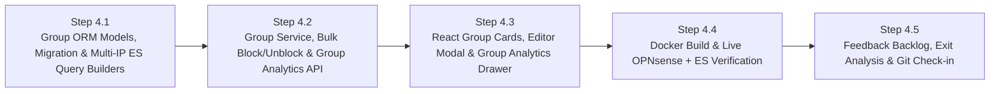

# Phase 4 Execution & Checkpoint Tracking (`PHASE_4_TRACKING.md`)

> **Phase:** 4 of 7 (Test Cycle 4 — Control Feature #2: Device Groups / Profiles & Bulk Access Control)  
> **Branch:** `phase4`  
> **Complexity Rating:** **3 / 5 (Medium)**  
> **Status:** `COMPLETE (Ready for CP-4.5 Sign-Off & Git Push)`  
> **Master Plan Reference:** [PLAN.md](PLAN.md) | [docs/development/PHASE_EXIT_REPORTS.md](docs/development/PHASE_EXIT_REPORTS.md) | [docs/development/FEATURE_BACKLOG.md](docs/development/FEATURE_BACKLOG.md)

---

## 1. Phase 4 Objectives & Waterfalled Inputs from Phases 1–3

1. **Groups / Profiles Data Model & Persistence (`device_groups` + `device_group_memberships`):**
   - Create, edit, and delete named device groups/profiles (e.g., *Kids Devices*, *Living Room Media*, *IoT*, *Guests*) with:
     - `name` (unique, case-insensitive)
     - `description` (optional notes)
     - `color_badge` (`indigo`, `emerald`, `amber`, `rose`, `cyan`, `violet`, `slate`)
     - `icon` (`users`, `tv`, `smartphone`, `gamepad`, `cpu`, `shield`)
     - Many-to-many membership (`device_group_memberships`) linking `Device` records to `DeviceGroup` records so a device can belong to one or more groups/profiles.
   - Expose group memberships directly on device responses (`groups: [{id, name, color_badge, icon}]`) so the Device Inventory can display group badges and filter by group.
2. **Control Feature #2 — Bulk Group Block / Unblock (`/api/v1/groups/{group_id}/block` & `/unblock`):**
   - Compute real-time Group Access State across assigned members:
     - `empty` (`0` blockable member devices)
     - `allowed` (all blockable members are currently allowed)
     - `partially_blocked` (some blockable members are blocked and some are allowed)
     - `blocked` (all blockable members are currently blocked)
   - **Bulk Block (`POST /api/v1/groups/{group_id}/block`):**
     - Automatically skips protected devices (`is_protected=True` or in `OPNSENSE_PROTECTED_IPS`) and offline devices without an `ipv4_address`, surfacing clear skipped-device warnings without failing the batch.
     - Adds all eligible member IPs to OPNsense `gateway_blocked_devices`, calls `/api/diagnostics/firewall/kill_states` for newly blocked IPs, updates SQLite `Device.is_blocked = True`, and writes a comprehensive `AuditLog` entry (`action="group_block"`).
   - **Bulk Unblock (`POST /api/v1/groups/{group_id}/unblock`):**
     - Removes eligible member IPs from OPNsense `gateway_blocked_devices`, updates SQLite `Device.is_blocked = False`, and writes an `AuditLog` entry (`action="group_unblock"`).
3. **Group-Level Analytics (`/api/v1/groups/{group_id}/analytics` — Waterfall Update 4A):**
   - Queries Elasticsearch `9.4.3` (`logs-pfsense.log*`) across all member IPv4 addresses combined using multi-IP `terms` filters (`source.ip`, `destination.ip`, `client.ip`).
   - **Phase 3 Waterfall Update 4A:** Includes a `by_member_ip` `terms` sub-aggregation enriched with SQLite `Device` metadata so Group Analytics shows each member device's individual contribution (bytes, allowed/blocked packets, DNS queries) alongside the group's combined Usage Timeline, 24-Hour Access Time Profile (`_compute_24h_access_profile()`), Top Visited Domains, Top Destination ASN Organizations, and searchable Chronological Recent DNS Queries.
4. **React Groups & Profiles UI:**
   - **Group Summary Cards Bar** at the top of the Device Inventory & Control page (and dedicated **Groups & Profiles** management modal + **Group Analytics Drawer**):
     - Displays group name, color badge, member count, online count, computed status badge (`Allowed`, `Partially Blocked`, `Blocked`, `Empty`), one-click **Block Group / Allow Group** toggle, **Manage Members** button, and **Group Analytics** button.
   - **Group Filter & Badges in Device Table:** Filter the device table by Group (`All Groups`, `Unassigned`, or a specific group) and display group pills on each device row.

---

## 2. Step-by-Step Execution & Checkpoint Tracker

### Progress Summary Table

| Step | Checkpoint | Description | Status | Verified Date |
| :--- | :--- | :--- | :---: | :---: |
| **Step 4.1** | `CP-4.1` | SQLAlchemy `DeviceGroup` & `DeviceGroupMembership` Models, Alembic Migration, and Multi-IP ES Group Query Builders + Unit Tests | `[x] Complete` | 2026-10-31 |
| **Step 4.2** | `CP-4.2` | `GroupService` (CRUD, State Calculation, Bulk Block/Unblock, Group Analytics) & `/api/v1/groups` Endpoints + Unit Tests | `[x] Complete` | 2026-10-31 |
| **Step 4.3** | `CP-4.3` | React Group Summary Cards, Create/Edit Group & Member Modal, Group Analytics Drawer & Device Group Filter + Unit Tests | `[x] Complete` | 2026-10-31 |
| **Step 4.4** | `CP-4.4` | Docker Container Rebuild (`http://localhost:8080`) & Live Group Block/Unblock + Group Analytics Smoke Verification | `[x] Complete` | 2026-10-31 |
| **Step 4.5** | `CP-4.5` | Phase 4 Feedback Backlog (`docs/development/FEATURE_BACKLOG.md`), QA Gate, Bug Ledger, Exit Analysis, Learnings Checkpoint & Git Push | `[x] Ready for Sign-Off` | 2026-10-31 |

---

## 3. Detailed Step Breakdown & Verification Checkpoints

### Step 4.1 — `DeviceGroup` ORM Models, Alembic Migration & Multi-IP ES Query Builders
- **Tasks:**
  - [x] Add `DeviceGroup` and `DeviceGroupMembership` models in `backend/app/models/__init__.py` and enable SQLite `PRAGMA foreign_keys=ON` in `backend/app/db/__init__.py`.
  - [x] Create Alembic migration `backend/alembic/versions/0003_phase4_device_groups.py`.
  - [x] Extend `backend/app/clients/elasticsearch.py` with pure synchronous multi-IP group query builders and normalizers (`build_group_analytics_query()`, `build_group_recent_domains_query()`, `normalize_group_analytics_response()`, and `ElasticsearchServiceClient.fetch_group_analytics()`).
  - [x] Write unit tests in `backend/tests/test_group_models_and_es.py`.
- **Checkpoint `CP-4.1` Verification Criteria:**
  - [x] `pytest` passes 100% with `>= 85%` coverage and `0` `ruff`/`mypy` errors (`85/85` passing, `96%` coverage).

---

### Step 4.2 — `GroupService`, Bulk Block/Unblock & `/api/v1/groups` REST API
- **Tasks:**
  - [x] Create `backend/app/services/group_service.py`:
    - Pure helper functions for group state computation (`allowed`, `partially_blocked`, `blocked`, `empty`), member assignment reconciliation, and batch OPNsense block/unblock planning (skipping protected and IP-less devices with warnings).
    - Async service methods for CRUD (`list_groups`, `get_group_by_id`, `create_group`, `update_group`, `set_group_members`, `delete_group`), bulk control (`block_group_internet`, `unblock_group_internet`), and group analytics (`get_group_analytics` with SQLite member enrichment and 20s cache).
  - [x] Update `backend/app/services/device_service.py` so `DeviceResponse` includes each device's assigned group badges (`groups: list[DeviceGroupBadge]`) and supports `status=unassigned` and `group_id` filtering.
  - [x] Create `backend/app/api/groups.py` (`/api/v1/groups` CRUD, `/block`, `/unblock`, `/analytics`) and register in `backend/app/main.py`.
  - [x] Write unit tests in `backend/tests/test_groups_api.py`.
- **Checkpoint `CP-4.2` Verification Criteria:**
  - [x] `pytest backend/tests/` passes 100% with `>= 85%` coverage, and `ruff` + `mypy` report `0` errors (`87/87` passing, `96%` coverage).

---

### Step 4.3 — React Groups UI, Member Assignment Modal & Group Analytics Drawer
- **Tasks:**
  - [x] Extend `frontend/src/api/client.ts` with Group types and API client functions (`getGroups`, `createGroup`, `updateGroup`, `deleteGroup`, `blockGroup`, `unblockGroup`, `getGroupAnalytics`).
  - [x] Create `frontend/src/components/GroupFormModal.tsx` (create/edit group name, description, color badge, searchable multi-select member device picker).
  - [x] Create `frontend/src/components/GroupAnalyticsDrawer.tsx` (slide-over drawer showing combined group telemetry, per-member traffic & DNS breakdown bar/table, Usage Timeline, 24-Hour Access Time Profile, Top Domains, Top ASN Organizations, searchable Recent DNS Queries, and header Bulk Block/Allow toggle).
  - [x] Update `frontend/src/pages/DevicesPage.tsx` with the **Device Groups / Profiles** cards bar, one-click Bulk Block/Allow toggle, group filter selector (`All`, `Unassigned`, or specific Group), and group badges on device rows.
  - [x] Write frontend unit tests in `frontend/src/__tests__/Groups.test.tsx`.
- **Checkpoint `CP-4.3` Verification Criteria:**
  - [x] `Vitest --coverage` and `tsc -b && vite build` pass with `0` errors and `>= 85%` coverage (`12/12` tests passing, `94.06%` coverage).

---

### Step 4.4 — Docker Container Rebuild & Live OPNsense + ES Smoke Verification
- **Tasks:**
  - [x] Rebuild and restart the Docker container (`docker compose -f docker/docker-compose.yml --env-file .env up -d --build`).
  - [x] Verify `/api/v1/groups` and `/api/v1/groups/{id}/analytics` inside the running container at `http://localhost:8080`, then prompt user for manual UI verification.
- **Checkpoint `CP-4.4` Verification Criteria:**
  - [x] Container reaches `healthy` status and user confirms live Group creation, bulk toggle, and Group Analytics at `http://localhost:8080`.

---

### Step 4.5 — Phase 4 QA Audit, Feedback Backlog, Exit Analysis, Learnings Checkpoint & Git Check-in
- **Tasks:**
  - [x] Run full backend and frontend quality gates (`87/87` backend tests at `96%` coverage; `12/12` frontend tests at `94.06%` coverage).
  - [x] Finalize all Phase 4 entries in [docs/development/TEST_AND_BUG_LOG.md](docs/development/TEST_AND_BUG_LOG.md) (`BUG-P4-001`).
  - [x] Log all 11 user UI/feature review items in [docs/development/FEATURE_BACKLOG.md](docs/development/FEATURE_BACKLOG.md) for systematic phase-by-phase review.
  - [x] Complete **Phase 4 Exit Report** in [docs/development/PHASE_EXIT_REPORTS.md](docs/development/PHASE_EXIT_REPORTS.md) and waterfall scheduled items into [PLAN.md](PLAN.md).
- **Checkpoint `CP-4.5` (Phase 4 Exit Sign-Off):**
  - [ ] Review Phase 4 Exit Report & `docs/development/FEATURE_BACKLOG.md` with user, commit to `phase4` branch, merge to `main`, and push to GitHub.
