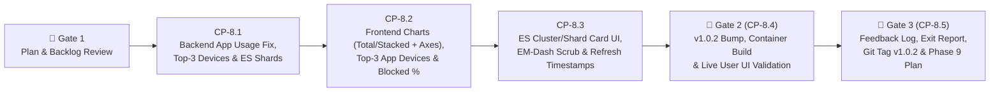

# Phase 8 Execution & Checkpoint Tracking (`docs/development/PHASE_8_TRACKING.md`)

> **Target Version:** `v1.0.2` (First Phase of the `v1.1` Release Cycle)  
> **Branch:** `phase8`  
> **Phase Status:** `COMPLETE`

---

## 1. Phase 8 Objectives & Scheduled Backlog Items (`FB-P8-001` – `FB-P8-007`)

Phase 8 resolves the `v1.0.1` telemetry observations and upgrades all analytics visualizations, Elasticsearch cluster/shard diagnostics, and refresh timestamps across the application:

| Backlog ID | Target Area | Summary of Deliverable |
| :--- | :--- | :--- |
| **`FB-P8-001`** | `backend/app/clients/elasticsearch.py`, `AnalyticsPage.tsx` | **Fix YouTube & Plex Near-100% Active-Time Inflation:** Aggregate 5-minute activity slots **per LAN device (`source.ip`)** with an active-streaming threshold (`min_doc_count >= 5` events per 5m slot per device, excluding passive `ytimg.com` / single-packet keepalive noise) so idle background pings across ~60 LAN devices no longer combine into a false 24h continuous active streak. |
| **`FB-P8-002`** | `backend/app/services/analytics_service.py`, `AnalyticsPage.tsx` | **Top 3 Devices per Application (YouTube & Plex):** Enrich per-device application usage slots with SQLite device names and display the **Top 3 Devices and their active time spent** directly at the bottom of the YouTube and Plex cards in `Application Usage Stats`. |
| **`FB-P8-003`** | `AnalyticsPage.tsx`, `DeviceAnalyticsDrawer.tsx`, `GroupAnalyticsDrawer.tsx` | **Blocked Firewall Packets Percentage:** Display the percentage of total firewall packets blocked right after the count (e.g., `14,250 (19.1%)`) in the `Blocked Firewall Packets` KPI box across the network overview and drawers. |
| **`FB-P8-004`** | `AnalyticsPage.tsx`, `DeviceAnalyticsDrawer.tsx`, `GroupAnalyticsDrawer.tsx` | **Bar Graph `Total` vs. `Stacked` View Selector:** Add a `Stacked | Total` mode toggle in the header of every bar graph allowing users to switch between stacked component bars (`DNS Queries` + `Firewall Events`) and a unified `Total Events` bar. |
| **`FB-P8-005`** | `AnalyticsPage.tsx`, `DeviceAnalyticsDrawer.tsx`, `GroupAnalyticsDrawer.tsx` | **Bar Graph Horizontal (X) & Vertical (Y) Axis Keys/Labels:** Add a visible **Y-Axis scale** (`Max`, `50%`, `0` + unit label) and **X-Axis time/hour tick labels** (`00:00`, `06:00`, `12:00`, `18:00`, etc. + axis title) to every bar graph so data is readable at a glance without hovering. |
| **`FB-P8-006`** | `backend/app/clients/elasticsearch.py`, `StatusPage.tsx`, `docs/API_KEYS_SETUP.md` | **Elasticsearch 9.4.3 Cluster Health & Shard Count Telemetry:** Query `GET /_cluster/health` in `ElasticsearchServiceClient.check_health()` and report **Cluster Health** (`GREEN` / `YELLOW` / `RED`) and **Shard Counts** (`Assigned`, `Unassigned`, `Relocating`) in the `Elasticsearch 9.4.3` card on `StatusPage.tsx`, plus document the required `cluster: ["monitor"]` / `GET _cluster/health` privilege in `docs/API_KEYS_SETUP.md`. |
| **`FB-P8-007`** | Global UI (`frontend/src/`, `backend/app/`) | **Global EM-Dash (`—`) Removal & `Updated: HH:MM:SS` Below All Refresh Buttons:** Remove all EM dashes (`—`) or replace with commas/colons (e.g., shorten `"Application Usage Stats — YouTube & Plex (24h)"` to `"Application Usage Stats"`), and show `Updated: HH:MM:SS` (24-hour format) directly underneath every `Refresh` button across all tabs and drawers. |

---

## 2. Phase 8 Workflow & Checkpoint Summary Table

| Step | Checkpoint ID | Description | Status | Completed Date |
| :--- | :--- | :--- | :---: | :---: |
| **Step 8.1** | `CP-8.1` | Backend Per-Device App Usage Accuracy Fix, Top-3 Devices Attribution & ES `_cluster/health` Shard Telemetry + Unit Tests | `[x] Complete` | 2026-11-03 |
| **Step 8.2** | `CP-8.2` | Frontend Bar Chart `Stacked`/`Total` Toggle + X/Y Axes, Top-3 App Devices UI & Blocked Firewall Packets `%` | `[x] Complete` | 2026-11-03 |
| **Step 8.3** | `CP-8.3` | Frontend ES Cluster/Shard Health Display, Global EM-Dash (`—`) Removal, `Updated: HH:MM:SS` Under Refresh Buttons & `Vitest` Suite | `[x] Complete` | 2026-11-03 |
| **Step 8.4** | `CP-8.4` | **🛑 GATE 2:** Bump Version to `1.0.2`, Rebuild Docker Container, Live Smoke Check & Prompt User for UI Validation | `[x] Complete` | 2026-11-03 |
| **Step 8.5** | `CP-8.5` | **🛑 GATE 3:** Log User Feedback, Phase 8 Exit Report, Merge/Tag `v1.0.2`, Push to GitHub & Create `docs/development/PHASE_9_TRACKING.md` | `[x] Complete` | 2026-11-03 |

---

## 3. Detailed Step-by-Step Breakdown

### Step 8.1 (`CP-8.1`) — Backend App Usage Accuracy Fix, Top-3 Devices & ES Cluster/Shard Health
- **Files to Modify:**
  - [`backend/app/clients/elasticsearch.py`](file:///d:/source/gateway-front-end/backend/app/clients/elasticsearch.py):
    - Update `_build_app_usage_agg(safe_tz)` so each application filter (`youtube`, `plex`) restricts to active streaming domains/ports (removing passive static thumbnail noise `ytimg.com` and requiring active session thresholds) and includes a nested `by_device` `terms` aggregation on `source.ip` (filtered to `RFC1918_CIDRS` for network overview) with its own `active_slots` (`5m` `date_histogram`, `min_doc_count: 5`), `bytes` (`sum`), and `dns_queries` (`filter`).
    - Update `_extract_app_usage(aggs)` to compute each device's `active_minutes = device_active_slots * 5`, aggregate overall `active_minutes` from active device slots (eliminating single-packet background ping inflation across 60 devices), and return `top_devices` (top 3 devices sorted by `active_minutes` desc, `bytes` desc, `event_count` desc).
    - Update `ElasticsearchServiceClient.check_health()` to call `await client.cluster.health()` (with graceful fallback on `AuthorizationException` / `TransportError`) and include `cluster_status`, `assigned_shards` (`active_shards`), `unassigned_shards`, and `relocating_shards` in `ServiceHealthStatus.details`.
  - [`backend/app/services/analytics_service.py`](file:///d:/source/gateway-front-end/backend/app/services/analytics_service.py):
    - Add `AppUsageDeviceItem` (`device_id`, `ipv4_address`, `effective_name`, `active_minutes`, `event_count`, `bytes`) to `AppUsageItem.top_devices`.
    - Enrich `AppUsageItem.top_devices` with SQLite `Device` display names (`effective_name`) in `_assemble_network_overview_response()`.
  - [`docs/API_KEYS_SETUP.md`](file:///d:/source/gateway-front-end/docs/API_KEYS_SETUP.md):
    - Document how `cluster: ["monitor"]` powers `GET /_cluster/health` cluster status and shard allocation telemetry on the System Connectivity tab.
  - [`backend/tests/`](file:///d:/source/gateway-front-end/backend/tests/):
    - Add unit tests in `test_app_usage_audit_and_backup.py` and `test_clients_and_health.py` verifying:
      - Single-packet background pings (`doc_count < 5` in a 5m slot) do not inflate `active_minutes` to 100%.
      - Top 3 devices per application are returned and enriched with SQLite device names.
      - `ElasticsearchServiceClient.check_health()` returns `cluster_status`, `assigned_shards`, `unassigned_shards`, and `relocating_shards` (and degrades gracefully if `_cluster/health` returns 403).
- **Verification Criteria (`CP-8.1`):**
  - `pytest backend/tests --cov=app` (`100%` pass, `>= 85%` coverage), `ruff check backend` (`0` errors), `mypy backend/app` (`0` issues).

### Step 8.2 (`CP-8.2`) — Frontend Bar Chart `Stacked`/`Total` Selector + X/Y Axes, Top-3 App Devices & Blocked `%`
- **Files to Modify:**
  - [`frontend/src/api/client.ts`](file:///d:/source/gateway-front-end/frontend/src/api/client.ts):
    - Add `AppUsageDeviceItem` to `AppUsageItem.top_devices` and add `cluster_status`, `assigned_shards`, `unassigned_shards`, and `relocating_shards` to Elasticsearch health details.
  - [`frontend/src/pages/AnalyticsPage.tsx`](file:///d:/source/gateway-front-end/frontend/src/pages/AnalyticsPage.tsx), [`frontend/src/components/DeviceAnalyticsDrawer.tsx`](file:///d:/source/gateway-front-end/frontend/src/components/DeviceAnalyticsDrawer.tsx), and [`frontend/src/components/GroupAnalyticsDrawer.tsx`](file:///d:/source/gateway-front-end/frontend/src/components/GroupAnalyticsDrawer.tsx):
    - Add **`Stacked` | `Total`** view selector buttons on every bar chart (`Usage & Activity Timeline` and `24-Hour Active Access Profile`).
    - Add **Y-Axis scale labels** (`Max`, `Mid`, `0` + vertical unit label) and **X-Axis tick labels** (evenly spaced timestamps/hours + horizontal axis label) on every bar chart so values are readable without hovering.
    - In `AnalyticsPage.tsx`, update the `Application Usage Stats` header to `"Application Usage Stats"` (removing `— YouTube & Plex (24h)`) and display the **Top 3 Devices** (name, IP, and active time) at the bottom of the YouTube and Plex cards.
    - In `AnalyticsPage.tsx`, `DeviceAnalyticsDrawer.tsx`, and `GroupAnalyticsDrawer.tsx`, append the blocked traffic percentage (`(XX.X%)`) after the number in the `Blocked Firewall Packets` card.

### Step 8.3 (`CP-8.3`) — ES Cluster/Shard Card UI, Global EM-Dash Removal & `Updated: HH:MM:SS` Under Refresh Buttons
- **Files to Modify:**
  - [`frontend/src/pages/StatusPage.tsx`](file:///d:/source/gateway-front-end/frontend/src/pages/StatusPage.tsx):
    - In the `Elasticsearch 9.4.3` service card, display **Cluster Health** (`GREEN` / `YELLOW` / `RED`) and **Shards (`Assigned / Unassigned / Relocating`)**.
    - Display `Updated: HH:MM:SS` (24-hour format) directly below the `Refresh Status` and `Refresh Audit Log` buttons.
  - [`frontend/src/pages/AnalyticsPage.tsx`](file:///d:/source/gateway-front-end/frontend/src/pages/AnalyticsPage.tsx), [`frontend/src/pages/SchedulesPage.tsx`](file:///d:/source/gateway-front-end/frontend/src/pages/SchedulesPage.tsx), [`frontend/src/components/DeviceAnalyticsDrawer.tsx`](file:///d:/source/gateway-front-end/frontend/src/components/DeviceAnalyticsDrawer.tsx), [`frontend/src/components/GroupAnalyticsDrawer.tsx`](file:///d:/source/gateway-front-end/frontend/src/components/GroupAnalyticsDrawer.tsx), [`frontend/src/pages/DevicesPage.tsx`](file:///d:/source/gateway-front-end/frontend/src/pages/DevicesPage.tsx), and [`frontend/src/components/`](file:///d:/source/gateway-front-end/frontend/src/components/):
    - Add `Updated: HH:MM:SS` (24-hour format) directly below every `Refresh` button.
    - Remove all EM dashes (`—`) across all UI labels, placeholders, and messages, replacing them with commas, colons, or concise wording.
  - [`frontend/src/__tests__/`](file:///d:/source/gateway-front-end/frontend/src/__tests__/):
    - Update and expand `Analytics.test.tsx`, `App.test.tsx`, and `Phase7Features.test.tsx` to test the `Stacked`/`Total` bar chart toggle, X/Y axis labels, Top 3 devices per app, Blocked Firewall Packets percentage, ES cluster/shard telemetry, `Updated: HH:MM:SS` timestamps, and zero EM dashes.
- **Verification Criteria (`CP-8.3`):**
  - `npm test` (`100%` pass, `>= 85%` coverage) and `npm run build` (`tsc -b && vite build` with `0` errors).

### Step 8.4 (`CP-8.4` — 🛑 GATE 2) — Version Bump (`1.0.2`), Container Rebuild & Live User UI Validation
- Increment version to `1.0.2` in `backend/app/__init__.py`, `backend/pyproject.toml`, and `frontend/package.json`.
- Rebuild and restart Docker container (`docker compose -f docker/docker-compose.yml --env-file .env up -d --build`).
- Run live API smoke test verifying `/api/v1/system/health` (`version == "1.0.2"`, ES `cluster_status` & shard counts) and `/api/v1/analytics/overview` (accurate YouTube/Plex active minutes + Top 3 devices).
- **STOP and prompt user** for live manual UI validation at `http://localhost:8080`.

### Step 8.5 (`CP-8.5` — 🛑 GATE 3) — Feedback Logging, Phase 8 Exit Report, Git Tag `v1.0.2` & Phase 9 Tracking
- Log user feedback in `docs/development/FEATURE_BACKLOG.md`, write Phase 8 Exit Report in `docs/development/PHASE_EXIT_REPORTS.md`, commit `phase8`, merge `--no-ff` to `main`, tag `v1.0.2`, push to `origin`, and create `docs/development/PHASE_9_TRACKING.md` for Gate 1 review.

