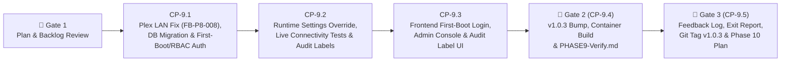

# Phase 9 Execution & Checkpoint Tracking (`docs/development/PHASE_9_TRACKING.md`)

> **Target Version:** `v1.0.3` (Second Phase of the `v1.1` Release Cycle)  
> **Branch:** `phase9`  
> **Phase Status:** `COMPLETE`

---

## 1. Phase 9 Objectives & Scheduled Backlog Items (`FB-P8-008`, `FB-P9-001` – `FB-P9-004`)

Phase 9 resolves the waterfalled local LAN Plex usage detection bug (`BUG-P8-003` / `FB-P8-008`) from Phase 8 and delivers the complete **Multi-User Authentication, NGINX-Style First-Boot Admin Setup, UI Integration Settings & Live Connectivity Diagnostics, and Per-User Audit Attribution** suite (`v1.0.3`):

| Backlog ID | Target Area | Summary of Deliverable |
| :--- | :--- | :--- |
| **`FB-P8-008`** (`BUG-P8-003`) | `backend/app/clients/elasticsearch.py`, `backend/tests/test_app_usage_audit_and_backup.py` | **Fix Plex Local LAN Client Streaming Detection:** Capture same-subnet L2 Smart TV (`LGwebOSTV` on `.243`) and LAN client Plex playback via `*.plex.direct` / `plex.tv` playback DNS domains (`analytics.plex.tv`, `discover.provider.plex.tv`, `luma.plex.tv`, `images.plex.tv`, `watch.plex.tv`, `scrobbles.plex.tv`), while separating Plex Media Server hosts (`.2`, `.250`) via `servers.plex.tv` sub-aggregation and 24/7 health pollers (`.3`) via poller heuristics (`>= 140` slots with zero playback/scrobble domains) and lowering the per-client Plex DNS slot threshold to `min_doc_count: 1`. |
| **`FB-P9-001`** | `backend/app/api/auth.py`, `frontend/src/pages/LoginPage.tsx` | **NGINX-Style First-Boot `admin` Password Creation:** On a clean container build when no SQLite `admin` user exists and `ADMIN_PASSWORD` is unset or a default placeholder in `.env`, prompt for initial password creation for `admin` on first login (`GET /api/v1/auth/setup-status` & `POST /api/v1/auth/setup-admin`). When `ADMIN_PASSWORD` is already set in `.env`, automatically seed the SQLite `admin` account on startup for seamless upgrades. |
| **`FB-P9-002`** | `backend/app/services/runtime_settings_service.py`, `backend/app/api/system.py`, `StatusPage.tsx` | **UI Admin Panel for OPNsense & Elasticsearch Variables + Live Connectivity Test:** Expose OPNsense and Elasticsearch connection variables in the `System & Admin` UI (persisted in SQLite with encrypted secrets, taking runtime precedence over `.env` with a `Reset to .env` option) and provide a live **Test Connection** action that displays detailed diagnostic errors in the UI and logs failures to `audit_logs`. |
| **`FB-P9-003`** | `backend/app/models/user.py`, `backend/app/api/users.py`, `StatusPage.tsx` | **Multi-User Management (`Admin` vs. `Standard User / Operator`) & Default `admin` Protection:** Allow Admins to create users, set/reset passwords, and toggle roles/status in the `System & Admin` console, while strictly enforcing (`403 Forbidden` + UI lock) that the built-in `admin` user cannot be deleted, disabled, or demoted. |
| **`FB-P9-004`** | `backend/app/models/audit_log.py`, `backend/app/api/*`, `StatusPage.tsx` | **Per-User Action Attribution & `audit_label` Badges:** Record the authenticated user's `username` (`actor`) and a structured `audit_label` (`AUTH_EVENT`, `USER_MGMT`, `SETTINGS_CHANGE`, `DIAGNOSTIC_ERROR`, `DEVICE_CONTROL`, `YOUTUBE_CONTROL`, `GROUP_CONTROL`, `TIMER_OVERRIDE`, `SCHEDULE_CHANGE`, `CONFIG_BACKUP`) on every UI action and display/filter by `audit_label` in the Audit & Event History table. |

---

## 2. Phase 9 Workflow & Checkpoint Summary Table

| Step | Checkpoint ID | Description | Status | Completed Date |
| :--- | :--- | :--- | :---: | :---: |
| **Step 9.1** | `CP-9.1` | Fix Plex Local LAN Client Detection (`FB-P8-008`), SQLite Schema (`users`, `system_settings`, `audit_logs.audit_label`), First-Boot `admin` Setup & Multi-User RBAC API | `[x] Complete` | `2026-11-04` |
| **Step 9.2** | `CP-9.2` | Backend Runtime Settings Override Service (Encrypted Secrets + `.env` Fallback), Live OPNsense/ES Connectivity Diagnostic Endpoints & Per-User `audit_label` Attribution | `[x] Complete` | `2026-11-04` |
| **Step 9.3** | `CP-9.3` | Frontend First-Boot Password Setup UI, `System & Admin` Integration Settings + Connectivity Test UI, User Management Table & Audit Label Badges + `Vitest` Suite | `[x] Complete` | `2026-11-04` |
| **Step 9.4** | `CP-9.4` | **🛑 GATE 2:** Bump Version to `1.0.3`, Rebuild Docker Container, Live Smoke Check & Publish `docs/development/Validation/PHASE9-Verify.md` | `[x] Complete` | `2026-11-04` |
| **Step 9.5** | `CP-9.5` | **🛑 GATE 3:** Log User Feedback from `PHASE9-Verify.md`, Phase 9 Exit Report, Merge/Tag `v1.0.3`, Push to GitHub & Create `docs/development/PHASE_10_TRACKING.md` | `[x] Complete` | `2026-11-04` |

---

## 3. Detailed Step-by-Step Breakdown

### Step 9.1 (`CP-9.1`) — Plex Local LAN Client Fix (`FB-P8-008`), SQLite Schema (`users`, `system_settings`, `audit_label`), First-Boot Setup & Multi-User RBAC
- **Files to Create / Modify:**
  - [`backend/app/clients/elasticsearch.py`](file:///d:/source/gateway-front-end/backend/app/clients/elasticsearch.py):
    - Update `_build_app_usage_agg()` and `_extract_app_usage()` for **`FB-P8-008` (`BUG-P8-003`)**:
      - Include `dns.question.registered_domain: ["plex.direct", "plex.tv", "plexapp.com"]` and wildcard `*plex*` local hostnames in the `plex` filter, excluding only `servers.plex.tv` and `pubsub.plex.tv` from general noise while tracking `server_registrations` (`term: {"dns.question.name": "servers.plex.tv"}`) and `playback_signals` (`terms: {"dns.question.name": ["analytics.plex.tv", "discover.provider.plex.tv", "luma.plex.tv", "images.plex.tv", "watch.plex.tv", "scrobbles.plex.tv", "metadata.provider.plex.tv", "app.plex.tv", "clients.plex.tv"]}`) inside `by_device.devices.aggs`.
      - Set per-device `active_slots` `min_doc_count: 1` for `plex` (keeping `min_doc_count: 5` for `youtube`), and filter out Plex Media Server hosts (`server_registrations > 0`) and 24/7 health pollers (`dev_active_slots >= 140` with `playback_signals == 0` and `port_32400 == 0`).
  - [`backend/app/models/__init__.py`](file:///d:/source/gateway-front-end/backend/app/models/__init__.py) & [`backend/alembic/versions/002_phase9_users_settings_audit_labels.py`](file:///d:/source/gateway-front-end/backend/alembic/versions/):
    - Add `User` model (`id`, `username`, `password_hash`, `role` [`"admin"` | `"operator"`], `is_active`, `theme_preference`, `created_at`, `updated_at`).
    - Add `SystemSetting` model (`id`, `key`, `value_text`, `is_secret`, `updated_by`, `updated_at`).
    - Add `audit_label: Mapped[str]` column (default `"SYSTEM"`) to `AuditLog`.
    - Ensure non-destructive automatic schema upgrade in `init_db()` / Alembic so existing `/app/data/gateway.db` databases upgrade seamlessly.
  - [`backend/app/auth/__init__.py`](file:///d:/source/gateway-front-end/backend/app/auth/__init__.py), [`backend/app/api/auth.py`](file:///d:/source/gateway-front-end/backend/app/api/auth.py), and [`backend/app/api/users.py`](file:///d:/source/gateway-front-end/backend/app/api/users.py):
    - Implement `GET /api/v1/auth/setup-status` and `POST /api/v1/auth/setup-admin` for NGINX-style first-boot `admin` password setup (`FB-P9-001`), plus automatic seeding from `.env` when a non-placeholder `ADMIN_PASSWORD` is configured.
    - Include `role` and `theme_preference` in `AuthUserResponse` (`GET /api/v1/auth/me`).
    - Implement `/api/v1/users` (`GET`, `POST`, `PATCH /{user_id}`, `DELETE /{user_id}`) with `require_admin` dependency and strict protection preventing deletion, disabling, or role demotion of `username == "admin"` (`FB-P9-003`).

### Step 9.2 (`CP-9.2`) — Runtime Settings Override Service, Live Connectivity Tests & Per-User `audit_label` Attribution
- **Files to Create / Modify:**
  - [`backend/app/services/runtime_settings_service.py`](file:///d:/source/gateway-front-end/backend/app/services/runtime_settings_service.py) & [`backend/app/api/system.py`](file:///d:/source/gateway-front-end/backend/app/api/system.py):
    - Implement secret encryption/decryption helper (using `APP_SECRET_KEY`) and runtime `Settings` overlay so UI-saved OPNsense and Elasticsearch settings override `.env` values at runtime without overwriting `.env` on disk (`FB-P9-002`).
    - Add `GET /api/v1/system/settings`, `PUT /api/v1/system/settings`, `DELETE /api/v1/system/settings` (`Reset to .env Defaults`), `POST /api/v1/system/settings/test-opnsense`, and `POST /api/v1/system/settings/test-elasticsearch`.
    - When a connectivity check fails, return structured diagnostic error details (`status_code`, `error_type`, `message`, `hint`) and write an `AuditLog` entry with `audit_label="DIAGNOSTIC_ERROR"` and `status="failure"`.
  - [`backend/app/api/devices.py`](file:///d:/source/gateway-front-end/backend/app/api/devices.py), [`backend/app/api/groups.py`](file:///d:/source/gateway-front-end/backend/app/api/groups.py), [`backend/app/api/timers.py`](file:///d:/source/gateway-front-end/backend/app/api/timers.py), [`backend/app/api/schedules.py`](file:///d:/source/gateway-front-end/backend/app/api/schedules.py), [`backend/app/services/audit_and_backup_service.py`](file:///d:/source/gateway-front-end/backend/app/services/audit_and_backup_service.py):
    - Propagate `actor = current_user.username` and structured `audit_label` values across all mutations, and support filtering `/api/v1/audit-logs` by `audit_label` (`FB-P9-004`).
- **Verification Criteria (`CP-9.1` & `CP-9.2`):**
  - `pytest backend/tests --cov=app` (`100%` pass, `>= 85%` coverage), `ruff check backend` (`0` errors), `mypy backend/app` (`0` issues).

### Step 9.3 (`CP-9.3`) — Frontend First-Boot Password Setup, `System & Admin` Console, User Management & Audit Labels
- **Files to Modify:**
  - [`frontend/src/api/client.ts`](file:///d:/source/gateway-front-end/frontend/src/api/client.ts):
    - Add typed API methods and interfaces for setup status, initial admin setup, user management (`/api/v1/users`), runtime integration settings (`/api/v1/system/settings`), live connectivity testing, and `audit_label`.
  - [`frontend/src/pages/LoginPage.tsx`](file:///d:/source/gateway-front-end/frontend/src/pages/LoginPage.tsx):
    - Check `getSetupStatus()` on mount; when `needs_initial_setup === true`, render the **First-Boot `admin` Password Creation** workflow (`New Password` + `Confirm Password`) that creates the `admin` account and signs in (`FB-P9-001`).
  - [`frontend/src/pages/StatusPage.tsx`](file:///d:/source/gateway-front-end/frontend/src/pages/StatusPage.tsx) & [`frontend/src/components/AppLayout.tsx`](file:///d:/source/gateway-front-end/frontend/src/components/AppLayout.tsx):
    - Add the **Integration Settings & Connectivity Diagnostics** panel (OPNsense & Elasticsearch configuration forms, `Source: UI Override` vs `.env` badge, `Test OPNsense Connection`, `Test Elasticsearch Connection` with inline diagnostic error box, `Save Settings`, and `Reset to .env Defaults` — visible to `admin` users) (`FB-P9-002`).
    - Add the **User Accounts & Access Management** panel (list users, `Add User` modal with username, password, role selector `Admin` / `Operator`, password reset, enable/disable toggle, and locked `Protected Default Admin` badge on `admin`) (`FB-P9-003`).
    - Add the **`Audit Label`** badge column and filter dropdown in the **Audit & Event History** panel (`FB-P9-004`).
  - [`frontend/src/__tests__/`](file:///d:/source/gateway-front-end/frontend/src/__tests__/):
    - Add comprehensive `Vitest` unit tests covering First-Boot Admin Setup, Integration Settings & Connectivity Diagnostics, Multi-User Management (including default `admin` protection), and Audit Label filtering.
- **Verification Criteria (`CP-9.3`):**
  - `npm test` (`100%` pass, `>= 85%` coverage) and `npm run build` (`tsc -b && vite build` with `0` errors).

### Step 9.4 (`CP-9.4` — 🛑 GATE 2) — Version Bump (`1.0.3`), Container Rebuild & `PHASE9-Verify.md`
- Increment version to `1.0.3` in `backend/app/__init__.py`, `backend/pyproject.toml`, and `frontend/package.json`.
- Rebuild and restart Docker container (`docker compose -f docker/docker-compose.yml --env-file .env up -d --build`).
- Run live container smoke check verifying `/api/v1/system/health` (`1.0.3`), `/api/v1/analytics/overview` (Plex LAN client usage fix `FB-P8-008`), `/api/v1/users`, `/api/v1/system/settings`, and `/api/v1/audit-logs`.
- Create [`docs/development/Validation/PHASE9-Verify.md`](file:///d:/source/gateway-front-end/docs/development/Validation/PHASE9-Verify.md) with all **"What to Verify at `http://localhost:8080` (`v1.0.3`)"** items and **STOP** for user validation.

### Step 9.5 (`CP-9.5` — 🛑 GATE 3) — Feedback Logging, Phase 9 Exit Report, Git Tag `v1.0.3` & Phase 10 Tracking
- Read user feedback from `docs/development/Validation/PHASE9-Verify.md`, update `FEATURE_BACKLOG.md` and `TEST_AND_BUG_LOG.md`, append Phase 9 Exit Report to `PHASE_EXIT_REPORTS.md`, merge/tag `v1.0.3`, push to GitHub, and create `docs/development/PHASE_10_TRACKING.md`.

