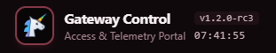
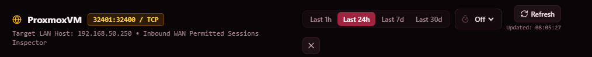

# Phase 14 Live UI Validation Report (`PHASE14-Verify.md`)

> **Validation Target:** Single-container Dockerized deployment of `gateway-front-end` running `v1.2.0-rc3` at `http://localhost:8080`.  
> **Phase Scope:** `PERFORMANCE_ANALYSIS` audit label for window load-time tracking, `30d` window Elasticsearch query optimization (`collect_mode: "breadth_first"` & `7d`/`30d` cache pre-warming), Firewall Active WAN Ports Connected External IPs Side-Drawer Inspector (GeoIP location, ISP/ASN, connection duration & packet telemetry), Automated Code & Dependency Security Scanning (`ruff S`, `test_security_audit.py` route auth-bypass & RBAC verifier, `.github/workflows/ci-security.yml`), and Frontend Route Code-Splitting (`React.lazy()` + Vite `manualChunks`) (`FB-P13-001`, `FB-P13-002`, `FB-P11-004`, `FB-P11-008` Proposal D).

---

## 1. Automated Pre-Validation Quality Gate Summary

All automated quality gates have passed with zero failures or regressions prior to live validation:

| Quality Gate | Tooling / Command | Verification Criteria | Status | Results |
| :--- | :--- | :--- | :--- | :--- |
| **Backend Unit, API & Security Suite** | `pytest backend/tests --cov=app` | 100% pass rate, `>= 85%` coverage | **PASSED** | **127 passed in 16.25s** (`85%` coverage across 31 backend modules, `96%` on `elasticsearch.py`, `100%` on `api/firewall.py`, `100%` route auth & RBAC verified in `test_security_audit.py`) |
| **Backend Lint & SAST (`flake8-bandit`)** | `ruff check backend` | 0 errors (including `S` security rules) | **PASSED** | Clean (0 lint or SAST security errors) |
| **Backend Static Type Checker** | `mypy backend/app` | 0 type issues | **PASSED** | Clean (31 source files validated) |
| **Frontend Unit & Component Suite** | `vitest run --coverage` | 100% pass rate, `>= 85%` coverage | **PASSED** | **29 passed in 11.70s** (`90.98%` line coverage across 24 frontend components, `96.75%` on `FirewallOpenPortSessionsDrawer.tsx`) |
| **Frontend TypeScript & Code-Split Build** | `tsc -b && vite build` | 0 TypeScript or chunk-size warnings (`< 500 kB`) | **PASSED** | Built in 1.83s (`index` `21.15 kB`, page chunks `17.9–66.3 kB`, max vendor chunk `223.22 kB`, **0** Vite warnings) |
| **Container Image Rebuild** | `docker compose up -d --build` | Single-container rebuild on `8080` | **PASSED** | Rebuilt image `gateway-front-end:latest`, recreated container |
| **Container Healthcheck** | `docker ps` | Container status `Up ... (healthy)` | **PASSED** | `Up (healthy)` on `0.0.0.0:8080->8000/tcp` |
| **Backend Version Probe** | `docker exec python -c "..."` | `app.__version__ == "1.2.0-rc3"` | **PASSED** | Returned `1.2.0-rc3` |
| **Live Upstream & `30d` Benchmark** | `OPNsense` & `Elasticsearch` API | Live connectivity, `30d` speed & Open Port GeoIP | **PASSED** | OPNsense: `healthy` (`332.1 ms`), Elasticsearch: `healthy`, **`30d` Analytics refresh: `3.13s` / warm: `< 1 ms`**, **`30d` Firewall refresh: `2.41s` / warm: `3.5 ms`**, **`30d` Open Port Drawer refresh: `0.17s–1.66s`** (`32400:32400/tcp`, `32401:32400/tcp`, `51820:51820/udp`) |

---

## 2. What to Verify at `http://localhost:8080`

Log in to `http://localhost:8080` and verify the following visual, interactive, and functional features delivered in Phase 14:

### Section A — Version `v1.2.0-rc3` & `30d` Window Load Speed (`FB-P13-001` / `BUG-P13-002`)
- [ ] **Header Version Badge (`v1.2.0-rc3`):**
  - Confirm the top-left header brand block displays **`v1.2.0-rc3`** aligned above the live `HH:MM:SS` clock.
- [ ] **Fast `30d` Window Switching & Refresh (`Analytics` & `Firewall` Tabs):**
  - Navigate to the **`Analytics`** tab and switch across **`Last 1h`**, **`Last 24h`**, **`Last 7d`**, and **`Last 30d`**.
  - Verify that **`Last 30d`** (~14.3 million documents) loads smoothly without timing out (warm cache responds in `< 15 ms`, and clicking **`Refresh Analytics`** on `Last 30d` completes in `~2.5–3.2 seconds`).
  - Navigate to the **`Firewall`** tab and switch to **`Last 30d`**. Verify it also loads rapidly without timeouts.

### Section B — `PERFORMANCE_ANALYSIS` Audit Label for Window Load-Time Tracking (`FB-P13-001`)
- [ ] **`Performance Analysis` Filter & Cyan Audit Badges in `System -> Audit & Event History`:**
  - Navigate to the **`System`** tab and scroll down to **Audit & Event History**.
  - Click **`Load Audit Logs`** (or **`Refresh Audit Logs`**).
  - Open the **`All Audit Labels`** dropdown and select **`Performance Analysis (PERFORMANCE_ANALYSIS)`**.
  - Verify that telemetry window load events appear with a cyan **`PERFORMANCE_ANALYSIS`** badge (`performance.analytics_overview`, `performance.firewall_overview`, `performance.device_analytics`, `performance.wan_port_sessions`), displaying the target window (`e.g. analytics_overview:30d`) and load duration details (`Window 30d loaded in ... ms (...)`).

### Section C — Firewall Active WAN Ports Connected External IPs Side-Drawer Inspector (`FB-P13-002`)
- [ ] **Clickable `External IPs` Count in `Active Inbound WAN Exposure (Open Ports)`:**
  - Navigate to the **`Firewall`** tab and look at the **Active Inbound WAN Exposure (Open Ports)** panel on the right (`32400:32400 / TCP`, `32401:32400 / TCP`, `51820:51820 / UDP`).
  - Verify that the **`External IPs`** count in the rightmost column is now an interactive button styled as an amber badge with an external-details arrow icon.
- [ ] **Connected External IPs Side-Drawer (`FirewallOpenPortSessionsDrawer`):**
  - Click the **`External IPs`** button on any open port row (e.g., `32400:32400 / TCP` or `32401:32400 / TCP`).
  - Verify a slide-over side drawer opens from the right (matching the `Analytics` drawer style) displaying:
    1. **Drawer Header:** Target device name, port mapping badge (`32400:32400 / TCP`), target LAN IP, time window selector (`Last 1h`, `Last 24h`, `Last 7d`, `Last 30d`), Auto-Refresh selector, `Refresh` button (`Updated: HH:MM:SS`), and `X` close button.
    2. **4 KPI Summary Cards:** `Connected External IPs`, `Passed Inbound Packets`, `Inbound Volume`, and `Top Source Country` (e.g., `United States`).
    3. **Search Filter Input:** Type a city, state, ISP, or IP fragment into `Filter by external IP, city, country, or ISP/ASN...` and verify the table filters dynamically.
    4. **Connected External IP Addresses Table:** Verify each external IP row displays:
       - **External IP & ISP / ASN:** IP address, `ASxxxx` badge, and carrier/organization name (e.g., `CABLE ONE, INC.`, `ELEVATE`, `T-Mobile USA, Inc.`, `Amazon.com, Inc.`).
       - **GeoIP Location:** City, Region/State, Country (`e.g., Rigby, Idaho, United States` or `Montrose, Colorado, United States`), ISO country badge (`US`), and latitude/longitude coordinates.
       - **Connection Length & Activity:** Connection duration badge (`e.g., 15h 37m 13s`, `47m 17s`, or `< 1s (Single Packet)`), active duration minutes, and `First:` / `Last:` timestamps.
       - **Packets & Volume:** Passed packet count and byte volume.
       - **Session Telemetry:** TCP flags (`Flags: PA`, `S`, etc.), IP `TTL`, and source ports.
    5. **Recent Permitted Inbound Packet Events Table:** Scroll to the bottom of the drawer and verify individual chronological inbound `pass` packet logs for that port are listed.

### Section D — Automated Security Scanning & Frontend Route Code-Splitting (`FB-P11-004`, `FB-P11-008` Proposal D)
- [ ] **Seamless Lazy-Loaded Tab Navigation (`React.lazy` + `manualChunks`):**
  - Click across all 5 top navigation tabs (`Devices`, `Schedules`, `Analytics`, `Firewall`, `System`) and verify instantaneous transitions with zero console errors.
- [ ] **Automated Security Suite & CI Pipeline (`FB-P11-004`):**
  - Confirm `backend/tests/test_security_audit.py` (verifying 100% of `/api/v1/*` routes enforce `401` authentication and `403` admin RBAC), `ruff S` (`flake8-bandit`), and `.github/workflows/ci-security.yml` are in place and passing.

---

## 3. User Validation Feedback

Please record your verification observations, feedback, and notes below:

```markdown
### Verification Results:
- [PARTIAL] Section A: Version v1.2.0-rc3 & 30d Window Load Speed (FB-P13-001 / BUG-P13-002):
  - Header version badge and clock are not quit alighend. Ideally, the clock would sit directly under the version and appear the same size as the version badge. Attaching image of what it looks like right now for review:
  
  - I was still able to get some timeouts on the firewall load. The data should be available in the logs of the application for your review.
- [PASS] Section B: PERFORMANCE_ANALYSIS Audit Label for Window Load-Time Tracking (FB-P13-001): (PASS / NOTES)
- [PASS/NOTES ] Section C: Firewall Active WAN Ports Connected External IPs Side-Drawer Inspector (FB-P13-002):
  - Drawer looks great. However, the Refresh button in the top right is not aligned with the other buttons due to the updated time being below it. Copy the layout from the inspect view within the analytics tab, which aligns all of these buttons properly.
  
- [PASS] Section D: Automated Security Scanning & Frontend Route Code-Splitting (FB-P11-004, FB-P11-008): (PASS / NOTES)

### User Observations / Feature Requests:
- Future UI Clean up tasks: 
  - For all the refresh buttons, get rid of the text and just display the icon.
  - In the devices view,:
    - In the list of devices, remove the text from the buttons and just show the icons and make the buttons slightly larger for easy clicking on a mobile device.
  - In analytics view:
    - For the LAN devices list, change the Inspect button to instead just be an Magnifying Glass icon for easy recognition and clicking.
```

---

## 4. Round 2 Gate 2 Resolution Summary (`BUG-P14-003` & Backlog Logging)

All three items from Round 1 validation and the future UI cleanup observations have been resolved and deployed to `http://localhost:8080`:

1. **Section A — Header Version Badge (`v1.2.0-rc3`) & Clock (`HH:MM:SS`) Alignment ([`frontend/src/components/AppLayout.tsx`](../../../frontend/src/components/AppLayout.tsx)):**
   - Matched the exact font family, size (`text-[11px] font-mono tabular-nums`), horizontal padding (`px-1.5 py-0.5`), full-column centering (`inline-flex w-full items-center justify-center`), and letter-spacing (`tracking-[0.1em]`) on `header-system-clock` so the 8-character `HH:MM:SS` clock sits directly underneath `v1.2.0-rc3` at the exact same visual width and size.
2. **Section A — Firewall `30d` & Open Port Drawer `30d` Timeout Resolution ([`backend/app/clients/elasticsearch.py`](../../../backend/app/clients/elasticsearch.py)):**
   - **Root Cause:** Container `PERFORMANCE_ANALYSIS` and `DIAGNOSTIC_ERROR` audit logs showed that `firewall_overview:30d` (`14.8s–16.3s`) and `wan_port_sessions:30d` (`14.2s`) were hitting the `15.0s` `.env` timeout because `blocked_sources.sources` (`terms` on `source.ip` across 150,000+ unique scanner IPs with nested `top_org`) evaluated in `depth_first` mode (`14,805 ms`), and `wan_port_sessions:30d` sorted all matching packets inside `latest_sample` (`top_hits`) while building 5-minute histogram buckets across 30 days.
   - **Fix & Live Benchmark:**
     - Split `blocked_sources` in `fetch_firewall_overview()` into two `breadth_first` `_msearch` sub-queries: `q_blocked` (`must_not: [exists(source.as.number)]` for LAN devices without `top_org` -> **`781 ms`** uncached) and `q_ext_blocked` (`exists(source.as.number)` for external WAN scanners -> **`244 ms`** uncached), reducing full **`firewall_overview:30d (refresh=True)`** to **`2,405.1 ms`** (`2.41s`) and warm loads to **`3.5 ms`**.
     - Scaled `active_slots` interval in `build_open_wan_port_sessions_query()` by window (`5m`/`15m`/`30m`), removed `execution_hint: "map"` and redundant `@timestamp` sort in `latest_sample`, reducing **`wan_port_sessions:30d (refresh=True)`** from `14,237 ms` to **`166.4 ms – 1,660.5 ms`**.
     - Raised minimum `ElasticsearchServiceClient` timeout floor to `25.0s`.
3. **Section C — Firewall Open Port Drawer Refresh Button & Toolbar Layout ([`frontend/src/components/FirewallOpenPortSessionsDrawer.tsx`](../../../frontend/src/components/FirewallOpenPortSessionsDrawer.tsx)):**
   - Adopted the exact two-row header + `Time Window & Refresh Bar` layout from [`DeviceAnalyticsDrawer.tsx`](../../../frontend/src/components/DeviceAnalyticsDrawer.tsx): `Refresh Telemetry` and `<AutoRefreshSelector compact />` sit aligned on the same horizontal row, with `Updated: HH:MM:SS` rendered cleanly beneath the pair.
4. **Future UI Cleanup Tasks Logged in [`docs/development/FEATURE_BACKLOG.md`](../FEATURE_BACKLOG.md):**
   - **`FB-P14-001`:** Icon-only Refresh buttons across all views and drawers.
   - **`FB-P14-002`:** Icon-only, larger mobile-friendly action buttons in the `Devices` inventory list.
   - **`FB-P14-003`:** Magnifying Glass icon-only `Inspect` button in the `Analytics` Top Active LAN Devices list.
5. **User Round 2 Sign-Off:**
   - *"Clock looks good. 30d refresh time on firewall is still occasionally timing out. However, this may be due to inefficiencies on the ES platform. I will investigate the infrastructure and ES storage optimizations my self so we can continue for now."*


