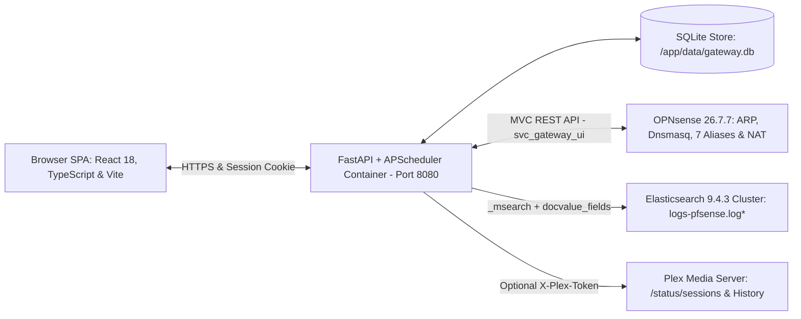
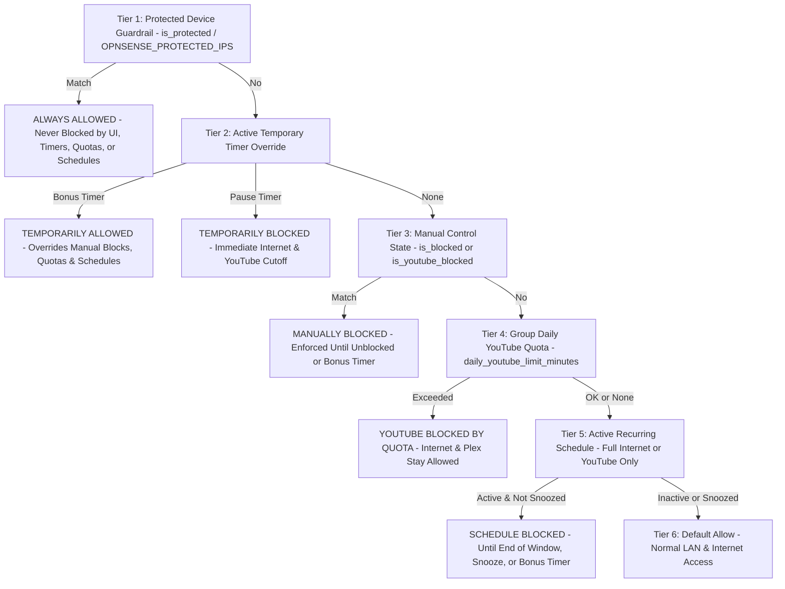

# Gateway Control — User Manual & Wiki (`v1.3.1`)

> **Quick Navigation:** [Project Home](../../README.md) · **Wiki Home** · [01. Setup & OPNsense](01-Installation-and-OPNsense-Setup.md) · [02. Devices & Quotas](02-Devices-Groups-and-YouTube-Quotas.md) · [03. Timers & Schedules](03-Timers-and-Recurring-Schedules.md) · [04. Analytics & Blocking](04-Analytics-App-Telemetry-and-Domain-ASN-Blocking.md) · [05. Firewall & WAN Blocking](05-Firewall-Inspector-GeoIP-and-WAN-Blocking.md) · [06. System & Admin](06-System-Administration-HA-and-Troubleshooting.md)

Welcome to the official User Manual for the **Gateway Access Control & Analytics Portal (`v1.3.1`)** — a self-hosted, single-container portal (`http://localhost:8080`) unifying LAN internet/application policy enforcement via **OPNsense (`26.7.7-amd64`)**, high-speed network telemetry from **Elasticsearch (`9.4.3`)**, and Tautulli-style playback visibility from **Plex Media Server**.

---

## Table of Contents

| Chapter | Topic & What You Will Learn |
| :--- | :--- |
| [**01. Installation, First-Boot & OPNsense Setup**](01-Installation-and-OPNsense-Setup.md) | Single-container Docker deployment, NGINX-style first-boot admin password setup, OPNsense `26.7.7` aliases & rules, least-privilege API user (`svc_gateway_ui`), Elasticsearch read-only API keys, and Plex integration. |
| [**02. Devices, Groups & Daily YouTube Quotas**](02-Devices-Groups-and-YouTube-Quotas.md) | ARP/Dnsmasq discovery, DHCP IP-drift reconciliation, filtering/sorting, inline `+ Group` assignment, Offline Device Archiving, Device Groups with uniform controls & Current Group Members removal, and Group Daily YouTube Quotas. |
| [**03. Temporary Timers & Recurring Schedules**](03-Timers-and-Recurring-Schedules.md) | Centered Pause & Bonus Reward timers (`15m`–`2h`, `Until 07:00`, `20m`/`40m`/`60m` bonus, custom minutes), 7-Day / 24-Hour Weekly Schedule Timeline, **Full Internet** vs. **YouTube Only** schedule modes, Snooze, and Rule Cloning. |
| [**04. Analytics, 9-App Telemetry & Domain/ASN Blocking**](04-Analytics-App-Telemetry-and-Domain-ASN-Blocking.md) | Time windows (`Today`, `1h`, `24h`, `7d`, `30d`), `Stacked`/`Total` charts, 9-app configurable telemetry + bidirectional **Configure Apps** modal, Plex *Now Playing* detail cards, Client Attribution drilldowns, 1-click Domain/ASN blocking, and Device/Group Drawers. |
| [**05. Firewall Inspector, GeoIP Maps & WAN Blocking**](05-Firewall-Inspector-GeoIP-and-WAN-Blocking.md) | Pass/Block KPIs, `Noisy LAN Devices` (`Inspect` drawer), `Active Inbound WAN Exposure` D-NAT rule descriptions, Connected External IPs side-drawer, Google Maps GeoIP links, `gateway_wan_blocked_ips` WAN blocklist card & 1-click Unblock, and Click-to-Filter Packet Log Explorer (`50`/`100`/`250` + CSV/JSON export). |
| [**06. System Administration, HA, Users & Backups**](06-System-Administration-HA-and-Troubleshooting.md) | 4-Service Health Cards & dynamic server version header, Multi-Node HA URLs, `Test All Connections` averaged ping, `Admin` vs. `Operator` RBAC, 5 Dark-Room Color Themes, `Ctrl+K` Quick Search, Filterable Audit History & Performance Logs, and JSON Config Backup/Restore. |

---

## High-Level Architecture

### Background Automation Loops (`APScheduler`)
- **Every `30s`:** Polls Plex Media Server `/status/sessions` (when configured) and records playback heartbeats into SQLite while pruning heartbeat rows older than 35 days.
- **Every `60s`:** Reconciles expired temporary timers (`Pause` / `Bonus`), evaluates recurring schedules, evaluates Group Daily YouTube Quotas, heals DHCP IP drift by MAC address, and syncs OPNsense aliases.
- **Every `180s`:** Pre-warms default `24h` (and expired `today`/`7d`/`30d`) Network & Firewall overview telemetry caches in memory for sub-25ms tab switches.

---

## Navigation Tabs & Global Workspace Controls

| Area / Tab | Core Purpose |
| :--- | :--- |
| **`Devices`** | Manage discovered LAN hosts, Device Groups & Profiles, YouTube & Full Internet blocks, Temporary Timers, Group Daily YouTube Quotas, and Offline Device Archiving. |
| **`Schedules`** | Visualize the 7-day / 24-hour coverage timeline and configure recurring Full Internet or YouTube-Only rules with cloning and instant snoozing. |
| **`Analytics`** | Inspect network traffic, hourly patterns, 9-app usage stats, live Plex streams, searchable Top LAN Devices, Domain/ASN Client Attribution, and 1-click Domain/ASN blocking. |
| **`Firewall`** | Audit firewall pass/block KPIs, noisy LAN hosts, inbound Open WAN Ports (with D-NAT labels), GeoIP Google Maps links for external scanners, WAN IP blocking (`gateway_wan_blocked_ips`), and an interactive packet log explorer. |
| **`System`** | Monitor 4 upstream health cards (OPNsense, Elasticsearch, Plex, SQLite), edit multi-node HA runtime integration settings, toggle visible telemetry apps, manage `Admin`/`Operator` users, audit logs, and export/restore JSON config backups. |

### Global Chrome & Navigation Shortcuts
- **Sticky Desktop Header:** Pins navigation tabs, live `HEALTHY` / `DEGRADED` / `UNHEALTHY` status pill (clickable shortcut directly to the **`System`** tab), live 24-hour clock, and User Menu to the top of the screen while scrolling.
- **Global Quick Search (`Ctrl+K` / `Cmd+K`):** Jump directly to any tab, device, group, or schedule from anywhere in the portal.
- **User Settings Menu:** Click your username in the top-right header to open **Change My Password** (centered modal) or switch between **5 Dark-Room Color Themes** (`Default Slate`, `Crimson & Obsidian`, `Ocean & Navy`, `Emerald & Forest`, `Amber & Carbon`), persisted per user.
- **Mobile Bottom Navigation:** Automatically docks thumb-accessible tab buttons at the bottom on small viewports (`< 640px`), paired with streamlined mobile tables (`Devices` & `Analytics`).

---

## Policy Evaluation Precedence Reference

Whenever the scheduler reconciles device state (every 60s, on timer creation/expiry, or on schedule edits), policies are evaluated in strict priority order so safety guardrails and parent reward timers always win:

